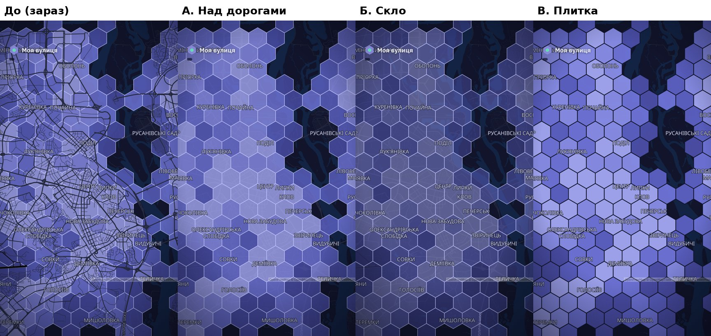
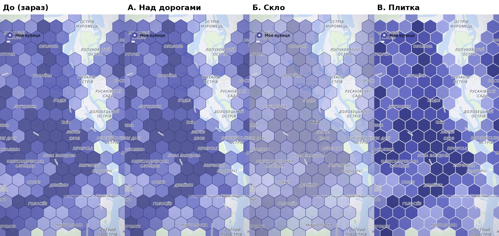

# ЗВІТ-134 — Система роликів: скільки, які, вигляд, зворотний зв'язок

Виконавець — хмара, 19.11.2026. Завдання — `ZAVDANNYA-134.md`. Повністю — [`docs/ROLYKY-SYSTEMA.md`](docs/ROLYKY-SYSTEMA.md).
Нічого не опубліковано.

## 1. Коротко

1. **Скільки:** у TikTok — **1 ролик на день** на старті, **до 2 на день** з третього тижня, якщо встигаємо з голосом.
   Велике дослідження (Buffer, 11,4 млн публікацій, 2025) показало: часті публікації **не зменшують** перегляди
   окремого ролика, лише дають більше шансів, що якийсь «вистрілить». На місяць — 30–45 нових роликів.
2. **Де:** той самий файл — у YouTube Shorts (усі) та Instagram Reels (3–5 найкращих на тиждень); у Facebook — ролики
   для ОСББ і рієлторів. Акаунт TikTok — **один**; акаунти районів чи ігор — не раніше ніж за 8 тижнів, і з іншими роликами.
3. **Рендер — не проблема** (одна ніч на ПК на місяць). Найвужче місце — запис голосу Андрієм, тому 2 з 3 роликів — без голосу.
4. **Типи:** одночасно 6–8; тип оцінюємо після 5–6 роликів, порівнюючи з серединою свого акаунта; ≈ 80 % «вау» і ігор,
   ≈ 20 % — «спершу потреба, потім продукт». Перший тест — 7 типів; запропоновано 12 нових, 6 з них — власні.
5. **«Мурашник» знайдено.** Рушій роликів клав соти **під** дороги: дороги прорізали заливку темними доріжками. Сайт
   робить правильно, ролики — ні. Зроблено три способи виправлення (вмикаються одним параметром; без нього все як було),
   знімки до/після — `docs/rolyky-v1/`. **Порада — «Плитка»:** суцільні соти з тонкими швами, без доріг усередині;
   вулиці з'являються, коли камера наближається до вулиці.
6. **Зворотний зв'язок:** перегляди, утримання й коментарі з YouTube та Instagram можна збирати щодня автоматично.
   **TikTok — слабке місце:** простий доступ не дає утримання, а TikTok відмовляє «особистим» застосункам. Тому спершу —
   вивантаження зі статистики TikTok раз на тиждень (5 хв), паралельно — заявка на бізнес-доступ.
7. **Тест — 4 тижні, ≈ 35–45 роликів;** рішення наприкінці 2-го тижня (які перші секунди тримають) і 4-го (які типи
   лишаємо).

## 2. Знімки «мурашника» (В1)

Той самий рушій, справжні соти Києва, кадр 1080×1920. Зліва направо: **до · А «Над дорогами» · Б «Скло» · В «Плитка»**.

Ще два аркуші (усе місто) — `docs/rolyky-v1/arkush-temna-z10.jpg`, `arkush-svitla-z10.jpg`. «Скло» на темній виходить
каламутним — не радимо. Андрію: подивитись аркуші й сказати «так / ні» «Плитці».

## 3. Пропозиції змін до `docs/ROLYKY-TYPY.md` (реєстр веде центральний чат)

**Розд. 1 — нові рядки зі станом «ідея»:**

| Тип | Формат | Куди веде | Вимога | Коли можна |
|---|---|---|---|---|
| POV: застава завтра (К-25) | запис сайту, 15–20 с | сторінка будинку | В6, В3 | зараз — **у тест** |
| Адреса зблизька | одиночний, публічне місце з номером | сторінка місця | В3 | зараз |
| Вулиця тижня (К-44) | серія з частин | сторінка вулиці | В3, В7 | зараз |
| Тур району: 5 зупинок (К-21) | одиночний | район | В3 | зараз |
| День і ніч ★ | поділений екран, світла · темна | карта | В4, В2 | зараз |
| Вгадай район за плиткою ★ | гра, відлік | район | В1, В2 | зараз |
| Календар року ★ | не карта, 365 клітинок | карта | В2 | зараз |
| Сота пояснює ★ (MV-148, К-29) | одиночний | карта | В2 | зараз |
| Карта з ваших коментарів ★ | серія | сторінки вулиць | В3, В7 | після перших коментарів |
| Одне місце — 10 років ★ | одиночний | сторінка місця | В3 | після повного Києва за 10 років |
| Хтось читає звіт — і вау | запис довідки | довідка | В5, В6 | після справжньої довідки (MV-151) |
| Стежу за вулицею (К-31) · Рієлтор (К-40) · ОСББ (К-41) | одиночні | підписка · 799 · 1 490 | В6, В5 | після справжніх продуктів |

**Розд. 1 — нова колонка «Тест 134»:** у тесті — Місто за N секунд, Сота розпадається, Вгадай де, Міф чи факт, Одна
подія-петля, Найдивніша справа, POV: застава; решта затверджених — запасні.

**Розд. 2:**
- В1 — «причину знайдено (соти під дорогами), 3 способи в рушії, порада — Плитка; чекає "так" Андрія на знімки».
- В2 — додати правило: «два ролики поспіль відрізняються щонайменше за двома осями: тема, шар, рівень, не карта, запис
  справжнього» (`ROLYKY-SYSTEMA.md`, розд. 3.3).
- В4 — у `video/vau/perevirka.py` ще стоїть правило 129 С7 «лише темна» (скасовано MV-158) — прибрати наступним завданням.

**Новий розд. 3 «Як міряємо»:** посилання на `ROLYKY-SYSTEMA.md`, розд. 4.4 (посилити / тримати / вбити) і на таблицю
`zamiry/rolyky.csv`: колонка `typ` — назва з розд. 1 дослівно.

## 4. Що змінено в коді

- `video/vau/stsena.js` — параметр сот `styl_sot`: `sait` (над дорогами), `sklo`, `plytka`. Без нього — як було, жоден
  наявний ролик не змінився.
- `tests/test_vau.py` — тест, що соти зі `styl_sot` лягають над дорогами. Усі тести репозиторію — 442, зелені.
- `video/vau/README.md` — опис причини й параметра.

## 5. Що не перевірено

- «Плитка» — лише знімки; у русі, з 3D-стовпцями й після стиснення TikTok не дивився. Точки подій і межа міста мають ту
  саму ваду (лежать під дорогами) — не виправляв.
- TikTok: довідник бізнес-доступу не відкрився (дані з уривків); чи має вивантаження статистики рядки по кожному ролику —
  має перевірити Микита у своєму акаунті.
- Офіційна порада TikTok про частоту — 2021 року, новішої немає. Пороги «посилити / вбити» — наші, не з досліджень.
- Час рендеру в хмарі не заміряно.
- Усе перевіряв ШІ-асистент за вебпошуком — це не незалежна перевірка.

## 6. Що далі (порада)

1. Андрій дивиться аркуші В1 → «так» на «Плитку».
2. Наступне завдання (ПК): «Плитка» типовою, точки й межа над дорогами, прибрати С7 «лише темна», перезібрати t1, t5, z2;
   зробити «POV: застава».
3. Микита: бізнес-акаунт TikTok, канал YouTube, професійний Instagram (розд. 4.2 системи).
4. Окреме завдання — збір чисел (щоденна задача в приватному репозиторії автопостингу).
