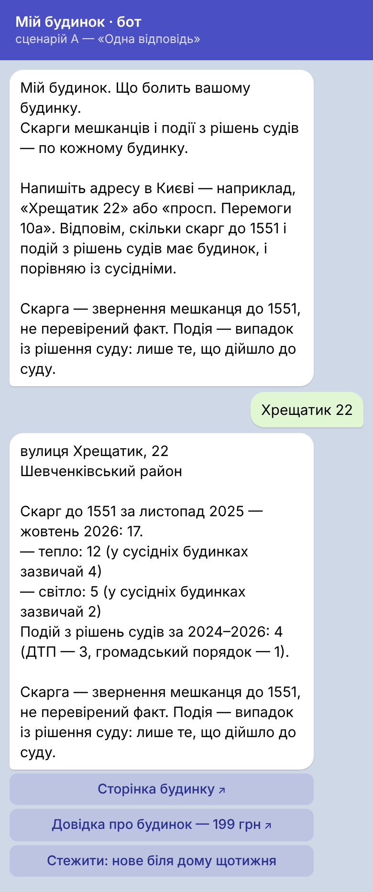
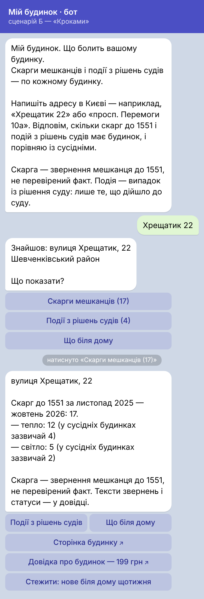
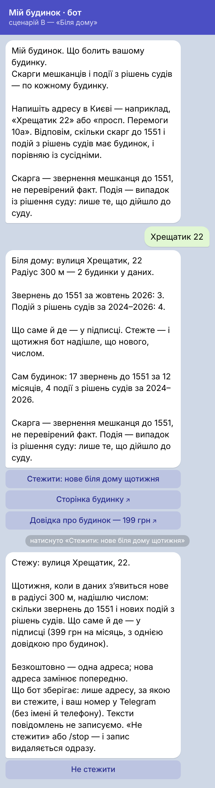
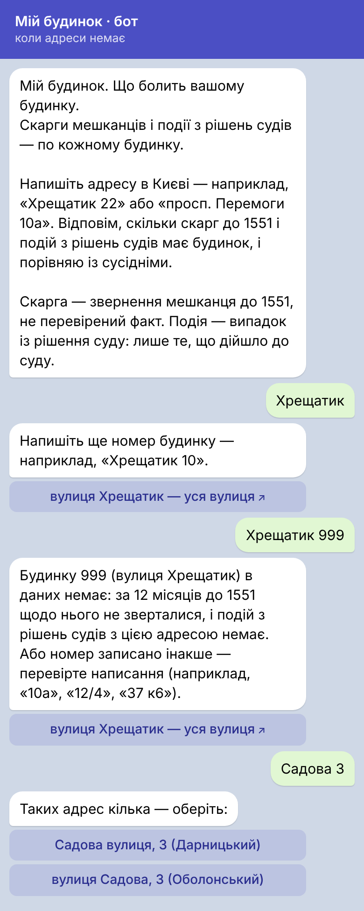
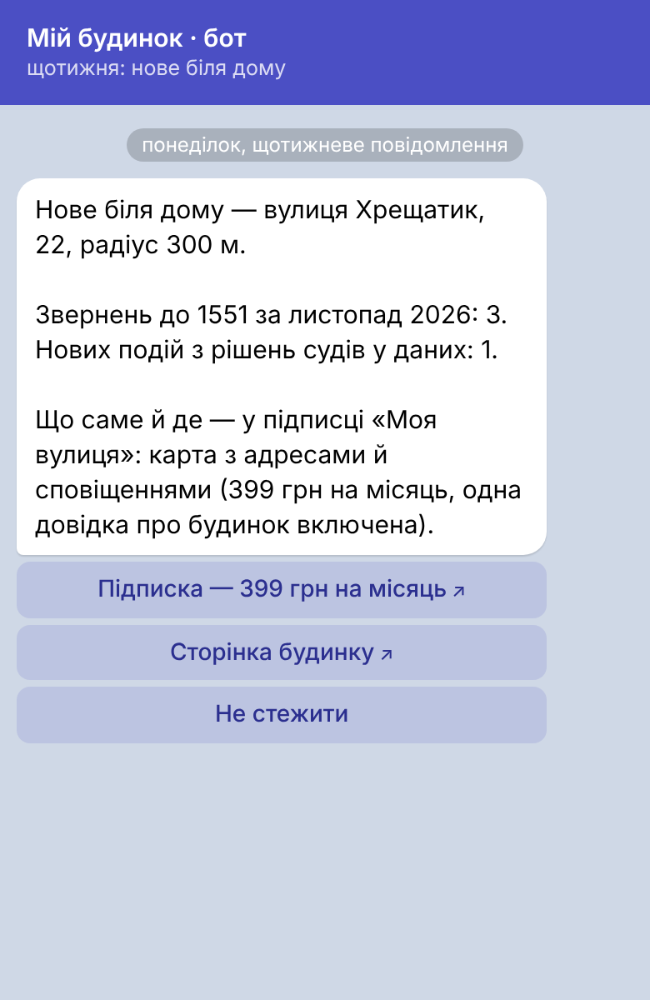
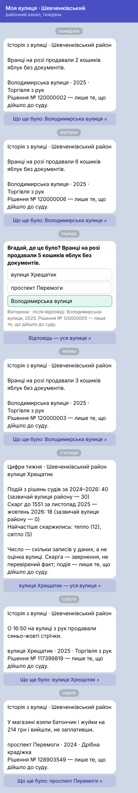

# Бот «Мій будинок» і районні канали Telegram — варіанти й прототип

17.11.2026 · хмара · за `ZAVDANNYA-97.md`. Лінія «Мій район» (`docs/KOMPAS.md`, розд. 3): бот і 10 районних каналів (MV-91)
ведуть на сторінку місця й на підписку. **Нічого не опубліковано, токена немає, бота в Telegram не створено.**
Код — `bot/`, тести — `tests/test_bot.py`, знімки — `docs/znimky-97/`.

---

## 0. Висновок

1. **Бот — сценарій А «Одна відповідь» (порада).** Людина пише адресу → одне повідомлення: скільки скарг до 1551 і
   подій з рішень судів (числами, як на сторінці будинку), дві найчастіші теми скарг поруч із «у сусідніх будинках
   зазвичай», і три кнопки: **Сторінка будинку · Довідка — 199 грн · Стежити**. Усі три виходи компасу в одному
   повідомленні, без зайвих натискань. Сценарії Б «Кроками» і В «Біля дому» — запасні (розд. 2).
2. **«Стежити»** — безкоштовно одна адреса; щотижня, **лише коли в даних є нове**, бот пише числом: скільки звернень до 1551
   за останній місяць і скільки нових подій з рішень у радіусі 300 м. Що саме й де — у підписці 399 грн.
3. **Районні канали:** 7 дописів на тиждень у кожному з 10: 5 «Історій з вулиці», середа — вікторина «Вгадай, де це було?»,
   п'ятниця — «Цифри тижня» однієї вулиці. **Кожен допис веде на сторінку вулиці**, про яку йдеться (не на будинок —
   бо номер будинку в безкоштовних дописах не показуємо, MV-25, MV-60). Генератор робить пачку на 14 днів; публікує сам,
   Андрій переглядає вже опубліковане (MV-114; черга, журнал і сторінка-перегляд — ZAVDANNYA-107).
4. **Прототип працює локально:** на пробному випуску 08.11 і скаргах 1551 бот знаходить будинок за звичним написанням у
   1 997 з 2 000 випадкових адрес (99,9 %), відповідає за ≈ 1 мс; генератор дав 140 дописів на 14 днів, жоден не впав на
   перевірці. Справжній бот — після токена від партнера (змінна середовища `MV_TELEGRAM_TOKEN`).
5. **Персональні дані — мінімум:** лише ідентифікатор чату Telegram і одна адреса стеження; без імені, телефону й текстів
   повідомлень; видаляється одразу за «Не стежити», при блокуванні бота і через рік без розсилок. Володілець — партнер.
6. **Що заважає запуску:** (а) тексти історій — це ще юридична мова з колоди гри, їх треба переписати ШІ (MV-21, MV-25);
   а оскільки за MV-114 дописи йдуть без попереднього перегляду, переказ ШІ має пройти автоматичну перевірку (розд. 3.3); (б) колоди вистачить на ≈ 4 місяці (розд. 3.4); (в) три питання Андрію — розд. 6.

---

## 1. Що зроблено

| Що | Де |
|---|---|
| Покажчик для бота й каналів з того самого випуску й зведення будинків, що й сайт (той самий код адрес сторінок) | `bot/indeks.py` |
| Пошук будинку за написанням людини («Хрещатик 22», «просп. Перемоги, буд. 10а», «Лесі Українки 7б», «Оболонська 13-15») | `bot/adresa.py` |
| Розмова: три сценарії, «не знайшов», кілька однакових адрес, межа 30 адрес на годину, /stop, /dani | `bot/rozmova.py` |
| Сховище стеження (SQLite) і щотижнева розсилка «нове біля дому» | `bot/stezhennia.py` |
| Запуск: Telegram (довге опитування, без сторонніх бібліотек) або розмова в терміналі без токена | `bot/telegram.py` |
| Дописи районних каналів: пачка на N днів, перегляд для людини (Markdown), перевірка, надсилання | `bot/kanaly.py` |
| Знімки розмов і тижня каналу | `bot/znimky.py` → `docs/znimky-97/` |
| Тести (24): адреси, три сценарії, лише числа й ціни MV-100, без заборонених слів і емодзі, стеження й видалення, розсилка, межа запитів, дописи, посилання збігаються зі сторінками сайту | `tests/test_bot.py` |
| У зведенні будинків — скарги за останній місяць (`ostannii`), для «нове біля дому» | `dani-edrsr`, `src/budynky_sait.py` (окремий PR) |

**Як спробувати самому** (на ПК з випуском і скаргами 1551):

```
# dani-edrsr: зведення будинків
python src/budynky_sait.py events-2026-11-08.db <тека skargy-*.tsv.gz> budynky.json --mezhi ../moya-vulytsya/data/borders.json
# moya-vulytsya: покажчик бота (≈ 25 с, 12 МБ) і розмова в терміналі
python bot/indeks.py events-2026-11-08.db budynky.json indeks.json --pereimenuvannya ../dani-edrsr/config/pereimenuvannia-kyiv.csv --koloda koloda-2026-11-08.json
python bot/telegram.py --indeks indeks.json --konsol --scenarii a      # «!1» — натиснути першу кнопку
# пачка дописів каналів на 2 тижні для перегляду
python bot/kanaly.py --indeks indeks.json --vid 2026-11-23 --dniv 14 --vykhid pachka.json --perehliad pachka.md
```

---

## 2. Бот: три сценарії розмови

Знімки — на **штучних числах** з тестів (репозиторій публічний, а справжні числа будинків ще не опубліковані); тексти й
кнопки — справжній вивід коду. Вигляд — схема чату, не копія Telegram.

Привітання (однакове): «Мій будинок. **Що болить вашому будинку.** Скарги мешканців і події з рішень судів — по кожному
будинку. Напишіть адресу в Києві…» (гасло й опис — MV-106). У кожній відповіді з числами — «Скарга — звернення мешканця до
1551, не перевірений факт. Подія — випадок із рішення суду: лише те, що дійшло до суду».

### А. «Одна відповідь» — порада



- **За:** найкоротший шлях до всіх трьох виходів (сторінка → Google-трафік, довідка → 199, стежити → підписка); число завжди
  з порівнянням «у сусідніх будинках зазвичай»; людина бачить усе за одне повідомлення.
- **Проти:** довге повідомлення на маленькому екрані.

### Б. «Кроками»



- Адреса → «Знайшов… Що показати?» → [Скарги мешканців (17)] [Події з рішень судів (4)] [Що біля дому]; у кожному кроці — ті
  самі кнопки сторінки, довідки й стеження.
- **За:** схоже на гру, людина сама обирає; коротші повідомлення. **Проти:** на одне-два натискання довше до довідки;
  частина людей зупиниться на першому кроці.

### В. «Біля дому» (лінія «Мій район»)



- Спершу що довкола — у радіусі 300 м: скільки будинків у даних, звернень до 1551 за останній місяць, подій за 2024–2026;
  потім сам будинок одним рядком; **головна кнопка — «Стежити»**.
- **За:** найсильніше веде на підписку («нове біля дому щотижня» — меседж лінії MV-107). **Проти:** числа «біля дому» поки
  без порівняння «зазвичай у районі» — це порушує правило компасу «число — завжди з порівнянням»; додати можна (медіана
  району по будинках), але це ще робота. Відповідь про сам будинок слабша, ніж в А.

### Коли адреси немає й щотижневе повідомлення

 

- Без номера → «Напишіть ще номер будинку» + кнопка на сторінку вулиці. Номера немає в даних → чесно: «за 12 місяців до 1551
  не зверталися, і подій з рішень судів з цією адресою немає. Або номер записано інакше» + сторінка вулиці. Кілька однакових
  адрес у різних районах → кнопки на вибір. Не впізнав → приклад написання.
- **Щотижня:** перевірка раз на тиждень; повідомлення — **лише якщо** з'явився новий місяць 1551 або нові події у випуску
  (інакше нічого не шлемо, щоб не набридати). Скарги 1551 оновлюються раз на місяць — тому «щотижня» на ділі означає
  «щотижня перевіряємо, пишемо, коли є нове»: приблизно раз на місяць про скарги й при кожному новому випуску про події.

### Що бот не робить

Описів подій, текстів скарг, імен, номерів справ — немає (лише числа, як на сторінці будинку, MV-99, MV-100). Статеві
справи й щодо дітей у числах не рахуються, домашнє насильство — нарівні (MV-102; так уже у зведенні `dani-edrsr`).
Без «небезпечно», рейтингів, найгірших будинків, емодзі (тест перевіряє кожну відповідь). Ціни — лише з `site/tsiny.py`.
Працює лише в особистих чатах (у групах адресу бачили б інші). Не більше 30 адрес на годину з одного чату — щоб бот не став
способом вивантажити всі будинки (ризик копіювання 1551 з `BIZNES-MODEL-PEREVIRKA.md`).

---

## 3. Районні канали

### 3.1. Розклад тижня одного каналу



| День | Допис | Звідки | Куди веде |
|---|---|---|---|
| пн, вт, чт, сб, нд | **Історія з вулиці** — переказ події, вулиця без номера, рік, вид, «Рішення № … — лише те, що дійшло до суду» | колода гри (MV-12) — події з будинком і посиланням, без найважчих категорій | сторінка цієї вулиці |
| ср | **Вгадай, де це було?** — вікторина Telegram: опис події, три вулиці району, після відповіді — вулиця й номер рішення | та сама колода | кнопка «Відповідь — уся вулиця» |
| пт | **Цифри тижня** — одна вулиця району: події з рішень за 2024–2026 і скарги 1551 за 12 місяців, поруч «зазвичай вулиця району», дві найчастіші теми | покажчик (як сторінки вулиць) | сторінка цієї вулиці |

Приклад «Цифр тижня» з пробних даних (Голосіївський район): «Ясинуватський провулок. Подій з рішень судів за 2024–2026: 24
(зазвичай вулиця району — 18). Скарг до 1551 за листопад 2025 — жовтень 2026: 154 (зазвичай вулиця району — 83). Найчастіше
скаржились: вода (60), світло (46). Число — скільки записів у даних, а не оцінка вулиці.» «Зазвичай» — медіана серед вулиць
району, що мають сторінку в пошуку (≥ 3 подій).

Посилання — з міткою каналу `?dzherelo=telegram-<район>` (MV-125, як в автопостингу) (MV-5: прийшли → ввели адресу → купили, з каналом).

### 3.2. Як іде допис

1. Раз на тиждень на сервері партнера: новий покажчик (`bot/indeks.py`) → пачка на 14 днів (`bot/kanaly.py --vykhid
   --perehliad`; події, що вже виходили, не повторюються — `--vzhe`).
2. **ШІ переписує історії** людською мовою без нових фактів (MV-21, MV-25) — крок `dani-edrsr/src/perekazy_istorii.py --koloda`
   (ZAVDANNYA-110), файл — у `bot/kanaly.py --perekazy`. Переказ, що не пройшов перевірку програмою (`site/sait/perekazy.py`:
   без цифр, дат, сум, марок авто, імен, мови суду й уривків рішення), не береться; тоді в пачці чернетка з колоди
   (`chernetka: true`), і `--nadislaty` її **не надсилає**. MV-110 це не зачіпає: там мова про карту.
3. **Публікація без попереднього перегляду (MV-114):** щодня бот публікує дописи дня (`--nadislaty`); перед надсиланням —
   автоматична перевірка (розд. 3.3), допис із зауваженням не йде. Андрій переглядає вже опубліковане й за потреби прибирає —
   черга, журнал і сторінка-перегляд — ZAVDANNYA-107 (там цей генератор — джерело дописів Telegram). Markdown-перегляд пачки
   (`--perehliad`) лишається для пробного режиму.

### 3.3. Перевірка кожного допису (автоматично)

Ті самі правила, що для роликів (`video/perevirka.py`), плюс свої: немає «небезпечн-», «безпечн-», «рейтинг», «страшн-»;
немає слідів імен і квартир («ОСОБА_», «кв. 5»); **немає номера будинку** в тексті («буд. 5», «вул. Х, 42»); немає чутливих
категорій (MV-4, MV-69, MV-102); **немає військових справ** (військова частина, військовослужбовець — див. питання 3);
є «лише те, що дійшло до суду»; посилання — лише на сторінку вулиці, будинку чи району. На пробних даних: з 1 200 подій колоди
придатні 1 128; у пачці з 140 дописів зауважень 0.

### 3.4. Чого вистачить і що слабке

- **Історій вистачить на ≈ 4 місяці:** у колоді 105–123 придатні події на район, витрата — 6 на тиждень (5 історій +
  вікторина) → 17–20 тижнів. Далі — більша колода з повного випуску (конвеєр `dani-edrsr/src/koloda.py`).
- **Тексти колоди — юридична мова** («Згідно протоколу… особа о 12 годині 20 хвилин…»), третина довша за 250 знаків, частина
  обрізана посередині речення. **Без переписування ШІ публікувати не можна** — нецікаво й місцями незрозуміло.
- У колоді трапляються військові справи («військовослужбовець… на території військової частини»): генератор їх відкидає
  (72 з 1 200 відкинуто з усіх причин разом).

---

## 4. Правові межі — персональні дані (коротко)

| Питання | Відповідь прототипу |
|---|---|
| **Що зберігаємо** | ідентифікатор чату Telegram (число) і сторінку одного будинку, за яким стежать; дату початку; що вже надіслано (версія даних, місяць 1551, кількість подій). Імені, ніка, телефону, текстів повідомлень — ні (`bot/stezhennia.py`, тест перевіряє склад таблиці). Запити адрес без «Стежити» не записуються; для межі «30 адрес на годину» бот тримає в пам'яті лише час запитів чату за останню годину |
| **Чому це персональні дані** | номер чату разом з адресою — це, ймовірно, адреса проживання людини, яку можна впізнати через Telegram (ЗУ «Про захист персональних даних», ст. 2) |
| **Підстава** | згода (ст. 11): натискання «Стежити» після тексту, що саме зберігаємо й як видалити. Текст показується в повідомленні про стеження й за командою /dani |
| **Скільки** | доки людина стежить; «Не стежити» або /stop — видалення одразу; людина заблокувала бота (помилка 403) — видалення при розсилці; рік без жодної розсилки — видалення |
| **Де** | один файл SQLite на сервері партнера, поруч із ботом; ніде не копіюється, нікому не передається; резервні копії — не робити або тримати не довше 30 днів |
| **Хто володілець** | **партнер** (Андрій — ні: `docs/02-pravo.md`, розд. 6). Токен бота, канали й сервер — на партнері (MV-91) |
| **Що треба до запуску** | дописати бот у політику конфіденційності (`site/zahlushka/polityka.html` — там зараз лише заявки й звернення); у боті — посилання на неї (є, команда /dani); вирішити, чи підписка в майбутньому прив'язуватиметься до Telegram (тоді даних більше — окремо) |

Не юридична консультація: перед запуском варто показати юристу разом з політикою конфіденційності.

---

## 5. Що не перевірено

- **Справжній Telegram не перевірено** — токена немає. Код викликів (sendMessage, sendPoll-вікторина з кнопкою,
  answerCallbackQuery, getUpdates) написано за документацією Bot API і перевірено лише в терміналі й тестах.
- Межі Telegram: питання вікторини — до 300 знаків, пояснення — до 200, дані кнопки — до 64 байт (у коді враховано).
  Чи показує Telegram кнопку-посилання під вікториною в каналі — не перевірено.
- Пошук адрес перевірено на «чистих» написаннях з самих даних; як пишуть живі люди (помилки, «Перемоги пр.», російською) —
  ні. Російськомовні назви бот зараз не впізнає.
- Число «біля дому» в сценарії В — без порівняння (розд. 2).
- Скарги за останній місяць (`ostannii`) — нове поле зведення в `dani-edrsr`; сайт його не читає.
- Групи подій у відповідях бота й «Цифрах тижня» беруться зі словника сайту (`site/sait/dani.py`, `HRUPY`); коли сайт перейде
  на сім груп MV-116 (ZAVDANNYA-108), бот перейде разом із ним після перебудови покажчика — окремо не перевірено.

---

## 6. Питання Андрію

1. **Сценарій бота:** А «Одна відповідь» (порада), Б «Кроками» чи В «Біля дому»? Можна А з кнопкою «Що біля дому» з В.
2. **Безкоштовне стеження — одна адреса** (більше — у підписці)? Порада: так, одна.
3. **Військові справи в дописах:** генератор їх зараз відкидає (місце служби під час війни). Лишити так? Порада: так, і
   записати рішенням.
4. Назви каналів — порада: «Моя вулиця · Оболонь», «Моя вулиця · Печерськ»… (назву району, як кажуть люди). Створює партнер.
