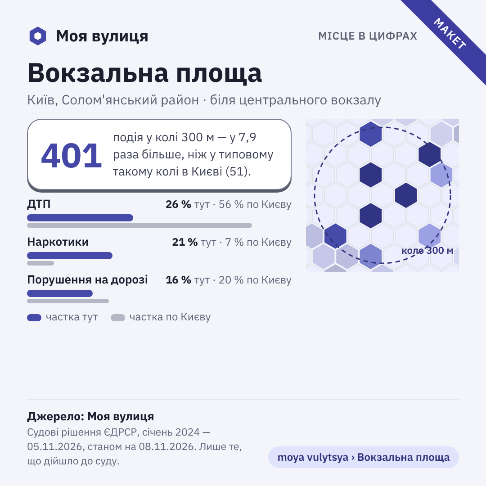
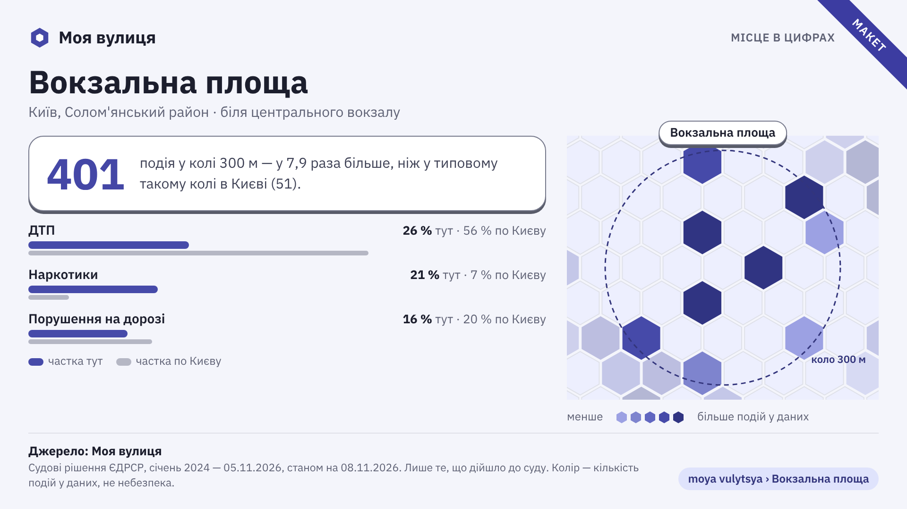
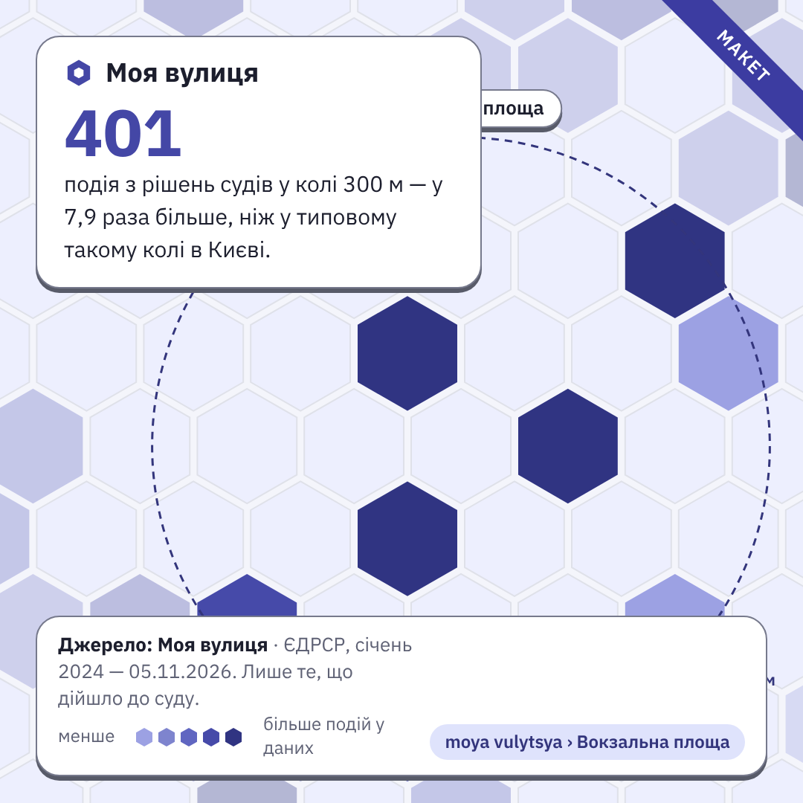
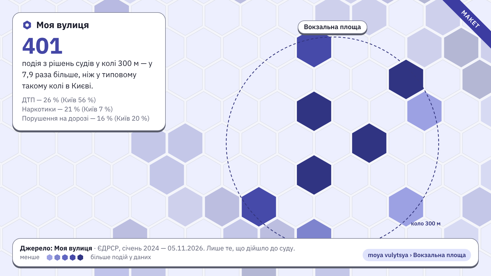
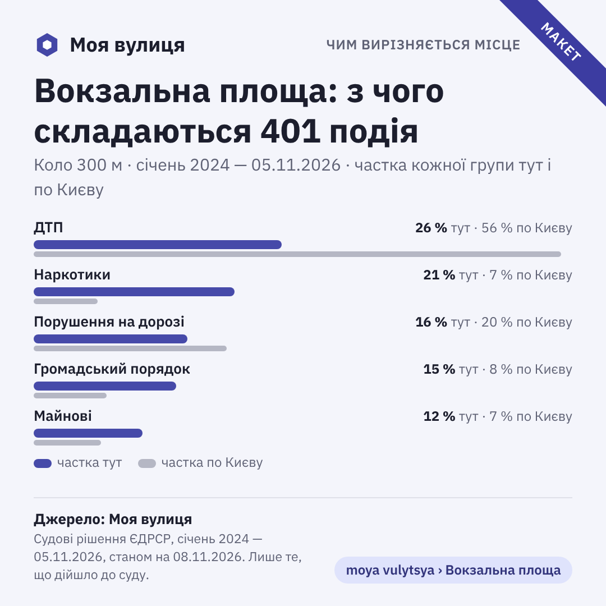
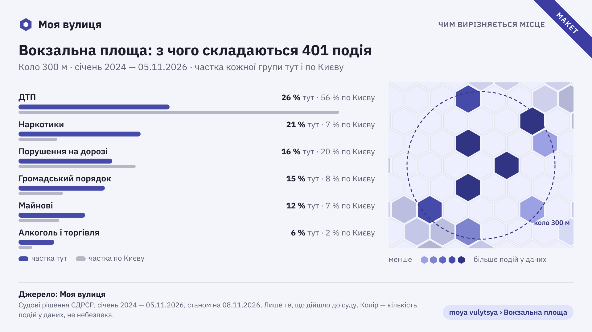

# Нові лінії: науковці й студенти, журналісти, юристи (судді) — пропозиції й макети

17.11.2026 · хмара · за `ZAVDANNYA-91.md`. Дослідження й дешеві макети; **рішень тут немає — вибір за Андрієм (MV-31)**.
Дані й код макета — приватний `dani-edrsr`, гілка `ccr-bffc03c5-imcl5o`, тека `prototypy/vizual-mistsia/`.
Знімки — `docs/znimky-91/`. Джерела — у кожному розділі. Що не перевірено, позначено.

---

## 0. Висновок

| Лінія | Що даємо | Як купують | Ціна (порада) | Перекриває наявне? | Ризик |
|---|---|---|---|---|---|
| **Журналісти** | готовий візуал про публічне місце: картка 1:1 і 16:9, 8 слайдів, згодом — ролик | кнопка «Для медіа» на сторінці місця, завантаження одразу | **безкоштовно за підпис «Джерело: Моя вулиця» з посиланням** | ні: це новий вхід, а не покупка | низький, якщо лише публічні місця й автоматично |
| **Науковці й студенти** | (1) відкритий підсумковий набір «район × місяць × група» з DOI — безкоштовно; (2) вибірка за темою й районом на рівні сот із методикою й описом полів | (1) завантажити; (2) на сайті: вибрати → оплатити → завантажити, оферта «лише для дослідження» | (1) 0 грн; (2) **≈ 490 грн** за вибірку (до перевірки попиту) | частково з «Для бізнесу» — тому без точних адрес, без описів, разовий знімок | середній: обхід «Для бізнесу» — закрито межами набору |
| **Юристи: судді** | лише оцінка; **не робити** | — | орієнтир за кордоном ≈ $180/міс (Trellis) | безпечна частина (суд × стаття) — уже в ZAVDANNYA-86 | найвищий: персональні дані, «тиск на суддю», неточність; у Франції — злочин |

**Порада, що робити першим:**

1. **Журналісти — першими.** Найдешевше (дані вже є, шаблон зроблено), і це не продаж, а **реклама**: кожна згадка в медіа
   веде на сторінку того самого місця (KOMPAS, розд. 0). Свіжих даних «по точці» в українських медіа немає — ніша вільна.
   Порада — варіант **А** (цифри + карта) як основний, **В** (чим вирізняється) — як другий кадр, слайди — для тих, хто хоче
   більше; **Б** (карта першою) — лише коли буде підкладка з вулицями (без неї карта абстрактна).
2. **Науковці — другими і в два кроки:** спершу безкоштовний відкритий набір з DOI на Zenodo (майже без роботи, дає цитування
   й видимість у Google Dataset Search), платну вибірку — лише якщо прийдуть запити.
3. **Судді — нічого, крім питань юристу** (розд. 3.4), разом із ZAVDANNYA-86. Показ чи продаж — лише після висновку юриста
   й окремого рішення (S-Д.5, MV-34).

---

## 1. Науковці й студенти

### 1.1 Кому й що болить

Магістерські, кандидатські й статті з права, кримінології, соціології, урбаністики. Зараз вони **вручну вибирають рішення з
ЄДРСР** (Єдиного державного реєстру судових рішень): десятки чи сотні справ, без місця події на карті. Приклади робіт на ЄДРСР:
аналіз вироків за допомогою GPT-4 («Форум права», 2024, №3 — <https://forumprava.pp.ua/files/018-028-2024-3-FP-Babkova_4.pdf>),
пів року моніторингу ЄДРСР (Каланча, 2020 — <https://zenodo.org/records/4382110/files/Kalancha.pdf>), стаття про ризики баз судових
рішень як джерела досліджень (<https://sls-journal.com.ua/uk/journals/tom-8-1-2025/tsifrovi-bazi-danikh-sudovikh-rishen-u-kriminalnomu-protsesi-znachennya-riziki-ta-optimizatsiya-vikoristannya>).
Попит є, але **не виміряний**: скільки з них заплатили б — не знаємо.

Що їм треба: (1) набір даних за темою й районом; (2) **методика й опис полів**, на які можна послатися в роботі; (3) постійне
посилання для списку літератури (DOI); (4) зрозуміла ліцензія «лише для дослідження».

### 1.2 Як це роблять інші

| Хто | Як дає дані | Джерело |
|---|---|---|
| police.uk (Велика Британія) | усе відкрито (ліцензія OGL), але точки зміщені до «анонімних» — кожна охоплює щонайменше 8 поштових адрес; «не офіційна статистика» | <https://data.police.uk/about/> |
| UK Data Service | рівні доступу: відкриті, «захищені» (End User Licence), «контрольовані» — останні лише некомерційно | <https://ukdataservice.ac.uk/conditions> |
| ICPSR (США) | дані з обмеженим доступом — «лише для досліджень або статистики», комерційним — окремо | <https://www.icpsr.umich.edu/sites/ICPSR/posts/shared/restricted-data-mgmt-access> |
| CourtListener / Free Law Project | масові вивантаження рішень вільно, програмний доступ — членам і за комерційними угодами | <https://courtlistener.com/help/api/bulk-data/> |
| LIGA:ZAKON | академічної ліцензії публічно немає; меморандуми з вишами (студенти ЗУНУ мають доступ до LIGA 360) | <https://www.wunu.edu.ua/en/12224-access-to-the-liga-360-legal-database-for-students.html> |
| Statista | ліцензія на весь університет, ціна не опублікована | <https://www.statista.com/getting-started/statista-for-universities> |
| Opendatabot | ціни програмного доступу — через заявку; знижок для науки не знайдено | <https://opendatabot.ua/api> (сторінка не відкрилась, 403 — за пошуковим витягом) |

Типова модель: **безкоштовно або символічно для некомерційного дослідження, але з умовами**: лише дослідження, без перепродажу,
без спроб упізнати людей, обов'язкове посилання на джерело. Публічних цін академічних ліцензій **ніде не знайдено**.

### 1.3 Що даємо (пропозиція)

**Крок 1 — відкритий підсумковий набір (безкоштовно).** Таблиця «район × місяць × група подій × стаття» (лише числа), опис полів,
методика, файл `CITATION.cff`; викласти на Zenodo — там дають DOI (постійне посилання, префікс 10.5281), Google Dataset Search
знаходить такі набори за розміткою schema.org/Dataset (<https://developers.google.com/search/docs/data-types/dataset>).
Це **приводить** (науковці, викладачі, журналісти), не продає. Межа MV-3 не порушена: безкоштовно — «скільки», без адрес.

**Крок 2 — «Вибірка для дослідження» (платно, на сайті, без розмов).**
- Вибрати: тема (групи / статті), район(и), роки → побачити, скільки подій → оплатити → завантажити.
- Що в наборі: подія на рівні **соти** (≈ 100–300 м, не адреса), місяць і частина доби, група й стаття, вид прив'язки,
  посилання на рішення в ЄДРСР (воно публічне); методика (PDF) і опис полів; рядок «Як цитувати» з DOI версії бази.
- Чого немає: точних адрес і координат, описів справ, суддів, сторін, номерів справ у полі; чутливих справ (статеві, щодо дітей)
  — лише числом у великій соті, як на відкритих сторінках (MV-102).
- Ліцензія — оферта з галочкою (на партнера, `docs/02-pravo.md`, розд. 6): лише некомерційне дослідження, без перепродажу й
  передачі, без спроб упізнати людей і без порівняння суддів, обов'язкове посилання «Джерело: Моя вулиця»; у кожен файл
  вшито ідентифікатор завантаження (щоб знайти, звідки витік).
- **Ціна-порада:** 490 грн за одну вибірку (до 10 000 подій). Обґрунтування: дешевше за ручну роботу, дорожче за довідку
  (199), щоб не стати «довідкою оптом»; студентам знижка не потрібна — це і так ціна однієї довідки й половини підписки.
  **Не перевірено попитом** — спершу кнопка «Хочу вибірку» на сторінці набору й лічильник.

### 1.4 Чому це не дешевий обхід «Для бізнесу»

«Для бізнесу» (MV-92) — **точні адреси, щомісячне оновлення, доступ для програм, комерційне використання**. Вибірка для дослідження —
**соти замість адрес, разовий знімок, обмеження за кількістю, некомерційна ліцензія**. Компанії потрібна адреса (будинок
у сервісі нерухомості), а саме її у вибірці немає — тож обхід не має сенсу. Підписка (399/міс) і так показує адреси на карті,
але не дає файлу для статистики — з нею перетину мало.

### 1.5 Як про нас дізнаються (засновники нікому не пишуть)

Google Dataset Search і Google Scholar (через DOI і цитування), Zenodo, сторінка «Дані для досліджень» з методикою (її знаходять
за «дані ЄДРСР за статтями», «статистика правопорушень Київ по районах»), посилання в чужих роботах і рекомендації наукових
керівників. Кафедри й конференції (НАВС, НЮУ, Асоціація правників України) — лише пасивно: про нас дізнаються з цитувань,
самі ми не пишемо. Меморандуми з вишами, як у LIGA, — лише якщо прийде вхідний запит, і оформлює партнер.

### 1.6 Ризики

- **Обхід «Для бізнесу»** — закрито межами набору (1.4); головне правило — жодних адрес у файлі.
- **Упізнавання людей** у малих сотах (мало подій) — об'єднувати соти, де менше 5 подій, як police.uk (≥ 8 адрес на точку).
- **Неправильні висновки** («район X найкримінальніший») — методика з першого рядка: «лише те, що дійшло до суду», база до 2024
  неповна, рішення за 2026 ще надходять.
- **Обсяг підтримки** — набір має збиратися автоматично з випуску, інакше це ручна робота щоразу.

---

## 2. Журналісти

### 2.1 Що зараз пишуть медіа й чого бракує

- **Texty.org.ua** — найкращі карти ДТП Києва, але на даних 2011–2012 років (<https://texty.org.ua/articles/51188/>,
  <https://texty.org.ua/mod/datavis/apps/dtp2012>); їхня свіжа карта ДТП на переходах — лише 10 випадків з новин
  (<https://texty.org.ua/d/kyiv_crossings>). Самі автори пишуть, що поліція не дає координат.
- **УП. Життя** — злочини за районами Києва 2025 за даними поліції: лише райони, абсолютні числа без поправки на населення,
  заголовок «Який район Києва найкримінальніший» (<https://life.pravda.com.ua/society/yakiy-rayon-kiyeva-naykriminalnishiy-infografika-308394/>).
- **Opendatabot** — регулярні дослідження судової статистики, медіа передруковують «за даними Опендатабота» (Kyiv Post, Forbes,
  Суспільне, Главком — <https://forbes.ua/news/v-ukraini-torik-mayzhe-u-pivtora-razi-pobilshalo-sudovikh-sprav-naybilshe-administrativnikh-ta-tsivilnikh-15032024-19884>,
  <https://suspilne.media/rivne/1312967-skilki-sudovih-risen-za-korupciu-uhvalili-na-rivnensini-dani-opendatabot/>).
  Це найближчий зразок для нас: безкоштовні цифри → згадка → впізнаваність.
- Матеріалів Hromadske, Бабеля, KyivVlada, Суспільного Києва, «Слова і діла» саме про конкретні місця в темі правопорушень
  **не знайдено** — це «не перевірено», а не «немає».

**Чого бракує:** рівня **точки й вулиці** (а не району), **свіжості** (не 2012), **порівняння** (а не голих чисел), **готової картинки**,
яку редакція може взяти без дизайнера.

### 2.2 Як дають візуали інші

| Хто | Умова | Джерело |
|---|---|---|
| Our World in Data | графіки й дані під CC BY: дозвіл не потрібен, лише вказати джерело; можна вбудувати | <https://ourworldindata.org/faqs> |
| Statista | безкоштовні графіки — з підписом і посиланням; платне — не публікувати | <https://www.statista.com/getting-started/publishing-statista-content-terms-of-use-and-publication-rights> |
| Datawrapper | безкоштовно з підписом «Created with Datawrapper» | <https://www.datawrapper.de/faq> |
| SpotCrime (США) | понад 70 медіапартнерів показували їхні карти (дані 2009–2012) | <https://blog.spotcrime.com/2009/04/spotcrimecom-announces-new-media.html> |

Платного «медіапакета» в аналогів **не знайдено**: усі дають безкоштовно за підпис — бо підпис і є реклама.

### 2.3 Що даємо: візуал про місце (5–8 блоків)

Лише **публічні місця** (площа, вокзал, станція метро, ТЦ, ринок, парк — MV-54, MV-60), бо номер житлового будинку в
безкоштовному — ні (MV-25). Блоки (вони ж — слайди):

1. **Обкладинка:** назва місця, район, період, міні-карта сот.
2. **Головне число з порівнянням:** скільки подій у колі 300 м і у скільки разів це більше чи менше за типове коло Києва.
3. **Карта:** соти ≈ 100 м, колір — кількість, без адрес; коло й назва місця.
4. **Що саме:** частка кожної групи **тут і по Києву** (смуги поруч).
5. **За роками:** з позначкою неповного року.
6. **Коли:** години доби (якщо година відома).
7. **Найчастіші статті** — назвою людською мовою й номером статті.
8. **Як читати:** «подія ≠ небезпека», «лише те, що дійшло до суду», як рахується типове коло, без чутливих і без імен; посилання на
   сторінку місця.

Підпис на кожному кадрі: **«Джерело: Моя вулиця»**, період, дата випуску, «Лише те, що дійшло до суду», «Колір — кількість подій у
даних, не небезпека» і пігулка з адресою сторінки місця. Ролик (30 с) — пізніше, тим самим рушієм, що й ролики (`video/`).

### 2.4 Макет — Вокзальна площа (справжні дані, випуск 08.11.2026)

Коло 300 м біля центрального вокзалу, січень 2024 — 05.11.2026: **401 подія** — у **7,9 раза** більше, ніж у типовому колі
300 м у Києві (медіана 2 824 кіл, де є хоч одна подія, — 51). ДТП — 26 % (по Києву 56 %), наркотики — 21 % (7 %),
порушення на дорозі — 16 % (20 %). Порівняння «тут · по Києву» — у кожному блоці.

| Варіант | 1:1 (1080×1080) | 16:9 (1920×1080) | Коли брати |
|---|---|---|---|
| **А — цифри + карта** (порада) |  |  | основна картка для статті й соцмереж |
| **Б — карта першою** |  |  | лише з підкладкою вулиць; без неї карта абстрактна |
| **В — чим вирізняється** |  |  | другий кадр: з чого складаються події |

Слайди 16:9 (8 блоків з 2.3): [1](znimky-91/slaid-1.png) · [2](znimky-91/slaid-2.png) · [3](znimky-91/slaid-3.png) ·
[4](znimky-91/slaid-4.png) · [5](znimky-91/slaid-5.png) · [6](znimky-91/slaid-6.png) · [7](znimky-91/slaid-7.png) ·
[8](znimky-91/slaid-8.png).

Що помітив на макеті (чесно):
- **Події прилипають до кількох адрес** (вокзал, сусідні будинки): у колі лише ≈ 10 зафарбованих сот. Тому контур порожніх
  сот — обов'язковий, інакше карта виглядає випадковою. Для варіанта Б потрібна підкладка з вулицями.
- **Людне місце завжди «більше»**: 7,9× тут — бо вокзал. На слайді 2 це сказано прямо («де більше людей — там більше подій у
  даних»); без цього рядка картка підштовхує до заголовка «найнебезпечніше місце».
- **2026 рік неповний** не через спад, а тому, що рішення ще надходять — позначено пунктиром і зірочкою.
- Адреса сторінки на картці — заглушка («moya vulytsya › …»), домену ще немає.
- Самоперевірка шаблону: текст не вилазить за полотно; слова «безпечн-», «рейтинг», «найгірш-», «страшн-» — заборонені.

### 2.5 Як купують і скільки коштує — порада: безкоштовно за згадку

- На **сторінці кожного публічного місця** — кнопка «Для медіа»: картка 1:1, 16:9, слайди (PDF), умови. Генерується
  автоматично з кожним випуском — нікому не пишемо, нічого не робимо вручну.
- **Умови (як CC BY-ND):** безкоштовно, з підписом «Джерело: Моя вулиця» і посиланням на сторінку місця; не змінювати числа й
  підписи; не робити з них «рейтингів небезпеки».
- **Платно — ні.** Медіа не платять за такі картинки (розд. 2.2), а згадка з посиланням приводить читачів і Google на сторінку
  місця, де продаються довідка й підписка. Платною може бути лише «вибірка для дослідження» (розд. 1.3) для дата-журналістів.

### 2.6 Як про нас дізнаються

Сторінки місць у Google (журналіст шукає «Вокзальна площа Київ ДТП»), підписи під нашими картинками в чужих статтях, ролики й
районні Telegram-канали (вони вже в плані), відкритий набір з DOI (дата-журналісти). Самі не пишемо в редакції.

### 2.7 Межі й ризики

- **Лише публічні місця**, без імен і номерів житлових будинків (MV-25, MV-60), без чутливих (статеві й щодо дітей — не
  рахуються, MV-102), без «небезпечно», колір = кількість.
- **Заголовки медіа ми не контролюємо.** Захист: на самій картинці «подія ≠ небезпека» і «людне місце», у правилах — заборона
  «рейтингів»; Кодекс етики українського журналіста, п. 15, забороняє дискримінацію за місцем проживання (цитата за посібником
  ОБСЄ — <https://www.osce.org/files/f/documents/0/4/485153.pdf>).
- **Старі цифри в чужих статтях** — на кожній картці дата випуску.
- **Порівняння «у 7,9 раза»** — сигнал (AGENTS, розд. 6): є період, територія, кількість і база порівняння; рахувати
  ним можна лише з цим текстом поруч.

### 2.8 Чи перекриває наявне

Ні. Безкоштовна карта й сторінки будинків — для мешканців; візуал — для редакцій. Він повторює числа сторінки місця, але не
дає нічого з платного (адрес, описів, подій поштучно). Це **вхід** (KOMPAS, розд. 2), а не нова покупка.

---

## 3. Юристи — «як розглядає справи суддя» (лише оцінка)

### 3.1 Що кажуть наші правила

S-Д.5 (`dani-edrsr/SPECYFIKATSIYA.md`) і MV-34, MV-43: суддя зберігається з дампу, статистику за суддями **можна рахувати лише
всередині**; показ чи продаж — **тільки після висновку юриста й окремого рішення**. Перевірка `bez_suddiv` у `check_build`
стежить, щоб поля судді не було у файлах сайту, підписки й бази. Цей розділ нічого з цього не змінює.

### 3.2 Що вже роблять інші

| Хто | Що | Джерело |
|---|---|---|
| Verdictum (LIGA) | 2019: фільтр за прізвищем судді і бета-функція «Прогноз» (суд, суддя, подібні справи); чинний стан і ціну не перевірено | <https://jurliga.ligazakon.net/news/198240_verdictum-pro--sprognozuyte-rshennya-sudu> |
| Opendatabot | профілів суддів зі статистикою не знайдено; є правові позиції Верховного Суду | <https://news.dtkt.ua/law/jurisprudence/116216-iaki-pravovi-poziciyi-verxovnogo-sudu-cituiut-naicastise-reiting-opendatabot> |
| ZAXID.NET (2019) | рейтинг львівських суддів за даними ВККС (скасовані рішення, скарги) — разова публікація | <https://zaxid.net/atestatsiya_suddiv_2019_reyting_lvivskih_suddiv_dosye_n1468866> |
| ГРД, DEJURE | висновки й досьє доброчесності, не статистика рішень | <https://grd.gov.ua/> |
| Trellis (США) | аналітика суддів — $179,95/міс або $1 649,95/рік | <https://support.trellis.law/what-are-the-different-tiers> |
| Lex Machina, Westlaw, Pre/Dicta (купила Gavelytics) | є, ціни за запитом | <https://www.lawnext.com/2023/01/shuttered-legal-analytics-company-gavelytics-is-acquired-by-recently-launched-analytics-company-pre-dicta.html> |
| Франція | ст. 33 закону 2019-222: заборонено оцінювати, порівнювати чи прогнозувати практику суддів за їхніми даними — до 5 років позбавлення волі | <https://www.artificiallawyer.com/2019/06/04/france-bans-judge-analytics-5-years-in-prison-for-rule-breakers> |

В Україні **публічної аналітики за суддями фактично немає** — попит не доведений, ризик найвищий з трьох ліній.

### 3.3 Ризики

- **Персональні дані.** ЗУ «Про захист персональних даних», ст. 5: дані про виконання посадових повноважень тими, хто виконує
  функції держави, не конфіденційні (<https://protocol.ua/ua/pro_zahist_personalnih_danih_stattya_5/> — сторінка не відкрилась, за
  витягом). Чи покриває це **статистику за суддею** — питання юристу.
- **Імена суддів у ЄДРСР.** ЗУ «Про доступ до судових рішень», ст. 7 — що знеособлюється; за копією закону, ч. 2 дозволяє в
  кримінальних справах з мотивів безпеки не вказувати суддю (<https://kodeksy.com.ua/pro_dostup_do_sudovih_rishen/7.htm>,
  чинну редакцію на zakon.rada.gov.ua **не перевірено** — сайт видав помилку).
- **«Тиск на суддю».** ЗУ «Про судоустрій і статус суддів», ст. 48 — незалежність від незаконного впливу; ВРП вважає скаргу на
  суддю правом, а не тиском (<https://interfax.com.ua/news/general/706849.html>). Як вона поставиться до таблиць «суддя × результат» —
  невідомо. Morice v. France (ЄСПЛ, 2015) захищає критику суддів адвокатом, але не статистику — прямо не стосується.
- **Неточність.** Автоматичний розподіл справ (ст. 15 того ж закону) і спеціалізація суддів дають різний склад справ — порівняння
  суддів «в лоб» хибне; малі вибірки; пропуски в ЄДРСР. Помилкова цифра про конкретного суддю — ризик позову про честь і гідність.
- **Наші правила.** Порівняння суддів — це по суті **рейтинг** (AGENTS, розд. 4 — не робимо). Власник — діючий поліцейський:
  аналітика суддів від його проєкту — окремий репутаційний ризик (`docs/02-pravo.md`, розд. 6).
- **«Вибрати суддю» неможливо** (авторозподіл) — можлива лише «підготовка до розгляду». Цінність для юриста нижча, ніж у США.

### 3.4 Що можна без імен

**Суд, склад суду (одноосібно / колегія), строки розгляду, частки результатів за статтею** — це вже робить ZAVDANNYA-86
(«стаття × суд», `docs/SUDOVA-PRAKTYKA.md`). Тут не дублюю. Лінія «Юристи: судді» на практиці = «Судова практика» з 86 плюс,
можливо, колись — закрита аналітика за суддею лише для юриста-клієнта, якщо юрист скаже «можна».

**Питання юристу (перед будь-яким показом):**

1. Чи гарантовано імена суддів у ЄДРСР не знеособлюються? Як застосовується ч. 2 ст. 7 ЗУ «Про доступ до судових рішень» і що
   вирішив Конституційний Суд (<https://ccu.gov.ua/sites/default/files/docs/71_21_2024.pdf>)?
2. Чи є статистика рішень за суддею обробкою персональних даних? Чи покриває її ст. 5 ЗУ «Про захист персональних даних»?
   Чи треба повідомляти Уповноваженого Верховної Ради з прав людини?
3. Чи може показ часток результатів за суддею вважатися втручанням чи тиском (ст. 48 ЗУ «Про судоустрій…», ст. 126 Конституції)?
4. Яка відповідальність за неточну цифру про конкретного суддю (дисциплінарна для нас неможлива, але цивільна — захист честі)?
5. Чи безпечніше показувати лише в закритому доступі юристу-клієнту, без публікації? Чи змінює це оцінку?
6. Чи є в Україні законопроєкти на кшталт французької ст. 33? Позиція ВРП?
7. Яке мінімальне застереження про метод (вибірка, спеціалізація, авторозподіл) захищає від звинувачення в оманливості?
8. Чи достатньо статистики «суд × стаття × склад» без імен як безпечної заміни?
9. Чи не є порівняння суддів «рейтингом» у розумінні споживчого й рекламного права?
10. Як оформити договір і хто відповідає (партнер), з огляду на статус власника — діючого поліцейського?
11. Чи можна використовувати ім'я судді хоча б для внутрішньої перевірки якості даних (як зараз за S-Д.5)?

---

## 4. Як усе це вписується в одну лінію (`docs/KOMPAS.md`)

**Одна вітрина, не три.** Пропоную не робити окремих розділів, а додати до вже наявних точок:

| Лінія | Де на сайті | Що приводить | Куди веде | Що продає |
|---|---|---|---|---|
| Журналісти | кнопка «Для медіа» на **сторінці публічного місця** | Google, ролики, Telegram районів | **на ту саму сторінку місця** (посилання в підписі) | нічого напряму; читачі статті → довідка 199 / підписка 399 |
| Науковці | сторінка «Дані для досліджень» (у підвалі, поруч із «Для бізнесу» й методикою) | Google Dataset Search, Zenodo (DOI), цитування | на сторінку набору → методика | вибірка ≈ 490 грн (після перевірки попиту) |
| Юристи: судді | нічого | — | — | — (після юриста — у «Судова практика», ZAVDANNYA-86) |

**Чим макет журналістів — реклама:** підпис «Джерело: Моя вулиця» і пігулка з адресою **конкретної сторінки місця** на кожному
кадрі (KOMPAS, розд. 0: «кожна реклама веде на конкретне місце»). Один візуал — одне місце — одне посилання, як «один ролик —
одне місце» (KOMPAS, розд. 4). Той самий шаблон годиться і для власних постів «Місце в цифрах» — це той самий формат, що
`brend/hotovi/post-tsyfry/`, лише для публічного місця.

**Фільтр KOMPAS, розд. 5:**
- Журналісти: лінія — «Мій район» / «Мій будинок» через сторінку місця; **приводить**; посилання — на місце; чесно, якщо лише
  публічні місця й «подія ≠ небезпека». ✔
- Науковці: власна лінія; крок 1 **приводить**, крок 2 **продає**; посилання — на набір; чесно з методикою. ✔
- Судді: не проходить п. 4 («не ранжує») без висновку юриста. ✘ — не робимо.

**Що змінити в KOMPAS, якщо Андрій скаже «так»** (зараз не змінював — KOMPAS змінюється лише рішенням Андрія): у розд. 2 —
рядок «Візуал для медіа (безкоштовно за згадку) → сторінка місця»; «Дані для досліджень: відкритий набір → вибірка»;
у розд. 3 — прибрати курсив «досліджуємо» з тих ліній, що приймуть; «Юристи: судді» — лишити «лише після юриста».

---

## 5. Питання Андрію

1. Журналісти: **безкоштовно за згадку** — так? Варіант **А** основним?
2. Яке місце для першого справжнього візуалу (Вокзальна площа — лише макет)? Список публічних місць для кнопки «Для медіа» —
   площі, вокзали, станції метро, ТЦ, ринки, парки?
3. Науковці: викладаємо безкоштовний підсумковий набір на Zenodo з DOI (це публікація назовні — потрібне «так»)?
4. Платна вибірка для дослідження — робимо зараз чи лише після запитів?
5. Судді — відкладаємо до юриста, питання з розд. 3.4 передаємо разом із питаннями з ZAVDANNYA-86?

## 6. Що перевірено і що ні

- Перевірено: числа макета пораховано з пробного випуску `events-2026-11-08` (у хмарі завантажено лише для читання, Release не
  змінювався); знімки відкрив і подивився; самоперевірка шаблону — без переповнень і заборонених слів; `check_build` у
  `dani-edrsr` — «усе гаразд».
- Не перевірено: попит (ні в науковців, ні в медіа — ніхто не опитаний, бо нікому не пишемо); чинні редакції законів на
  zakon.rada.gov.ua (сайт не відкрився); ціни Opendatabot і Verdictum; матеріали Hromadske, Бабеля, KyivVlada, Суспільного Києва.
  Дослідження джерел робив ШІ-помічник — це не незалежна перевірка, посилання варто відкрити.
- «Типове коло» — медіана кіл на сітці по всьому Києву; інша база (той самий район, лише людні місця) дасть інше число.
