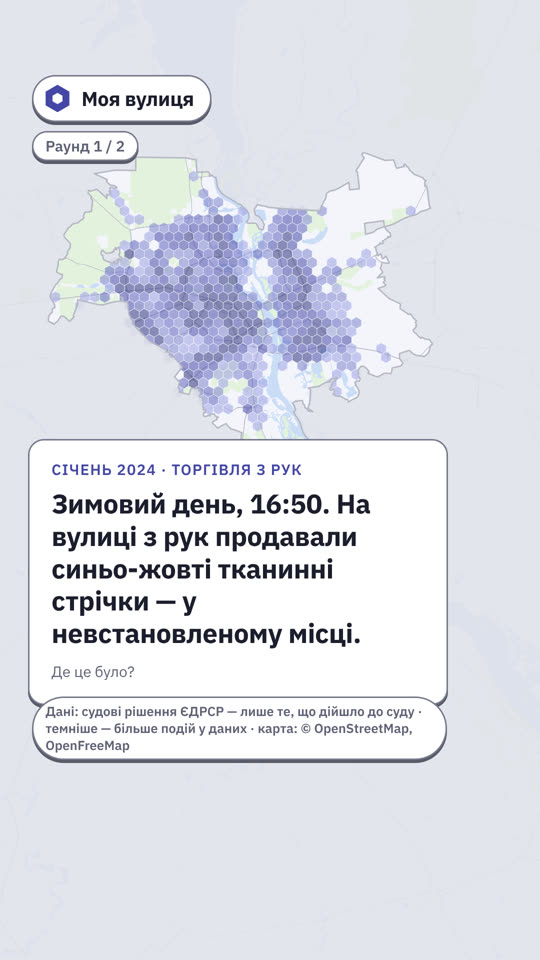
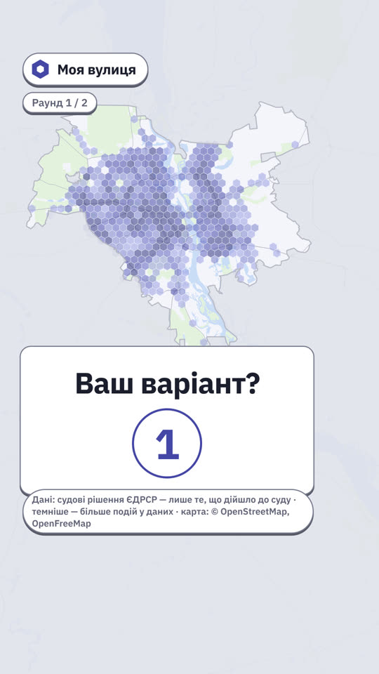
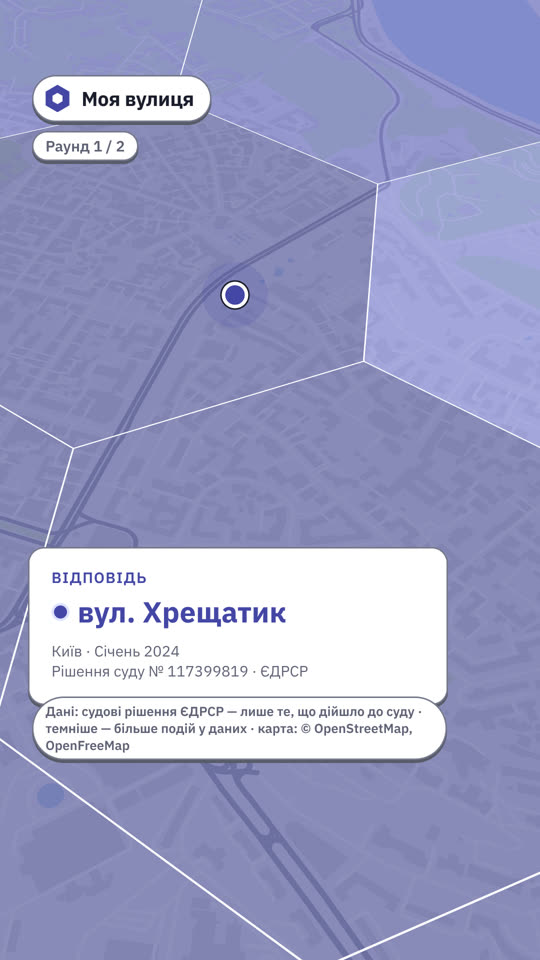
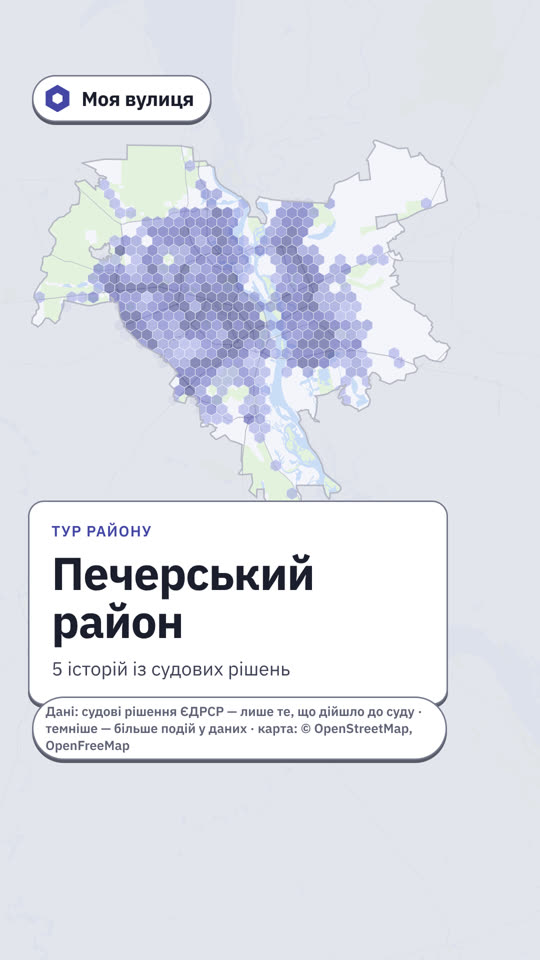
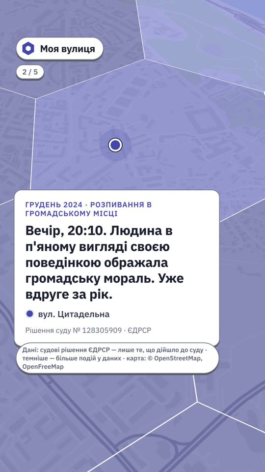
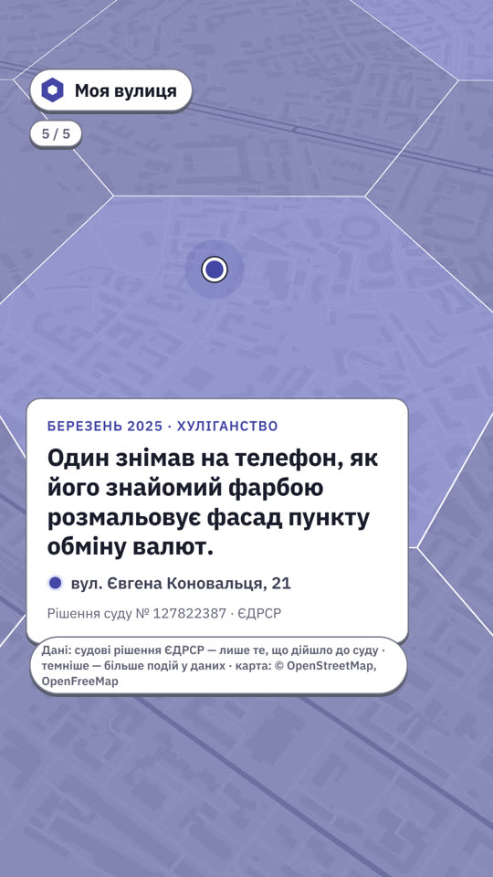
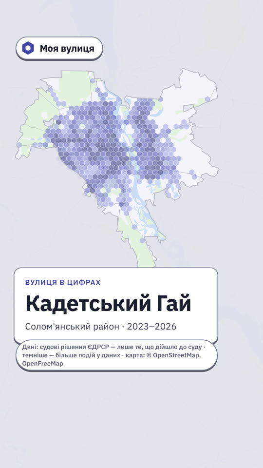
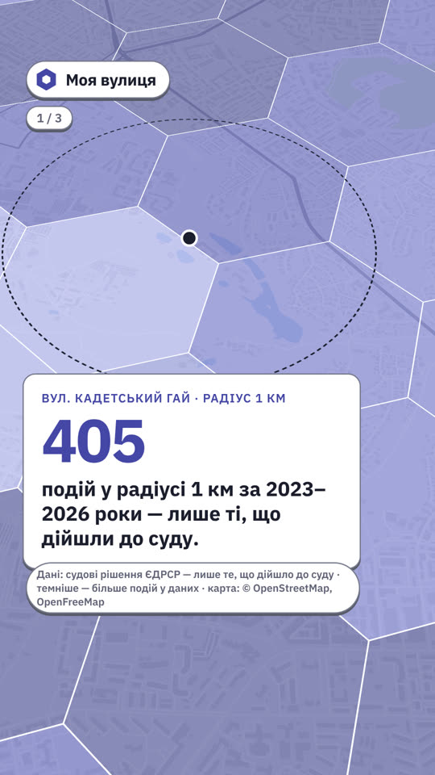
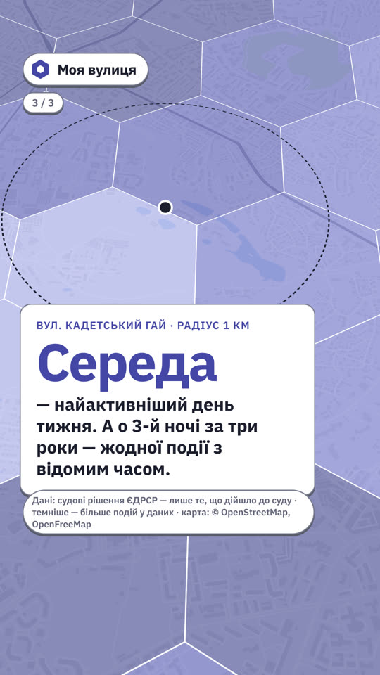

# Ролики й соцмережі: скільки, які, рушій, автоматизація, сторінки вулиць

ZAVDANNYA-78, 16.11.2026, за MV-91. Дослідження й перевірка рушія; продукт не змінювався.
Основа — [`PLAN-REKLAMY-I-ZAPUSKU.md`](PLAN-REKLAMY-I-ZAPUSKU.md), MV-91, `AGENTS.md` розд. 4–5, 8.
Позначка **«порада»** — думка виконавця, не рішення. **«Не перевірено»** — взято з чужих джерел, самі не пробували.

---

## Висновок — головне за хвилину

1. **Один ролик на день** в усі чотири мережі разом (TikTok, Instagram Reels, YouTube Shorts, Facebook Reels) — це
   **≈ 30 унікальних роликів на місяць** і **≈ 40 на запуск** (місяць наперед + запас). Більше на старті не треба:
   за даними Buffer (11,4 млн дописів TikTok), головний приріст переглядів дає перехід від «раз на тиждень» до 2–5
   на тиждень; далі приріст малий. Той самий ролик у різні мережі — можна, якщо файл чистий, без чужого водяного знака.
2. **Telegram — 10 районних каналів, по одній історії на день у кожному = ≈ 300 дописів на місяць.** Це найбільший
   обсяг і найлегший для автоматизації (бот публікує сам, без схвалень). Історій вистачить на роки — вузьке місце не
   дані, а переказ ШІ й перевірка людиною.
3. **Каталог — 20 типів роликів і 8 типів дописів** (розд. 2). 13 типів роликів збираються з бази автоматично;
   3 — частково; 4 — разові або вручну. Рейтингів районів, страшилок і прогнозів у каталозі немає.
4. **Рушій `video/` працює**: у хмарі зібрано всі три шаблони з підкладкою, ролик 30 с — **≈ 3,5 хв** на
   4 ядрах без відеокарти. Вигляд чистий, правила (номер рішення, «лише те, що дійшло до суду», без номера будинку)
   на кожному кадрі. **Головні вади:** немає звуку; на підкладці **немає назв вулиць** — глядач не впізнає місце;
   соти на великому зумі заливають усе фіолетовим; рядок джерела налазить на картку; немає генератора з бази.
   Відеокарта не потрібна: місяць роликів (30 шт.) — ≈ 2 год на одному сервері.
5. **Звук:** безкоштовний синтезований голос Piper (українська «Лада») розбірливий, але звучить як робот —
   для перших тестів годиться. Для запуску — платний хмарний голос (Azure, Google, ElevenLabs): ≈ 400 знаків на
   ролик, тобто місяць озвучки — копійки–кілька доларів. **Музику генеруємо самі** — без чужих прав (зразок зроблено).
6. **Автопостинг:** Telegram — так, одразу. YouTube, Facebook, Instagram — так, але потрібні застосунок розробника
   на Микиту, бізнес-акаунти й перевірка (YouTube — аудит, інакше всі ролики «приватні»; Meta — перевірка застосунку
   й бізнесу). **TikTok — найважче:** до схвалення застосунку можна публікувати лише в приватний акаунт; до того —
   ролики туди ставить людина вручну або через вбудований розклад TikTok.
7. **Сторінки вулиць для Google:** головне — домен і Search Console (без них нічого), картинка для поширення,
   справжні сторінки районів, одна людська історія на сторінці, щомісячне оновлення дати й чисел. Тонкі сторінки
   (1–2 події) уже не йдуть у пошук — це правильно.
8. **План робіт — 10 кроків** (розд. 6): найперше — назви вулиць і менше соти на підкладці, звук, генератор
   сценаріїв з бази, Telegram-бот. Разом ≈ 6–8 завдань виконавцю.

---

## 1. Скільки роликів

### 1.1. Що кажуть джерела

| Мережа | Скільки на новому акаунті | Довжина | Звідки |
|---|---|---|---|
| **TikTok** | 2–5 на тиждень дає +17 % переглядів на ролик проти «раз на тиждень»; 6–10 — +29 %; 11+ — +34 %. Медіана переглядів (≈ 500) майже не росте — частота піднімає «стелю» вдалих роликів. Блоги переказують пораду самого TikTok «1–4 на день» — офіційної сторінки не знайшов | ролики до 10 хв (з телефону) і до 60 хв (завантаження); блоги: найкраще — до 1 хв | Buffer, 11,4 млн дописів, жовт. 2025 [1]; [2] |
| **Instagram Reels** | частіше постиш — більше нових підписників (Buffer, 2,1 млн дописів); охоплення одного допису з частотою падає. Reels мають на 36 % більше охоплення, ніж каруселі; каруселі — на 12 % більше реакцій | у застосунку до 3 хв (з січня 2025); через програмний інтерфейс Meta для розкладу — 3–90 с (не перевірено) | Buffer [3], [4]; [5] |
| **YouTube Shorts** | окремих даних не знайшов; правило те саме — сталість важливіша за обсяг | до 3 хв (з 15.10.2024), вертикальні або квадратні | YouTube, жовт. 2024 [6] |
| **Facebook Reels** | окремих даних не знайшов | 9:16, 1080×1920 рекомендовано | Meta [7] |

**Той самий ролик в усі мережі — можна, з однією умовою:** Instagram з 2021 р. показує менше ролики з водяним
знаком TikTok, з рамками й розмитих [8]. Наш рушій робить чистий файл без чужих знаків — його й вантажимо всюди.
Порада: різні підписи й хештеги на кожну мережу; перші 1–2 с — гачок (питання або число), бо в стрічці гортають швидко.

**Як часто повторювати тип.** Даних немає; порада — не два однакові типи поспіль і не більше 2 разів на тиждень на
тип, крім «Вгадай» і «Однієї історії» (вони дешеві й найкраще підходять для серій).

### 1.2. Розрахунок (порада)

**Короткі ролики (одні на 4 мережі): 1 на день = 7 на тиждень = ≈ 30 на місяць.** Це в межах «6–10 на тиждень»
Buffer, а автоматизація робить це посильним без людини щодня.

| Тиждень (7 місць) | Тип |
|---|---|
| 2 | «Вгадай, де це було» (гра) |
| 2 | «Одна вулиця — одна історія» |
| 1 | «Тур району» |
| 1 | «Вулиця в цифрах» |
| 1 | змінний: «Судові абсурди», «Що нового за місяць», «Звіт адреси», «Підписка», ігри «Яка з двох», «Вгадай число» |

| | На запуск | На місяць |
|---|---|---|
| «Вгадай» | 10 | 8 |
| «Одна історія» | 10 | 8 |
| «Тур району» | 5 (по одному на 5 районів) | 4 |
| «Вулиця в цифрах» | 5 | 4 |
| змінні (абсурди, ігри, звіт, підписка, «що нового») | 8 | 6 |
| «Як це працює / звідки дані» (довіра) | 2 | — |
| **Разом коротких** | **40** | **≈ 30** |
| YouTube довгий 16:9, 3–5 хв («Тур району» повний, «Твій район») | 1 | 1 |

Запуск = 4 тижні наперед + запас 10 на випадок, якщо частину відкине людина при перегляді.

**Telegram (MV-91 — окремий канал на кожен з 10 районів Києва):**

| Що | Як часто | На місяць (10 каналів) |
|---|---|---|
| Історія з рішення (вулиця без номера, номер рішення) | щодня | ≈ 300 |
| Опитування «Вгадай» (вбудована вікторина Telegram) | 1 на тиждень | ≈ 40 |
| «Місяць району»: скільки подій за видами — з місячного випуску (MV-37) | раз на місяць | 10 |
| Той самий короткий ролик району (якщо є) | коли є | ≈ 4–10 |

Чи вистачить історій: у сотах роликів — 71 698 подій Києва з точкою (випуск 08.11; повна база буде більшою), тобто
в середньому ≈ 7 тис. на район. Навіть якщо придатних для розповіді «цікавих» лише 5 %, це ≈ 350 на район — рік
щоденних дописів. Вузьке місце — переказ ШІ й перевірка людиною (як MV-88: перші 50 — людина).
Порада для старту: 14 днів наперед × 10 каналів = **140 історій**, перші 50 читає людина.

**Facebook-сторінка:** щодня той самий короткий ролик (автоматично) + 2–3 картки на тиждень («Історія з рішення»,
«Вулиця в цифрах»). Районні групи — лише вручну, за правилами кожної групи (боти туди не ходять).
**Instagram-дописи:** Reels щодня (той самий), карусель 2 на тиждень, сторіз «Вгадай» щодня (готовий шаблон `brend/`).

**Разом на місяць:** ≈ 30 коротких роликів + 1 довгий + ≈ 350 дописів Telegram + ≈ 10 карток + ≈ 8 каруселей +
≈ 30 сторіз. Вручну це неможливо — тому все нижче будується довкола генератора з бази.

---

## 2. Каталог сценаріїв

Мета: **З** — звіт адреси, **П** — підписка, **Г** — гра, **В** — впізнаваність.
«Авто» — чи можна збирати з бази без людини: **так** / **частково** (потрібен вибір або текст) / **ні**.
Приклади — на справжніх даних з колоди 08.11 і пробного звіту (вулиця без номера будинку, MV-25; номер рішення —
у кадрі, MV-60). Числа прикладів **перерахувати на повній базі** перед публікацією.

### 2.1. Ролики (20)

| № | Назва | Мета | Що в кадрі й текст (приклад) | Дані | Авто | Довжина | Шаблон |
|---|---|---|---|---|---|---|---|
| 1 | **Вгадай, де це було** | Г | Місто згори → картка «Січень 2024 · Торгівля з рук. На вулиці з рук продавали синьо-жовті стрічки» → «Ваш варіант?» 3-2-1 → політ до точки: «вул. Хрещатик», рішення № 117399819 | колода «цікаві» (MV-29) | так | 20–30 с | `vhadai` є |
| 2 | **Тур району** | В, П | 5 зупинок Печерського району: «Електричний ендуро без номерів їхав дорогою, хоча поруч була велодоріжка…» — вул. Генерала Алмазова, № 116084498 | колода + межі районів | так (після меж районів) | 25–35 с | `tur` є |
| 3 | **Вулиця в цифрах** | З | Кадетський Гай: «89 % подій — про дороги», «середа — найактивніший день», «о 3-й ночі — жодної за три роки» | агрегати вулиці (як сторінка вулиці) | так | 20–25 с | `tsyfry` є, **перевести з «кола 1 км навколо будинку» на вулицю** (Б2 `ZVIRKA-LINII.md`) |
| 4 | **Одна вулиця — одна історія** | В | Одна точка, повільний обліт, переказ на 2–3 картки: «Неділя, 15:55. Тут продавали живу рибу без документів: 97 карасів по 80 грн за кілограм» — просп. Європейського Союзу, № 125436493 | колода + переказ ШІ (MV-21) | так | 15–20 с | новий, на основі `tur` з 1 точкою |
| 5 | **Судові абсурди** | В | «У магазині взяли батончик, жуйки й шоколад. Разом — 214,67 грн. Справа дійшла до суду» — бульв. Лесі Українки, № 128903549. Без глузування з людей — дивна сама ситуація | колода + оцінка «вражає» | частково (відбір — людина) | 15–25 с | як №4 |
| 6 | **Що нового за місяць** | П | «У жовтні в базі +N подій. Найбільше — ДТП, далі — …» → соти, що «засвітились» | місячний випуск (MV-37) | так | 15–20 с | новий: карта сот + 3 числа |
| 7 | **Твій район <рік>** | В, П | Найдивніша справа року, скільки подій за видами, **без порівняння з іншими районами** (MV-46) | річні агрегати району | так | 30–45 с (+ довгий 16:9) | новий: картки поверх району |
| 8 | **Що ти отримаєш у звіті адреси** | З | Прокрутка зразка звіту: табло, «Місця довкола», події двома шарами | зразок звіту (MV-10) | ні (разовий, після затвердження звіту MV-89) | 20–30 с | новий: запис сторінки звіту |
| 9 | **Підписка: стеж за своєю вулицею** | П | Карта з точками й адресами (розмита для неплатних), сповіщення «нова подія на вашій вулиці» | макет M9 | ні (разовий, після M9) | 15–20 с | новий: запис сторінки |
| 10 | **Порівняй дві адреси** | З | Дві вулиці поруч: які види подій, у які години — **«різні», а не «краща/гірша»** | агрегати двох вулиць | так | 20–30 с | новий: розділений кадр |
| 11 | **Яка з двох вулиць?** | Г | формат: «На якій вулиці в даних більше випадків торгівлі з рук за 2024: вулиця А чи вулиця Б?» → відповідь із числами (пару й числа бере генератор з бази; прикладу на даних немає) | агрегати; гра MV-12 | так | 15–20 с | новий, на основі `vhadai` |
| 12 | **Вгадай число** | Г | формат: «Скільки ДТП дійшло до суду на вул. Кадетський Гай за 2025?» → пауза → число (число — з бази, у пробному звіті його немає) | агрегати вулиці; гра MV-12 | так | 12–15 с | новий, на основі `tsyfry` |
| 13 | **Що раніше?** | Г | Дві події на одній вулиці — яка сталася раніше | колода | так | 15–20 с | новий, на основі `vhadai` |
| 14 | **Одне місце — багато подій (проблемна зона)** | П, З | «На цій ділянці в даних — N випадків керування напідпитку за 3 роки». Головна ідея продукту «подія ≠ проблема»; **без причин** («тут небезпечно» — ні) | проблемні зони (MV-36) | так (після шару проблем) | 20–25 с | новий: точки з'являються одна за одною |
| 15 | **Місто за добу** | В | Соти Києва «дихають» по годинах: 00:00 → 23:00, підпис «коли події, що дійшли до суду» | агрегати сот за годиною | так | 15–20 с | новий: анімація сот |
| 16 | **Рік за 30 секунд** | В | Соти за місяцями року; підпис місяця | агрегати сот за місяцем | так | 30 с | новий: анімація сот |
| 17 | **Стара назва — нова історія** | В | Перейменовані вулиці: «колишня вулиця X → тепер Y. Що в даних судів за 3 роки» | довідник перейменувань (вже є в сайті) | так | 15–20 с | як №3 |
| 18 | **Перевір свою вулицю (відповідь на коментар)** | З, В | Коментатор назвав вулицю → «Вулиця в цифрах» саме для неї, відповіддю на коментар | агрегати вулиці | частково (людина вибирає коментар) | 15–20 с | `tsyfry` |
| 19 | **Звідки дані / як це працює** | В | ЄДРСР, «лише те, що дійшло до суду», «колір — більше даних, а не страшніше», «ми не рейтинг» | — | ні (разовий) | 30–45 с | вручну, рушієм |
| 20 | **Перевірили міф** | В | «Кажуть, на X завжди…» → що в даних | аналітика (MV-87) | ні (після перевірки гіпотез) | 30–45 с | пізніше |

**Свідомо не взято:** «найнебезпечніші вулиці/райони» в будь-якій формі, «топ районів», «де стане гірше», «куди не
ходити вночі», машинні «фото з місця», реконструкції з акторами, події з категорій MV-4 у безкоштовних роликах (лише
числом у загальних сумах), імена суддів і людей.

**Чим гра відрізняється від «ролика про гру».** №1, 11, 12, 13 — це реклама ігор MV-12; у кінці кожного —
«Більше — у грі», мітка `?dzherelo=`.

### 2.2. Дописи (8)

| № | Назва | Мета | Де | Що й текст (приклад) | Авто | Шаблон |
|---|---|---|---|---|---|---|
| Д1 | **Історія з рішення** | В, П | Telegram (районні), FB, IG | «О 15:15 у магазині людина взяла з прилавка худі розміру M за 1 199 грн і вийшла, не заплативши. вул. Антоновича · рішення № 128462180 · лише те, що дійшло до суду» | так | `brend` post-istoriya є |
| Д2 | **Вулиця в цифрах** (картка 1080×1350) | З | FB, IG, Telegram | 3 числа вулиці + «Звіт адреси — що це означає для вас» | так | `brend` post-tsyfry є (перевести з кола на вулицю) |
| Д3 | **Сторіз «Вгадай»** | Г | IG, FB | опис → «відповідь у грі» | так | `brend` storis-vhadai є |
| Д4 | **Вікторина в Telegram** | Г | Telegram | вбудоване опитування-вікторина: «Де продавали 97 карасів?» — 3 варіанти вулиць | так (бот, `sendPoll`) | новий |
| Д5 | **Місяць району** | П | Telegram (районні) | «Жовтень у Печерському районі: +N подій у даних. ДТП — N, торгівля з рук — N…» + посилання на карту | так | новий |
| Д6 | **Карусель «5 історій району»** | В | IG, FB | 5 карток Д1 одного району | так | на основі Д1 |
| Д7 | **Що нового в базі** | П | усі | «Оновили базу: +N рішень за жовтень, нові вулиці…» | так | новий |
| Д8 | **Подія дня** | Г | Telegram, FB | картка-результат гри «Подія дня» з кнопкою «Зіграти» | так | є в `site/hra/` |

---

## 3. Рушій `video/` — чесна оцінка

### 3.1. Що зроблено

У хмарі (4 ядра, без відеокарти, Chromium + програмний WebGL) зібрано по ролику з кожного шаблону **з підкладкою**
OpenFreeMap, кодом без змін (`python video/rendery.py <сценарій> --rezhym pidkladka`), плюс «Тур» у вигляді «схема»
для порівняння, плюс «Вгадай» зі звуком (розд. 3.3). Файли — **у хмарній сесії, `tmp/video/`** (у git не йдуть,
Release не створювали); знімки кадрів — [`docs/znimky-rolykiv-78/`](znimky-rolykiv-78/).

| Ролик | Довжина | Рендер | Файл |
|---|---|---|---|
| «Вгадай, де це було» (підкладка) | 30,0 с | 215 с | `tmp/video/vhadai-pidkladka.mp4` |
| те саме **зі звуком** (голос Piper «Лада» + власна музика) | 30,0 с | + 5 с | `tmp/video/vhadai-pidkladka-zvuk.mp4` |
| «Тур району: Печерськ» (підкладка) | 31,5 с | 324 с (паралельно з іншими задачами) | `tmp/video/tur-pechersk-pidkladka.mp4` |
| «Вулиця в цифрах: Кадетський Гай» (підкладка) | 23,5 с | 158 с | `tmp/video/vulytsia-kadetskyi-hai-pidkladka.mp4` |
| «Тур району: Печерськ» (схема, без мережі) | 31,5 с | 204 с | `tmp/video/tur-pechersk.mp4` |

**Знімки кадрів** (зменшено вдвічі; повний розмір — `tmp/video/znimky/` у хмарній сесії):

| | Кадр 1 | Кадр 2 | Кадр 3 |
|---|---|---|---|
| «Вгадай» |  |  |  |
| «Тур району» |  |  |  |
| «Вулиця в цифрах» |  |  |  |

### 3.2. Подивився очима — що добре, що міняти

**Добре:**
- Чистий впізнаваний стиль «Індиго й м'ята», великий читабельний шрифт IBM Plex, картки з тінню-«клавішею».
- Правила вшиті: на кожному кадрі «Дані: судові рішення ЄДРСР — лише те, що дійшло до суду»; у кожній події —
  «Рішення суду № …»; номер будинку прибрано кодом (на кадрах — «вул. Цитадельна», «вул. Хрещатик»).
- Покадровий рендер: жодного смикання, результат не залежить від швидкості сервера.
- Політ камери дугою з нахилом — живо, як у турі карти Києва. Відлік «3-2-1» у «Вгадай» читається.
- Перевірка сценарію не пустить заборонені слова, імена, категорії MV-4, точку поза Києвом.

**Міняти (за важливістю):**
1. **На підкладці немає назв вулиць, площ, станцій метро.** На кадрі «Відповідь: вул. Хрещатик» глядач бачить
   фіолетові квартали й не впізнає місце — а впізнавання і є сенс «Вгадай» і «Туру». Додати шар підписів OpenFreeMap
   (шрифти вже підключено в режимі `pidkladka`) і 1–2 орієнтири (метро, Дніпро).
2. **Соти на великому зумі заливають усе фіолетовим** (прозорість 0,55, межі сот — білі лінії через увесь кадр).
   На зупинці соти треба гасити до ≈ 0,15 або ховати; соти — лише на загальному плані міста.
3. **Рядок джерела налазить на картку** (картка закінчується на ≈ 1 405 px, рядок починається на ≈ 1 395 px) і
   займає 3 рядки. Скоротити до одного: «Дані: ЄДРСР — лише те, що дійшло до суду · © OpenStreetMap».
4. **Безпечні зони мереж.** Нижні ≈ 20–25 % екрана в TikTok і Reels закриває підпис і кнопки, праві ≈ 120 px —
   кнопки «вподобати/поділитися» (орієнтовно, перевірити на телефоні). Зараз картка й рядок джерела — на 41–79 %
   висоти, тобто майже на межі. Підняти картку на ≈ 150 px, не ставити нічого важливого нижче 1 450 px.
5. **Вступ «Тур району» показує весь Київ**, район не виділено. Потрібні межі районів (OSM) і підсвітка району.
6. **Перші 1–2 секунди — без гачка.** Зараз ролик відкривається логотипом і заголовком. Порада: першим кадром —
   питання або число («Тут продавали 97 карасів. Де?»), логотип — у кінці.
7. **Кінцівка без адреси сайту й заклику:** «Карта подій Києва — скоро». Потрібні домен, «посилання в профілі» і
   мітка `?dzherelo=` в описі.
8. **«Вулиця в цифрах» досі рахує «коло 1 км навколо будинку»** (Б2 `ZVIRKA-LINII.md`) — перевести на вулицю, як
   сторінка вулиці; номер будинку з центру — прибрати.
9. **Номер будинку для публічного місця.** У «Турі» на кадрі — «вул. Євгена Коновальця, 21» (пункт обміну валют,
   `typ_mistsia: zaklad`): так дозволяє MV-60, а `AGENTS.md` розд. 8 коротко каже «вулиця без номера будинку
   (MV-25)». Це не помилка коду, але центральному чату варто звірити формулювання в `AGENTS.md` з MV-60.
10. Точка події — тільки кружечок; можна додати коротку «пульсацію» й тінь — дрібниця.

### 3.3. Звук

| Варіант | Якість (перевірено?) | Ціна | Порада |
|---|---|---|---|
| **Piper** (вільний, офлайн, на сервері), голоси `uk_UA`: «Лада» (x_low), «Тетяна», «Микита», «Лада» (medium-модель `ukrainian_tts`) | **перевірено:** розпізнавач мови Whisper (small) з голосу «Лада» відновив речення майже дослівно («…з рук продавали синю Жов'ї стрічки. Де це було?» — «синьо-жовті» поплило); «Тетяна» ковтає перші звуки («Січень» → «І чень»). На слух — рівний «роботичний» голос, 16 кГц у x_low | 0 | для внутрішніх тестів і як запасний варіант |
| **robinhad/ukrainian-tts** (ESPnet, 5 голосів), **tts_uk** (RAD-TTS++, Тетяна/Лада/Микита) [15] | не перевірено; за описами — кращі за Piper, теж безкоштовні й офлайн | 0 | спробувати першим кроком завдання «звук» |
| **Azure AI Speech**, голоси uk-UA «Поліна» й «Остап» (нейронні) [16] | не перевірено; індустріальний рівень | ≈ 15 $ за 1 млн знаків (за сторонніми даними; офіційна сторінка не показала ціну) | **порада для запуску:** ролик ≈ 400 знаків → 30 роликів ≈ 12 тис. знаків/міс ≈ 0,2 $; є безкоштовний обсяг (не перевірено) |
| **Google Cloud TTS** (Chirp 3: HD) | не перевірено; чи є українська в Chirp 3 HD — не підтверджено | 30 $ за 1 млн знаків [17] | запасний |
| **ElevenLabs** | не перевірено; найвиразніші голоси за відгуками | підписка ≈ 5–22 $/міс (не перевірено) | якщо Azure звучить сухо |
| **Живий голос Микити** | — | час Микити | лише якщо сам захоче (MV-24); не масштабується до 30/міс |

**Позначка ШІ:** звичайний синтезований голос диктора, що не імітує реальну людину, позначки «синтетичний вміст»
у YouTube і TikTok не вимагає [11]; клонувати голос реальної людини — ні.
**Наголоси й числа:** синтезатори плутають наголоси в назвах вулиць і читають «214,67 грн» дивно. Генератор має
готувати окремий «текст для голосу» (числа словами, складні назви — з наголосом), перевірка — на перших 50.

**Музика.** Без чужих прав — генеруємо самі. У зразку: тихий акорд із синусоїд з повільною «хвилею» гучності,
зроблений `ffmpeg` (≈ −34 дБ середньої гучності проти −17 дБ голосу — фон не заважає). Для кращого — 5–10 власних
коротких петель (набір згенерувати один раз; бібліотеки «без авторських прав» мають умови ліцензій, які треба
читати, і ризик скарг Content ID — краще своє). Вбудовані трендові звуки TikTok через програмний інтерфейс не
додаються — лише вручну.

### 3.4. Генератор сценаріїв з бази (сотні одним запуском)

Зараз сценарії JSON пишуться вручну. Потрібен `video/heneruvaty.py`:

```
python video/heneruvaty.py <events.db> --typ vhadai --skilky 10 --rayon Печерський --vykhid video/stsenarii/avto/
```

- **Відбір:** «цікаві» з колоди (`dani-edrsr/src/koloda.py --tsikavi`, MV-29), без MV-4, межа одного виду 15 %,
  без повторів події за останні 90 днів (журнал використаних).
- **Текст:** переказ ШІ один раз на подію (MV-21, `vytiah_shi.py`), збережений у базі; генератор лише бере готовий.
  Для голосу — окремий текст (числа словами).
- **Агрегати** для «Вулиці в цифрах», «Яка з двох», «Вгадай число», «Що нового» — з тих самих функцій, що
  сторінки вулиць (`site/sait/dani.py`), щоб числа в ролику й на сайті збігались.
- **Вихід:** JSON-сценарій + текст для голосу + підпис для кожної мережі + посилання з `?dzherelo=`.
  Далі — та сама перевірка правил, рендер, звук, пачка «на перегляд».

### 3.5. Швидкість і де рендерити

- Тут: ролик 30 с — **≈ 3,5 хв** на 4 ядрах (без відеокарти; ZVIT-11 на ПК — 5,5–10 хв). Процесор при цьому
  зайнятий мало (за `time` ≈ 52 с роботи процесора на 219 с рендеру) — головне чекання на домальовування карти,
  тож кілька роликів паралельно мають іти майже без втрат (не перевірено).
- **Місяць (≈ 30 коротких + 1 довгий) ≈ 2 год на одному 4-ядерному сервері** — уночі, раз на тиждень. Запуск
  (40) — ≈ 2,5 год. **Відеокарта не потрібна.**
- «Сотні одним запуском» (300 роликів, напр., «Вгадай» для всіх вулиць) ≈ 17 год на 4 ядрах або ≈ 4 год на
  16-ядерному сервері погодинно (Hetzner CCX, ціна — у Микити). Пришвидшити вдвічі можна, рендерячи 540×960 з
  масштабом ×2 — перевірити якість.
- Підкладка тягне плитки з `tiles.openfreemap.org` — для сотень роликів краще покласти свою копію плиток Києва на
  сервер (файл PMTiles), щоб не залежати від чужого сервера.

### 3.6. Формати й субтитри

- **9:16 (1080×1920)** — є: TikTok, Reels, Shorts, Facebook Reels, сторіз.
- **1:1 (1080×1080) і 4:5 (1080×1350)** — для стрічки Facebook/Instagram: кадр задається у `rendery.py` і
  `stsena.css`; треба параметр `--format` і інший відступ картки. Невелике завдання.
- **16:9 (1920×1080)** — довгий YouTube і вбудовування на сторінки районів: картка збоку, а не знизу.
- **Субтитри.** Текст і так у кадрі, але для голосу потрібні субтитри: генератор знає текст і час кожної репліки →
  пише файл `.srt` (YouTube, Facebook приймають окремим файлом) і, для TikTok/Reels, «впалює» короткі рядки в кадр
  тим самим рушієм. Розпізнавання мови не потрібне.

---

## 4. Автоматичний постинг — що дозволяє кожна мережа

**Схема (порада).** Сервер партнера (той самий Hetzner або окремий дешевий) раз на тиждень за розкладом:
1. бере новий випуск бази → генератор (розд. 3.4) робить пачку: ролики, картки, тексти Telegram;
2. перевірка правил (`video/perevirka.py`, `brend/zrobyty.py`) відкидає порушення;
3. пачка лягає в теку «на перегляд» + коротка сторінка-прев'ю; людина (Микита або найнятий) за потреби
   відкидає окремі одиниці; **без дії людини за 24 год — пачка йде як є** (або навпаки, «лише після перегляду» —
   вибір Андрія; порада: перші 4 тижні — лише після перегляду, як MV-88);
4. щогодинна задача публікує те, чий час настав, у кожну мережу через її офіційний програмний інтерфейс;
5. журнал: що, куди, коли, посилання на допис, помилка. Мітка `?dzherelo=<мережа>` у кожному посиланні (MV-5).

Ключі й токени — **лише змінні середовища на сервері** (`AGENTS.md` розд. 13), не в репозиторії.
Андрій нічого не натискає і не має доступу до акаунтів (`docs/02-pravo.md` розд. 6).

| Мережа | Можна автоматично? | Умови й ліміти | Ризик | Що робить Микита |
|---|---|---|---|---|
| **Telegram** (10 районних каналів) | **так, одразу** | бот (BotFather) — адміністратор каналу з правом публікувати; текст, фото, відео до 50 МБ через звичайний Bot API; вікторини `sendPoll`. Ліміт для груп — 20 повідомлень/хв, для каналів — за неофіційними даними так само [9]; нам треба ≈ 12 на день | низький; при перевищенні — помилка 429, бот чекає | створити 10 каналів і бота, додати бота адміністратором, дати токен у змінну на сервері |
| **YouTube** (Shorts і довгі) | **так, після аудиту** | YouTube Data API, `videos.insert`. **Без аудиту проєкту Google всі завантажені ролики — лише «приватні»**, оскарження нема [10]. Ліміт: раніше 1 600 одиниць з 10 000 на добу (≈ 6 роликів), з червня 2026, за непідтвердженими даними, — окремий кошик ≈ 100 завантажень на добу [10] — перевірити в консолі. Ролик до 3 хв, вертикальний = Shorts. Позначка «змінений або синтетичний вміст» — потрібна для реалістичних підробок, **звичайний синтезований голос диктора її не вимагає** [11] | середній: аудит може тривати тижні; до аудиту — завантаження вручну з телефону або «YouTube Studio» з розкладом | акаунт Google (пошта MV-24), канал, проєкт у Google Cloud, екран згоди OAuth, подати аудит; один раз увійти, щоб сервер отримав ключ оновлення |
| **Facebook-сторінка** (Reels і дописи) | **так, після перевірки застосунку** | Graph API `/{page_id}/video_reels`; дозволи `pages_show_list`, `pages_read_engagement`, `pages_manage_posts`; 9:16, 1080×1920; **30 Reels на добу** [7]. Для власної сторінки розробника часто вистачає стандартного доступу; перевірка застосунку й бізнесу — дні–тижні (не перевірено) | середній | бізнес-портфоліо Meta (Business Manager), сторінка, застосунок розробника, перевірка бізнесу; токен сторінки в змінну |
| **Instagram** (Reels, каруселі, сторіз) | **так, для професійного акаунта** | Content Publishing API; лише бізнес- або творчий акаунт, прив'язаний до сторінки Facebook; **50 дописів на добу** (в одному місці документації — 100) [12]; сторіз — лише бізнес-акаунт [12]; Reels через інтерфейс — за даними третьої сторони 3–90 с (не перевірено) | середній; ролики з чужим водяним знаком показуються менше [8] | перевести Instagram у бізнес-акаунт, прив'язати до сторінки Facebook, той самий застосунок Meta |
| **TikTok** | **лише після схвалення застосунку** | Content Posting API. **До аудиту: публікація лише в приватний акаунт** (помилка `unaudited_client_can_only_post_to_private_accounts`), до 5 користувачів на добу [13]. Аудит — за сторонніми даними 2–6 тижнів, перевіряють, що застосунок для широкого кола людей і має обов'язковий екран публікації [13] — **для нашого «внутрішнього» бота аудит можуть не дати** | **високий** | бізнес-акаунт TikTok; застосунок на developers.tiktok.com; подати аудит. **До схвалення — людина ставить ролики вручну** (з телефону або вбудованим розкладом TikTok Studio у браузері — 10 хв на тиждень) |

**Що видно до схвалень:** Telegram — усе; YouTube — ролики є, але приватні (тобто нікому не видно); Facebook і
Instagram — працює на власних сторінках розробника; TikTok — лише приватний акаунт. Тому **перші тижні — гібрид:**
Telegram автоматично, решта — пачка готових файлів з текстами, людина ставить у вбудований розклад кожної мережі
(це і є варіант «А» з `PLAN-REKLAMY-I-ZAPUSKU.md`).

**Готові сервіси-посередники** (Buffer, Later, Ayrshare, Postiz тощо) мають уже схвалені застосунки й публікують
у всі мережі одним запитом — платно (≈ 10–50 $/міс, не перевірено) і з ризиком залежності. Порада: якщо аудит TikTok
або YouTube затягнеться — тимчасово через посередника, з тими ж ключами лише на сервері.

**Ризик блокування — як зменшити:** один ролик на день, а не 20 за годину; різні підписи; без купівлі
підписників і «накрутки»; відповідати на коментарі (людина); без масових розсилок у чужі групи; позначка ШІ там,
де вимагає мережа.

---

## 5. Сторінки вулиць для Google

Що вже є (`site/zibraty_sait.py`): 1 588 сторінок, заголовок і опис з числом подій, canonical, `Place` з schema.org,
хлібні крихти, «Інші вулиці району», `noindex` для вулиць з 1–2 подіями, `sitemap.xml` з датою випуску, `robots.txt`,
переадресації зі старих назв. **Описів справ на сторінках немає** — так і лишається (розд. 8 `AGENTS.md`). Адреси будинків —
з MV-99/MV-100 є: окремі сторінки будинків, події там лише числом (зроблено в ZAVDANNYA-85, як і п. 4, 6, 9, 11, 13 нижче; п. 2 і 8 — у ZAVDANNYA-88: картинка лише з назвою й числами, без сот, і рядок «Оновлено» з дати випуску).

**Головний ризик:** Google з березня 2024 карає «масово згенеровані сторінки без користі» (scaled content abuse) —
зокрема шаблонні сторінки, що відрізняються лише назвою місця [14]. Наші сторінки відрізняються даними (роки, дні,
години, види), але текст на них шаблонний. Тому кожен пункт нижче — про **унікальну користь** сторінки.

| № | Що зробити | Навіщо | Складність |
|---|---|---|---|
| 1 | **Домен + Search Console + Bing Webmaster**, подати `sitemap.xml` (на Микиті, MV-23) | без цього Google не знає про сайт; видно, які сторінки в індексі й за якими запитами | Микита, 1 вечір |
| 2 | **Картинка для поширення** (`og:image`, `twitter:card`) — картка вулиці 1200×630: назва, соти вулиці, 3 числа; генерується тим самим кодом, що й картки `brend/` | посилання в Telegram, Facebook, Viber з прев'ю — у рази більше переходів | 1 завдання |
| 3 | **Заголовок під запит людей:** зараз «<вулиця>, Київ — N подій за 2024–2026 у даних судів». Порада: «<вулиця>, Київ: що відбувалося — N подій з судових рішень 2024–2026». Перевірити в Search Console через 1–2 місяці й підправити | люди шукають «вулиця X Київ що там», «район X відгуки»; слово «події» нечасте в запитах | малий |
| 4 | **Один абзац людською мовою** на початку: «На вулиці X за 2024–2026 у даних судів — N подій. Найчастіше — ДТП (N) і торгівля з рук (N); частіше, ніж у середньому по Києву, — …» — з чисел, без вигадок (MV-21) | унікальний текст на кожній сторінці замість лише таблиць; саме його Google показує в результатах | генератор тексту з чисел, 1 завдання |
| 5 | **Одна історія з вулиці** (вже є місце, «чернетка, перепише ШІ», MV-27): вулиця без номера будинку, номер рішення; не з категорій MV-4 | живий зміст; та сама історія — для Telegram і роликів | з генератором переказу |
| 6 | **Сторінки районів** (10): числа району, види, «вулиці району з найбільшою кількістю даних» — **як покажчик, не рейтинг** (колір = кількість даних), посилання на всі вулиці району, ролик «Тур району» вбудовано | запити «Печерський район Київ», внутрішні посилання, вхід із роликів | 1 завдання |
| 7 | **Сторінки видів подій** по місту («ДТП у Києві за даними судів», «торгівля з рук…»), з посиланнями на вулиці | ще один вхід із пошуку; лише суми, без адрес | 1 завдання, пізніше |
| 8 | **Оновлення щомісяця**: перезбирання з випуском (MV-37), `lastmod` у sitemap — дата випуску, рядок «Оновлено: листопад 2026» на сторінці; змінювати дату лише там, де числа змінились | Google частіше обходить сторінки, що реально змінюються; фальшива дата шкодить | малий |
| 9 | **Внутрішні посилання:** «сусідні вулиці» — за географією (уже є за районом), «вулиці з такими ж видами подій», посилання з карти й гри на вулицю, з кожного ролика — на сторінку вулиці (опис ролика) | Google знаходить усі 1 588 сторінок не лише з sitemap | малий |
| 10 | **Швидкість:** сторінка вулиці без карти MapLibre (лише статична картинка вулиці або SVG сот), шрифти вже свої й з `preload`; виміряти PageSpeed після публікації; ціль — завантаження < 2,5 с на телефоні | понад 3 с — половина людей іде (`DOSLIDZHENNIA-VYHLIADU.md` Г.6) | перевірити після публікації |
| 11 | **Хлібні крихти й `Place`** уже є; у schema.org додати `BreadcrumbList` (зараз немає) і `dateModified` | гарніший вигляд у результатах | малий |
| 12 | **Без спливних вікон** при вході з Google; «у підписці» — тиха кнопка з ціною внизу (`ZVIRKA-LINII.md` В1) | Google знижує сторінки з нав'язливими вікнами | малий |
| 13 | **Сторінки «Про дані», «Хто ми», «Як прибрати подію»** — уже в боргу перед публікацією | довіра (E-E-A-T у термінах Google) і ст. 302 ЦК | 1 завдання |

Сторінки вулиць і ролики підсилюють одне одного: опис кожного ролика — з посиланням на сторінку вулиці/району,
а на сторінці — вбудований ролик (коли буде YouTube-канал).

---

## 6. План робіт по кроках

Кожен крок — окреме завдання виконавцю після «так» Андрія (MV-31); кожен новий тип ролика — спершу дешевий макет
(кілька кадрів) Андрію. Оцінка — у завданнях одного виконавця, вечорами.

| № | Що | Хто | Залежить від | Оцінка |
|---|---|---|---|---|
| 1 | **Рушій: вигляд.** Назви вулиць і орієнтири на підкладці; соти гаснуть на зупинці; рядок джерела в один рядок; безпечні зони (картка вище); гачок у перші 2 с; кінцівка з доменом; «Вулиця в цифрах» — по вулиці, не по колу; межі й підсвітка районів | виконавець | — | 1 завдання |
| 2 | **Звук.** Порівняти на слух 3 голоси (Piper/`tts_uk`, Azure «Поліна»/«Остап», ElevenLabs) на 5 однакових текстах → Андрій вибирає; «текст для голосу» (числа словами, наголоси); 5–10 власних музичних петель; зведення голос+музика в `rendery.py`; субтитри `.srt` | виконавець; ключ Azure — Микита | 1 (паралельно) | 1 завдання |
| 3 | **Формати** 1:1, 4:5, 16:9 (`--format`) | виконавець | 1 | ½ завдання |
| 4 | **Генератор сценаріїв з бази** (`video/heneruvaty.py`): типи 1–4, 6, 10–13, 15–17; журнал використаних подій; підписи для мереж з `?dzherelo=` | виконавець | переказ ШІ для колоди (MV-21), повна база Києва | 1–2 завдання |
| 5 | **Нові шаблони** «Одна історія», «Місто за добу», «Рік за 30 с», «Яка з двох», «Вгадай число», «Що нового» — спершу макети Андрію | виконавець | 1, 4 | 1–2 завдання |
| 6 | **Telegram-бот** + 10 районних каналів: розклад, історії, вікторини, «Місяць району»; пачка на перегляд | код — виконавець; канали, бот, сервер — Микита | 4 (тексти), переказ ШІ | 1 завдання |
| 7 | **Пачка тижня на сервері:** cron → генератор → перевірка → рендер → сторінка-прев'ю → публікація за розкладом; журнал | виконавець + Микита (сервер) | 2, 4, 6 | 1 завдання |
| 8 | **Акаунти й доступи (Микита):** пошта (MV-24) → YouTube + проєкт Google + аудит; Meta Business + сторінка + Instagram-бізнес + застосунок; TikTok бізнес + застосунок + аудит. До схвалень — ручне розміщення з пачки | Микита | домен (MV-23) | тижні очікування, паралельно з 1–7 |
| 9 | **Автопостинг YouTube, Facebook, Instagram, TikTok** — підключати кожну мережу, щойно її схвалено | виконавець | 7, 8 | по ½ завдання на мережу |
| 10 | **Сторінки вулиць для Google** (розд. 5, п. 2–13): картинка поширення, абзац людською мовою, історія, сторінки районів, `BreadcrumbList`, щомісячне оновлення | виконавець; домен і Search Console — Микита | повна база, публікація сайту | 1–2 завдання |

**Порядок (порада):** 1 і 2 паралельно → 4 → 6 (Telegram — найшвидший результат без схвалень) → 5 → 7 → 9;
8 Микита починає одразу, бо схвалення найдовші; 10 — разом із публікацією сайту.
**Перший видимий результат:** 10 районних каналів Telegram з щоденними історіями + 40 роликів у пачці для ручного
розміщення — після кроків 1, 2, 4, 6.

---

## Що не перевірено

- Ліміти й умови програмних інтерфейсів мереж — з документації й сторонніх оглядів станом на листопад 2026; самі не
  підключали. Нова квота YouTube (червень 2026) — лише зі сторонніх джерел. Чи дасть TikTok аудит застосунку для
  власного акаунта — не відомо.
- Ціни голосу Azure й ElevenLabs — зі сторонніх джерел; українські голоси Google Chirp 3 HD — не підтверджено.
- Якість голосу Piper оцінено розпізнавачем мови й за формою звуку; **людина не слухала** — Андрію послухати зразок.
- Безпечні зони TikTok/Reels — орієнтовні; перевірити, переглянувши ролик на телефоні.
- Паралельний рендер кількох роликів на одному сервері — не пробував.
- Скільки «цікавих» подій у кожному районі на повній базі — не рахував (база в `dani-edrsr`, повна — ≈ 20.11).
- Поради щодо частоти — з загальних досліджень (Buffer), не для українських акаунтів і не для нашої теми.

## Джерела

1. Buffer, «How Often Should You Post on TikTok» (11,4 млн дописів, 150 тис. акаунтів, 08.10.2025) —
   https://buffer.com/resources/how-often-should-you-post-on-tiktok/ ; огляд — https://www.searchenginejournal.com/study-shows-2-5-weekly-tiktoks-deliver-biggest-view-increase/558641/
2. Переказ поради TikTok «1–4 на день» (сторонні блоги) — https://joinbrands.com/blog/how-often-to-post-on-tiktok/
3. Buffer, «How Often Should You Post on Instagram» (2,1 млн дописів) — https://buffer.com/resources/how-often-to-post-on-instagram/
4. Buffer, «The State of Social Media Engagement» (52 млн дописів) — https://buffer.com/resources/state-of-social-media-engagement/
5. Instagram Reels до 3 хв — https://learn.headliner.app/hc/en-us/articles/34164986965271-Social-Media-Video-Length-Limits-2025 ; https://sproutsocial.com/insights/social-media-video-specs-guide/
6. YouTube Shorts до 3 хв (з 15.10.2024) — https://techcrunch.com/2024/10/03/youtube-takes-on-tiktok-with-longer-shorts-templates-trends-and-more ; https://9to5google.com/2024/10/03/youtube-shorts-3-minutes/
7. Meta, Reels Publishing API (дозволи, 9:16, 30 на добу) — https://developers.facebook.com/docs/video-api/guides/reels-publishing
8. Instagram показує менше ролики з водяним знаком TikTok (02.2021) — https://tubefilter.com/2021/02/10/instagram-reels-with-tiktok-watermark-less-discoverable/
9. Telegram Bots FAQ (ліміти) — https://core.telegram.org/bots/faq ; про канали — https://github.com/python-telegram-bot/python-telegram-bot/wiki/Avoiding-flood-limits
10. YouTube Data API `videos.insert` (неперевірені проєкти — лише приватні) — https://developers.google.com/youtube/v3/docs/videos/insert ; про квоти — https://www.ayrshare.com/solutions/how-to-bypass-the-youtube-10k-unit-limit-fixing-the-403-quota-exceeded-error/ ; https://singhamandeep.com/?p=1570
11. Позначка синтетичного вмісту YouTube і TikTok — https://www.engadget.com/youtube-lays-out-new-rules-for-realistic-ai-generated-videos-154248008.html ; https://blog.hootsuite.com/ai-disclosure-policy-for-tiktok/
12. Instagram Content Publishing (50 на добу, професійні акаунти) — https://developers.facebook.com/docs/instagram-platform/content-publishing/ ; https://developers.facebook.com/docs/instagram-platform/instagram-graph-api/reference/ig-user/content_publishing_limit
13. TikTok Content Posting API (до аудиту — лише приватні акаунти) — https://developers.tiktok.com/doc/content-posting-api-reference-direct-post ; про аудит — https://bundle.social/blog/tiktok-api-approval
14. Google, політика «scaled content abuse» (березень 2024) — https://www.seroundtable.com/google-march-2024-spam-updates-37002.html
15. Вільні українські синтезатори — https://pypi.org/project/ukrainian-tts/ ; https://pypi.org/project/tts-uk/ ; голоси Piper — https://huggingface.co/rhasspy/piper-voices
16. Azure AI Speech, ціни — https://azure.microsoft.com/pricing/details/cognitive-services/speech-services ; стороннє — https://cloudprice.net/models/azure/speech/azure-tts
17. Google Cloud Text-to-Speech, ціни — https://cloud.google.com/text-to-speech/pricing

