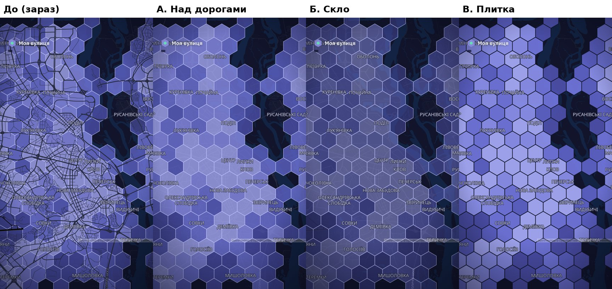

# Ролики: система — скільки, які, як виглядають, як міряємо (ZAVDANNYA-134)

Хмара, 19.11.2026. Основа — `docs/ROLYKY-TYPY.md` (В1–В8 обов'язкові), `docs/KOMPAS.md`, `docs/ROLYKY-DOSLIDZHENNIA-2026.md`,
`docs/ROLYKY-KONTSEPTSII.md`, `docs/ZVIT-129.md`, рушій `video/vau/`. Межі — `AGENTS.md` розд. 4 і 8, MV-147…MV-158.
Нічого не опубліковано.

**Позначки джерел:** **[В]** — сторінку відкрито й прочитано; **[П]** — лише переказ (пошукова видача, блог, сторонній огляд);
**[Н]** — наш висновок, не з джерела. Перевіряв ШІ-асистент вебпошуком 19.11.2026 — це не незалежна перевірка.

## 0. Висновки першими

<!-- розд. 0 дописується наприкінці -->

## 1. Скільки публікувати

### 1.1. Що кажуть джерела

| Що | Число | Джерело |
|---|---|---|
| Офіційна порада TikTok | «1–4 рази на день, щоб перевірити, як сприймають різні типи вмісту» | TikTok for Business, «Creative ultimate guide», **08.10.2021** — новішої офіційної цифри не знайдено [В] <https://ads.tiktok.com/business/en-US/blog/tiktok-creative-ultimate-guide> |
| Чи шкодить частота охопленню | 11,4 млн публікацій, 150 тис. акаунтів, кожен акаунт порівнюється сам із собою. Проти «1 на тиждень» перегляди на публікацію: 2–5/тиж — до **+17 %**, 6–10/тиж — до **+29 %**, 11+/тиж — до **+34 %**. Середній (медіанний) ролик майже не змінюється: 489 → 506 → 487 → 459; а верхні 10 % ростуть: 3 722 → 6 983 → 10 092 → **14 401** | Buffer, 08.10.2025 [В] <https://buffer.com/resources/how-often-should-you-post-on-tiktok/> |
| Скільки публікують бренди | 3–5 на тиждень «або скільки можете»; бізнеси в середньому 3,7/тиж (I кв. 2025) | Hootsuite, 18.04.2025 [В] <https://blog.hootsuite.com/how-often-to-post-on-social-media/> |
| Скільки публікують бренди (2025) | на місяць: 8 (1–5 тис. підписників) … 23 (100 тис.–1 млн); частота за рік зросла ≈ на 40 % | Socialinsider, 40,7 млн відео, 22.04.2026, оновл. 04.11.2026 [В] <https://www.socialinsider.io/blog/tiktok-engagement-report/> |
| Кілька акаунтів | Можна, «але не щоб обманювати»; вміст «неоригінальний або повторно використаний без нового» не потрапляє в стрічку «Для тебе» | Правила спільноти TikTok, «Integrity and Authenticity», чинні з 24.09.2026 [В] <https://www.tiktok.com/community-guidelines/en/integrity-authenticity> |
| YouTube Shorts | вертикальні до **3 хв** (з 15.10.2024); з 01.10.2026 рекомендації віддають перевагу оригінальним Shorts, перезаливи чужого — менше охоплення | YouTube Help [П] <https://support.google.com/youtube/answer/15424877>; Search Engine Journal, 01.10.2026 [В] <https://searchenginejournal.com/youtube-original-shorts-reposted-clips-reach/591774/> |
| Instagram Reels | свій логотип — можна; чужий знак (TikTok, CapCut) зменшує показ незнайомим; з 30.04.2026 акаунти, що здебільшого перепощують чуже, втрачають рекомендації | Social Media Today [П]; PetaPixel 30.04.2026 — сторінка не відкрилась (403), за переказами [П] |
| Facebook Reels | з 07.2025 акаунти, що повторюють чужий вміст, втрачають охоплення; свій вміст — ні | TechCrunch, 14.07.2025 [П] |
| Instagram / Facebook, частота | Instagram 3–5 на тиждень; Facebook 1–2 на день | Hootsuite, 2025 [В] |

### 1.2. Що з цього для нас [Н]

- **Частота не «з'їдає» охоплення** окремого ролика (Buffer): середній ролик дивляться так само, а частіші публікації дають
  більше шансів на «вистрілений». Для нового акаунта це головне — ми ще не знаємо, який тип вистрілить.
- **Старт — 1 ролик на день** у TikTok (30 на місяць). **Після 2 тижнів — до 2 на день**, якщо встигаємо робити без втрати
  якості (див. 1.3). 5 на день — ні: для нас вузьке місце не стрічка, а голос і перегляд Андрієм (MV-156, MV-158).
- **Один акаунт**, не кілька. Окремі акаунти районів чи ігор — лише коли формат уже доведено, і з **різними** роликами
  (той самий ролик на кількох своїх акаунтах = «повторний вміст»). Райони вже мають Telegram (компас, розд. 2).
- **Перевикористання:** той самий **чистий файл** (з рушія, без знака TikTok) — у YouTube Shorts та Instagram Reels того ж
  дня або наступного; Facebook Reels — лише «Історії з даних» і продуктові (аудиторія ОСББ, рієлторів). Це наш власний
  вміст, тож правила про «неоригінальне» його не зачіпають. Підпис — під кожну мережу свій (посилання, хештеги).
- **Місяць:** TikTok 30–45, Shorts 30–45 (ті самі), Reels 12–20 (вибрані, 3–5 на тиждень), Facebook 4–8.
  **Нових роликів на місяць — 30–45.**

### 1.3. Чи потягне рушій

| Що | Скільки | Звідки |
|---|---|---|
| Рендер на ПК (GTX 1650) | кадр ≈ 0,4 с → ролик 15 с ≈ 3 хв, 20 с ≈ 3–5 хв | `docs/ZVIT-127.md` |
| 45 роликів на місяць | ≈ 2–4 год рендеру на місяць (одна ніч) | [Н] з рядка вище |
| Хмара без відеокарти (SwiftShader) | кілька секунд на кадр → ролик 15 с ≈ 20–40 хв | `video/vau/README.md`; у цій сесії не заміряно |
| Голос | Андрій записує сам, потім перетворення (MV-156) — **вузьке місце** | [Н] |
| Перегляд | Андрій — «подобається / ні» (MV-158) | [Н] |

**Висновок [Н]:** рендер — не перешкода (одна ніч на ПК на місяць). Перешкода — голос. Тому в тесті **2 з 3 роликів — без
голосу** (музика, текст, удари: петлі, ігри, «Місто за N секунд»), голос — 2–3 ролики на тиждень, записані одним заходом.

## 2. Скільки й які типи

### 2.1. Що кажуть джерела

- **Тем-стовпів (pillars) одночасно — 3–5;** більше розмиває акаунт. Sprout Social, Brandwatch [П] — це правило практиків, не дослідження.
- **Серію судити не раніше ніж за ≈ 8 тижнів;** міняти гачки, а не серію. Ознаки, що працює: чекають наступну частину,
  згадують попередні, позначають друзів. Sked Social, 11.08.2026 [В] <https://skedsocial.com/blog/the-content-series-playbook-eight-weeks-one-idea-one-format>.
  Інший сервіс радить знімати серію після **4+ тижнів спаду** попри зміни [П].
- **Розважальне проти продажу — 80/20** (Brandwatch) або 70/20/10 (Measure Studio) [П] — правила практиків.
- Дослідження про те, як саме акаунти з картами й даними чергують формати, **не знайдено**. Числового правила «коли вбивати
  формат», заснованого на даних, — теж (див. ще `docs/ROLYKY-DOSLIDZHENNIA-2026.md`, розд. 6).

### 2.2. Наше правило [Н]

- **Стовпи — 4** (з семи груп компаса, MV-111): **Місто згори** (вау), **Ігри**, **Історії «під боком»**, **«Що болить вулиці»**
  (потреба → продукт). Решта груп («Як це працює», «Що буває за…», «Історії з даних») — рідше, раз на 1–2 тижні.
- **Типів у ротації одночасно — 6–8.** Чому: тип судимо після 5–6 публікацій (розд. 4.4); за 4 тижні по 7–10 роликів = 28–40
  публікацій → 6–8 типів по 5–6 разів. Більше — жоден не набере вибірки; менше — не знайдемо переможця.
- **Новий тип — лише на звільнене місце:** коли тип вбито або коли переможець має 3 варіанти поспіль, що тримають рівень.
  Плюс одне «дике місце» на тиждень для проби (1 ролик з нового типу).
- **Вбиваємо тип** після 5–6 публікацій, якщо медіана його переглядів **і** утримання на 3 с нижчі за медіану акаунта (розд. 4.4).
  Серії (Найдивніша справа, Вулиця тижня) — не раніше ніж за 6–8 тижнів, міняючи спершу гачок.
- **«Вау» проти «потреба → продукт» (В6):** **≈ 80 / 20** — з 7 роликів на тиждень 5–6 приводять (вау, ігри, історії),
  1–2 продають. Продуктовий ролик будується як В6: **спершу яскрава потреба** («Застава — завтра. Що ви знаєте про
  будинок?»), **потім продукт одним словом** («Довідка») і сторінка того самого місця. Поки немає справжніх довідки, ОСББ,
  Telegram і «Стежу» — продуктові ведуть на сторінку будинку/вулиці, а не на покупку (MV-151).

### 2.3. Що тестувати першими (з 15 затверджених і 46 концепцій)

Ротація тесту — **7 типів** (по 4–6 публікацій кожен за 4 тижні):

| # | Тип (реєстр) | Стовп | Чому в тесті | Голос |
|---|---|---|---|---|
| 1 | Місто за N секунд (t5, К-01) | Місто згори | найкоротший «вау», петля; знайомить із картою | ні |
| 2 | Сота розпадається (t1, К-02) | Місто згори | «вау», який описав Андрій | ні |
| 3 | Вгадай, де це було (t2, К-08) | Ігри | найдешевший двигун коментарів; колода подій готова | ні |
| 4 | Міф чи факт (n4, n5, К-35/36) | Ігри / Що буває за… | суперечка в коментарях, дані готові | так |
| 5 | Одна подія-петля (t3, К-16) | Історії | на ній міряємо гачки (3 варіанти гачка) | ні |
| 6 | Найдивніша справа тижня (n1, n2) | Історії | серія — повертає глядачів | ні |
| 7 | **Новий:** «POV: застава завтра» (К-25) | Що болить вулиці | перший справжній В6: потреба → сторінка будинку | так |

Запасні на звільнені місця: Знайди точку за 3 с (n3), Вгадай число (n8), Число з 1551 (t4 — з холодами, грудень–січень),
Відповідь на коментар (n6 — лише на справжній коментар), Запис сайту (z1, z2 — раз на 2 тижні, «Як це працює»).

### 2.4. Яких типів бракує — пропозиції

З переліку завдання (В3 адреси, В5 звіт, «Стежу», POV, тур, вулиця тижня, серії, рієлтор, ОСББ) і **власні** (позначено ★):

| Пропозиція | Що в кадрі | Вимога | Стовп → куди | Коли можна |
|---|---|---|---|---|
| **Адреса зблизька** | публічне місце з номером (ТЦ, ринок, станція): камера падає з міста до точки, події навколо вискакують, лічильник; житло — лише рівень вулиці | В3 | Що болить → сторінка місця | зараз |
| **POV: застава завтра** (К-25) | запис сайту: пошук адреси → сторінка будинку (скарги 1551 і події числом) | В6, В3 | Що болить → сторінка будинку | зараз |
| **Хтось читає звіт — і вау** | запис екрана справжньої довідки: палець гортає, наклейки-реакції на 2–3 числа | В5, В6 | Що болить → довідка | **після справжньої довідки** (MV-151) |
| **Вулиця тижня** (К-44), серія | проліт уздовж вулиці (рівень вулиці), 3 числа, частини 1/2/3 | В3, В7 | Історії → сторінка вулиці | зараз |
| **Тур району: 5 зупинок** (К-21) | 5 публічних місць району, по 2 с, лічильник | В3 | Історії → район | зараз |
| **Стежу за вулицею** (К-31) | сповіщення на телефоні → карта підписника | В6 | Мій район → підписка | **після «Стежу»** |
| **Рієлтор: «а що тут за будинок?»** (К-40) | поділений екран: питання клієнта · відповідь за хвилину | В6 | Рієлтор → 799 | після довідки; Facebook, Reels |
| **ОСББ: що болить будинку щомісяця** (К-41) | лист-звіт ОСББ, порівняння із сусідами числом | В5 | ОСББ → 1 490 | після зразка ОСББ; Facebook |
| ★ **День і ніч** | поділений екран: світла тема — події вдень, темна — вночі, на тій самій карті | В4, В2 | Місто згори → карта | зараз |
| ★ **Вгадай район за плиткою** | силует району із сот «плиткою» без назв, 3 варіанти, відлік | В1, В2 | Ігри → район | зараз |
| ★ **Карта з ваших коментарів** | збірка вулиць, які назвали в коментарях: переліт від однієї до іншої, по числу на кожну | В3, В7 | Що болить → сторінки вулиць | після перших коментарів |
| ★ **Календар року** | 365 клітинок на весь кадр, що заповнюються днями; пік — підпис «що було цього дня» | В2 (не карта) | Історії з даних → карта | зараз |
| ★ **Одне місце — 10 років** | публічне місце, рік за роком стовпчиками й точками, без прогнозу | В3 | Історії → сторінка місця | після повного Києва 10 років |
| ★ **Сота пояснює** (MV-148) | персонаж «Сота» показує, як рішення стає точкою (К-29) за 3 кроки | В2 | Як це працює → карта | зараз |

## 3. Різноманіття графіки (В1–В5)

### 3.1. «Мурашник» (В1): причина

Андрій: «соти виглядають як мурашник: видно вулиці, не видно прозорості, сота наче мурахами поїдена».

**Причина — порядок шарів, а не кольори.** `video/vau/stsena.js` ставив соти «перед першим шаром підписів»
(`pershyiSymvol`). Але в стилях OpenFreeMap (`dark`, `positron`) перший підпис — **назва води**, і вона стоїть у списку **до**
будинків і доріг. Тож будинки й дороги (на темній — темні лінії з непрозорістю 1) малювалися **поверх** сот і прорізали
заливку тисячами темних доріжок — це й є «поїдено мурахами». ZAVDANNYA-129 міняв кількість сот і межі — тому не допомогло.
Сайт (`site/sait/karta.js:330`) робить правильно: соти — над останнім шаром ліній, під підписами.
Та сама вада зачіпає точки подій (`tochky`) і межу міста — вони теж лежать під дорогами, якщо не ввімкнено
`tochky_nad_pidpysamy`.

### 3.2. Три способи виправлення (зроблено в рушії, параметр `styl_sot`, без нього — як було)

| Спосіб | Що робить | Темна тема | Світла тема |
|---|---|---|---|
| **А. Над дорогами** (`sait`) | лише правильний порядок шарів, як на сайті; заливка та сама (0,55…0,8) | рівна, без доріжок; трохи «туманна» | майже як було (на світлій вада слабка) |
| **Б. Скло** (`sklo`) | А + рівна напівпрозорість 0,5; дороги й будинки під сотами приглушені на 60 % | каламутна, сіро-синя — **гірше** | спокійна, бліда |
| **В. Плитка** (`plytka`) | А + заливка 0,94, шов між сотами кольору тла; дороги й назви вулиць під сотами сховані | чиста мозаїка, яскрава, кожна сота окремо | контрастна, читається з телефона |

Знімки (той самий рушій, справжні соти Києва `video/dani/soty-kyiv.geojson`, кадр 1080×1920, зліва направо: до · А · Б · В):

- темна, район (z 12,3): 
- темна, місто (z 10,6): 
- світла, район (z 12,3): 
- світла, місто (z 10,6): 

**Порада [Н]: «Плитка» (В) — типовий вигляд сот у роликах** (місто й район, обидві теми). Причини: немає жодної лінії
всередині соти — нема й «мурах»; кожна сота окрема — видно саму сітку, якою ми є (знак — сота в соті); число-колір
читається з телефона. Вулиці повертаються на рівні вулиці: при наближенні соти згасають (`prozorist`), лишаються точки й
назви. «Прозорість», про яку казав Андрій, дає перехід «плитка → вулиці» в русі, а не напівпрозора заливка поверх доріг.
«Над дорогами» (А) — для 3D-стовпців і «Сота розпадається», де заливка 0,1–0,12. «Скло» (Б) — не брати.

**Що зробити далі (наступне завдання):** у `stsenarii129.py` поставити `styl_sot='plytka'` у `SOTY`, перезібрати t1, t5, z2;
точки подій і межу міста теж перенести над дороги (та сама вада). Андрій дивиться знімки — «так / ні».
**Не перевірено:** вигляд у русі (лише знімки), 3D-стовпці з «плиткою», стиснення TikTok.

### 3.3. Каталог візуальних варіантів (В2–В5)

Варіант — не новий тип, а зміна всередині типу (`docs/ROLYKY-TYPY.md`, розд. 1). Кожен ролик описується п'ятьма осями;
**два ролики поспіль у стрічці відрізняються щонайменше за двома осями** [Н] — це й є відповідь на В2 «всі однотипні».

| Вісь | Варіанти | Що вже вміє рушій | Чого бракує |
|---|---|---|---|
| **Тема** (В4) | темна · світла · день/ніч поділеним екраном | обидві теми (`tema`), поділений екран (`split`) | правило 129 С7 «лише темна» прибрати з `perevirka.py` (скасовано MV-158) |
| **Головний шар** | соти «плиткою» · 3D-стовпці · точки-хвиля · «соняшник» точок одного місця · лінія маршруту | усе, крім «плитки» за замовчуванням | `styl_sot='plytka'` типовим (розд. 3.2) |
| **Рівень** (В3) | місто · район · вулиця (z ≤ 15,3) · публічне місце з номером | камера-кіно, переліт дугою, 3D-будинки | ролик «Адреса зблизька» (розд. 2.4) |
| **Не карта** (В5) | число на весь кадр · стовпчики · поділений екран · печатка «МІФ» · календар 365 · годинник 24 год | число, стовпчики, split, печатка, таймер | календар 365, годинник |
| **Запис справжнього** | сайт: карта, сторінка вулиці, будинку · довідка · гра | запис сайту (`zapys_saitu.py`, z1, z2) | запис сторінки будинку і довідки (В5 — після справжньої довідки) |
| **Акцент** | м'ята · індиго · колір групи подій | палітра «Індиго й м'ята» (MV-58), без червоного | — |

Приклад ротації тижня [Н]: пн «Місто за N секунд» (темна · точки · місто) → вт «Вгадай, де це було» (світла · плитка ·
район) → ср «Найдивніша справа» (темна · точка · вулиця) → чт «Міф чи факт» (не карта: число й split) → пт «POV: застава»
(запис сайту, світла) → сб «Сота розпадається» (темна · 3D) → нд «День і ніч» (обидві теми).
