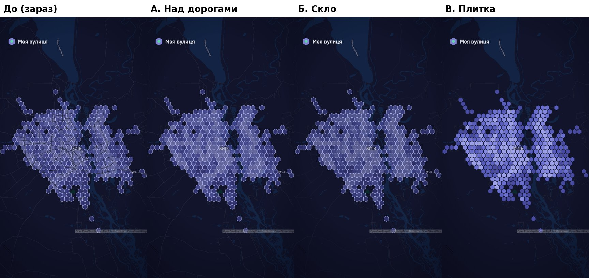
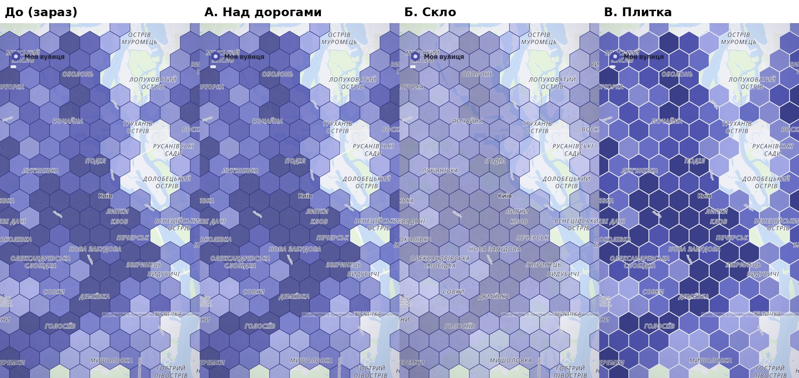

# Ролики: система — скільки, які, як виглядають, як міряємо (ZAVDANNYA-134)

Хмара, 19.11.2026. Основа — `docs/ROLYKY-TYPY.md` (В1–В8 обов'язкові), `docs/KOMPAS.md`, `docs/ROLYKY-DOSLIDZHENNIA-2026.md`,
`docs/ROLYKY-KONTSEPTSII.md`, `docs/ZVIT-129.md`, рушій `video/vau/`. Межі — `AGENTS.md` розд. 4 і 8, MV-147…MV-158.
Нічого не опубліковано.

**Позначки джерел:** **[В]** — сторінку відкрито й прочитано; **[П]** — лише переказ (пошукова видача, блог, сторонній огляд);
**[Н]** — наш висновок, не з джерела. Перевіряв ШІ-асистент вебпошуком 19.11.2026 — це не незалежна перевірка.

## 0. Висновки першими

<!-- розд. 0 дописується наприкінці -->

## 1. Скільки публікувати

### 1.1. Що кажуть джерела

| Що | Число | Джерело |
|---|---|---|
| Офіційна порада TikTok | «1–4 рази на день, щоб перевірити, як сприймають різні типи вмісту» | TikTok for Business, «Creative ultimate guide», **08.10.2021** — новішої офіційної цифри не знайдено [В] <https://ads.tiktok.com/business/en-US/blog/tiktok-creative-ultimate-guide> |
| Чи шкодить частота охопленню | 11,4 млн публікацій, 150 тис. акаунтів, кожен акаунт порівнюється сам із собою. Проти «1 на тиждень» перегляди на публікацію: 2–5/тиж — до **+17 %**, 6–10/тиж — до **+29 %**, 11+/тиж — до **+34 %**. Середній (медіанний) ролик майже не змінюється: 489 → 506 → 487 → 459; а верхні 10 % ростуть: 3 722 → 6 983 → 10 092 → **14 401** | Buffer, 08.10.2025 [В] <https://buffer.com/resources/how-often-should-you-post-on-tiktok/> |
| Скільки публікують бренди | 3–5 на тиждень «або скільки можете»; бізнеси в середньому 3,7/тиж (I кв. 2025) | Hootsuite, 18.04.2025 [В] <https://blog.hootsuite.com/how-often-to-post-on-social-media/> |
| Скільки публікують бренди (2025) | на місяць: 8 (1–5 тис. підписників) … 23 (100 тис.–1 млн); частота за рік зросла ≈ на 40 % | Socialinsider, 40,7 млн відео, 22.04.2026, оновл. 04.11.2026 [В] <https://www.socialinsider.io/blog/tiktok-engagement-report/> |
| Кілька акаунтів | Можна, «але не щоб обманювати»; вміст «неоригінальний або повторно використаний без нового» не потрапляє в стрічку «Для тебе» | Правила спільноти TikTok, «Integrity and Authenticity», чинні з 24.09.2026 [В] <https://www.tiktok.com/community-guidelines/en/integrity-authenticity> |
| YouTube Shorts | вертикальні до **3 хв** (з 15.10.2024); з 01.10.2026 рекомендації віддають перевагу оригінальним Shorts, перезаливи чужого — менше охоплення | YouTube Help [П] <https://support.google.com/youtube/answer/15424877>; Search Engine Journal, 01.10.2026 [В] <https://searchenginejournal.com/youtube-original-shorts-reposted-clips-reach/591774/> |
| Instagram Reels | свій логотип — можна; чужий знак (TikTok, CapCut) зменшує показ незнайомим; з 30.04.2026 акаунти, що здебільшого перепощують чуже, втрачають рекомендації | Social Media Today [П]; PetaPixel 30.04.2026 — сторінка не відкрилась (403), за переказами [П] |
| Facebook Reels | з 07.2025 акаунти, що повторюють чужий вміст, втрачають охоплення; свій вміст — ні | TechCrunch, 14.07.2025 [П] |
| Instagram / Facebook, частота | Instagram 3–5 на тиждень; Facebook 1–2 на день | Hootsuite, 2025 [В] |

### 1.2. Що з цього для нас [Н]

- **Частота не «з'їдає» охоплення** окремого ролика (Buffer): середній ролик дивляться так само, а частіші публікації дають
  більше шансів на «вистрілений». Для нового акаунта це головне — ми ще не знаємо, який тип вистрілить.
- **Старт — 1 ролик на день** у TikTok (30 на місяць). **Після 2 тижнів — до 2 на день**, якщо встигаємо робити без втрати
  якості (див. 1.3). 5 на день — ні: для нас вузьке місце не стрічка, а голос і перегляд Андрієм (MV-156, MV-158).
- **Один акаунт**, не кілька. Окремі акаунти районів чи ігор — лише коли формат уже доведено, і з **різними** роликами
  (той самий ролик на кількох своїх акаунтах = «повторний вміст»). Райони вже мають Telegram (компас, розд. 2).
- **Перевикористання:** той самий **чистий файл** (з рушія, без знака TikTok) — у YouTube Shorts та Instagram Reels того ж
  дня або наступного; Facebook Reels — лише «Історії з даних» і продуктові (аудиторія ОСББ, рієлторів). Це наш власний
  вміст, тож правила про «неоригінальне» його не зачіпають. Підпис — під кожну мережу свій (посилання, хештеги).
- **Місяць:** TikTok 30–45, Shorts 30–45 (ті самі), Reels 12–20 (вибрані, 3–5 на тиждень), Facebook 4–8.
  **Нових роликів на місяць — 30–45.**

### 1.3. Чи потягне рушій

| Що | Скільки | Звідки |
|---|---|---|
| Рендер на ПК (GTX 1650) | кадр ≈ 0,4 с → ролик 15 с ≈ 3 хв, 20 с ≈ 3–5 хв | `docs/ZVIT-127.md` |
| 45 роликів на місяць | ≈ 2–4 год рендеру на місяць (одна ніч) | [Н] з рядка вище |
| Хмара без відеокарти (SwiftShader) | кілька секунд на кадр → ролик 15 с ≈ 20–40 хв | `video/vau/README.md`; у цій сесії не заміряно |
| Голос | Андрій записує сам, потім перетворення (MV-156) — **вузьке місце** | [Н] |
| Перегляд | Андрій — «подобається / ні» (MV-158) | [Н] |

**Висновок [Н]:** рендер — не перешкода (одна ніч на ПК на місяць). Перешкода — голос. Тому в тесті **2 з 3 роликів — без
голосу** (музика, текст, удари: петлі, ігри, «Місто за N секунд»), голос — 2–3 ролики на тиждень, записані одним заходом.

## 3. Різноманіття графіки (В1–В5)

### 3.1. «Мурашник» (В1): причина

Андрій: «соти виглядають як мурашник: видно вулиці, не видно прозорості, сота наче мурахами поїдена».

**Причина — порядок шарів, а не кольори.** `video/vau/stsena.js` ставив соти «перед першим шаром підписів»
(`pershyiSymvol`). Але в стилях OpenFreeMap (`dark`, `positron`) перший підпис — **назва води**, і вона стоїть у списку **до**
будинків і доріг. Тож будинки й дороги (на темній — темні лінії з непрозорістю 1) малювалися **поверх** сот і прорізали
заливку тисячами темних доріжок — це й є «поїдено мурахами». ZAVDANNYA-129 міняв кількість сот і межі — тому не допомогло.
Сайт (`site/sait/karta.js:330`) робить правильно: соти — над останнім шаром ліній, під підписами.
Та сама вада зачіпає точки подій (`tochky`) і межу міста — вони теж лежать під дорогами, якщо не ввімкнено
`tochky_nad_pidpysamy`.

### 3.2. Три способи виправлення (зроблено в рушії, параметр `styl_sot`, без нього — як було)

| Спосіб | Що робить | Темна тема | Світла тема |
|---|---|---|---|
| **А. Над дорогами** (`sait`) | лише правильний порядок шарів, як на сайті; заливка та сама (0,55…0,8) | рівна, без доріжок; трохи «туманна» | майже як було (на світлій вада слабка) |
| **Б. Скло** (`sklo`) | А + рівна напівпрозорість 0,5; дороги й будинки під сотами приглушені на 60 % | каламутна, сіро-синя — **гірше** | спокійна, бліда |
| **В. Плитка** (`plytka`) | А + заливка 0,94, шов між сотами кольору тла; дороги й назви вулиць під сотами сховані | чиста мозаїка, яскрава, кожна сота окремо | контрастна, читається з телефона |

Знімки (той самий рушій, справжні соти Києва `video/dani/soty-kyiv.geojson`, кадр 1080×1920, зліва направо: до · А · Б · В):

- темна, район (z 12,3): 
- темна, місто (z 10,6): 
- світла, район (z 12,3): 
- світла, місто (z 10,6): 

**Порада [Н]: «Плитка» (В) — типовий вигляд сот у роликах** (місто й район, обидві теми). Причини: немає жодної лінії
всередині соти — нема й «мурах»; кожна сота окрема — видно саму сітку, якою ми є (знак — сота в соті); число-колір
читається з телефона. Вулиці повертаються на рівні вулиці: при наближенні соти згасають (`prozorist`), лишаються точки й
назви. «Прозорість», про яку казав Андрій, дає перехід «плитка → вулиці» в русі, а не напівпрозора заливка поверх доріг.
«Над дорогами» (А) — для 3D-стовпців і «Сота розпадається», де заливка 0,1–0,12. «Скло» (Б) — не брати.

**Що зробити далі (наступне завдання):** у `stsenarii129.py` поставити `styl_sot='plytka'` у `SOTY`, перезібрати t1, t5, z2;
точки подій і межу міста теж перенести над дороги (та сама вада). Андрій дивиться знімки — «так / ні».
**Не перевірено:** вигляд у русі (лише знімки), 3D-стовпці з «плиткою», стиснення TikTok.
