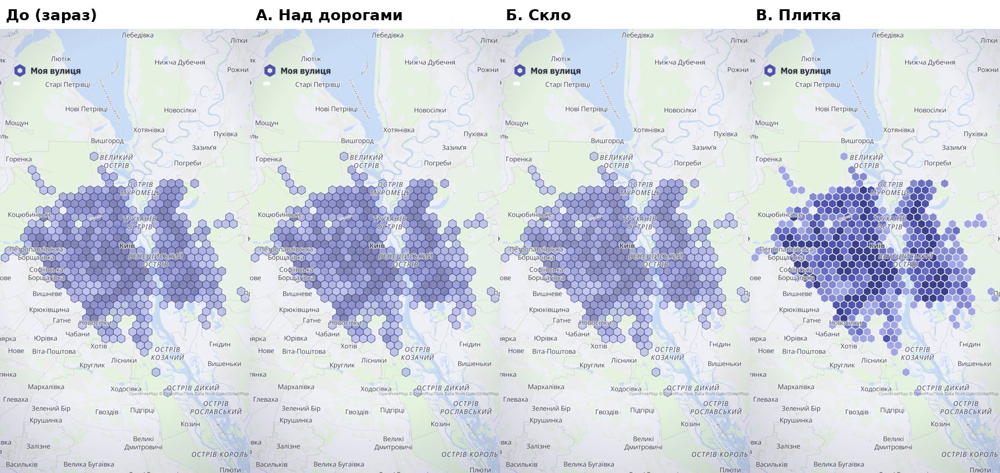

# Ролики: система — скільки, які, як виглядають, як міряємо (ZAVDANNYA-134)

Хмара, 19.11.2026. Основа — `docs/ROLYKY-TYPY.md` (В1–В8 обов'язкові), `docs/KOMPAS.md`, `docs/ROLYKY-DOSLIDZHENNIA-2026.md`,
`docs/ROLYKY-KONTSEPTSII.md`, `docs/ZVIT-129.md`, рушій `video/vau/`. Межі — `AGENTS.md` розд. 4 і 8, MV-147…MV-158.
Нічого не опубліковано.

**Позначки джерел:** **[В]** — сторінку відкрито й прочитано; **[П]** — лише переказ (пошукова видача, блог, сторонній огляд);
**[Н]** — наш висновок, не з джерела. Перевіряв ШІ-асистент вебпошуком 19.11.2026 — це не незалежна перевірка.

## 0. Висновки першими

1. **Частота:** TikTok — **1 ролик на день** на старті, **до 2 на день** з 3-го тижня, якщо встигає голос. Частота не зменшує
   перегляди окремого ролика (Buffer, 11,4 млн публікацій: середній ролик однаковий, верхні 10 % — у 4 рази вищі при 11+
   на тиждень). Офіційно TikTok радить 1–4 на день (2021). **30–45 нових роликів на місяць.**
2. **Мережі:** той самий чистий файл — у YouTube Shorts (усе) й Instagram Reels (3–5 на тиждень, найкращі); Facebook —
   продуктові й «Історії з даних». **Один акаунт**; окремі акаунти районів чи ігор — після 8 тижнів і лише з іншими роликами.
3. **Рушій потягне:** 45 роликів ≈ одна ніч рендеру на ПК на місяць. Вузьке місце — голос Андрія (MV-156): 2 з 3 роликів
   — без голосу.
4. **Типи:** 4 стовпи, **6–8 типів у ротації**, тип судимо після 5–6 публікацій проти медіани свого акаунта; ≈ 80 % «вау» /
   20 % «потреба → продукт» (В6). Тест — 7 типів (розд. 2.3), 12 нових пропозицій (розд. 2.4), з них 6 власних.
5. **«Мурашник» (В1) знайдено:** соти лежали **під дорогами** (рушій вставляв їх перед назвою води, яка в стилі карти йде
   до доріг). Три способи зроблено в рушії, знімки до/після — розд. 3.2. **Порада — «Плитка»:** суцільні соти зі швами, без
   доріг усередині; вулиці з'являються, коли камера наближається.
6. **Різноманіття (В2–В5):** 5 осей вигляду (тема, шар, рівень, не карта, запис справжнього); два ролики поспіль
   відрізняються щонайменше за двома.
7. **Зворотний зв'язок:** YouTube і Instagram — автоматично (щоденна задача GitHub Actions у приватному репозиторії →
   таблиця знімків); **TikTok — спершу вивантаження зі Studio раз на тиждень**, паралельно заявка на Business API (лише
   він дає утримання). Кожен рядок — з типом із `ROLYKY-TYPY.md`.
8. **Тест 4 тижні, ≈ 35–45 роликів;** рішення — наприкінці 2-го (гачки) і 4-го тижня (типи).

## 1. Скільки публікувати

### 1.1. Що кажуть джерела

| Що | Число | Джерело |
|---|---|---|
| Офіційна порада TikTok | «1–4 рази на день, щоб перевірити, як сприймають різні типи вмісту» | TikTok for Business, «Creative ultimate guide», **08.10.2021** — новішої офіційної цифри не знайдено [В] <https://ads.tiktok.com/business/en-US/blog/tiktok-creative-ultimate-guide> |
| Чи шкодить частота охопленню | 11,4 млн публікацій, 150 тис. акаунтів, кожен акаунт порівнюється сам із собою. Проти «1 на тиждень» перегляди на публікацію: 2–5/тиж — до **+17 %**, 6–10/тиж — до **+29 %**, 11+/тиж — до **+34 %**. Середній (медіанний) ролик майже не змінюється: 489 → 506 → 487 → 459; а верхні 10 % ростуть: 3 722 → 6 983 → 10 092 → **14 401** | Buffer, 08.10.2025 [В] <https://buffer.com/resources/how-often-should-you-post-on-tiktok/> |
| Скільки публікують бренди | 3–5 на тиждень «або скільки можете»; бізнеси в середньому 3,7/тиж (I кв. 2025) | Hootsuite, 18.04.2025 [В] <https://blog.hootsuite.com/how-often-to-post-on-social-media/> |
| Скільки публікують бренди (2025) | на місяць: 8 (1–5 тис. підписників) … 23 (100 тис.–1 млн); частота за рік зросла ≈ на 40 % | Socialinsider, 40,7 млн відео, 22.04.2026, оновл. 04.11.2026 [В] <https://www.socialinsider.io/blog/tiktok-engagement-report/> |
| Кілька акаунтів | Можна, «але не щоб обманювати»; вміст «неоригінальний або повторно використаний без нового» не потрапляє в стрічку «Для тебе» | Правила спільноти TikTok, «Integrity and Authenticity», чинні з 24.09.2026 [В] <https://www.tiktok.com/community-guidelines/en/integrity-authenticity> |
| YouTube Shorts | вертикальні до **3 хв** (з 15.10.2024); з 01.10.2026 рекомендації віддають перевагу оригінальним Shorts, перезаливи чужого — менше охоплення | YouTube Help [П] <https://support.google.com/youtube/answer/15424877>; Search Engine Journal, 01.10.2026 [В] <https://searchenginejournal.com/youtube-original-shorts-reposted-clips-reach/591774/> |
| Instagram Reels | свій логотип — можна; чужий знак (TikTok, CapCut) зменшує показ незнайомим; з 30.04.2026 акаунти, що здебільшого перепощують чуже, втрачають рекомендації | Social Media Today [П]; PetaPixel 30.04.2026 — сторінка не відкрилась (403), за переказами [П] |
| Facebook Reels | з 07.2025 акаунти, що повторюють чужий вміст, втрачають охоплення; свій вміст — ні | TechCrunch, 14.07.2025 [П] |
| Instagram / Facebook, частота | Instagram 3–5 на тиждень; Facebook 1–2 на день | Hootsuite, 2025 [В] |

### 1.2. Що з цього для нас [Н]

- **Частота не «з'їдає» охоплення** окремого ролика (Buffer): середній ролик дивляться так само, а частіші публікації дають
  більше шансів на «вистрілений». Для нового акаунта це головне — ми ще не знаємо, який тип вистрілить.
- **Старт — 1 ролик на день** у TikTok (30 на місяць). **Після 2 тижнів — до 2 на день**, якщо встигаємо робити без втрати
  якості (див. 1.3). 5 на день — ні: для нас вузьке місце не стрічка, а голос і перегляд Андрієм (MV-156, MV-158).
- **Один акаунт**, не кілька. Окремі акаунти районів чи ігор — лише коли формат уже доведено, і з **різними** роликами
  (той самий ролик на кількох своїх акаунтах = «повторний вміст»). Райони вже мають Telegram (компас, розд. 2).
- **Перевикористання:** той самий **чистий файл** (з рушія, без знака TikTok) — у YouTube Shorts та Instagram Reels того ж
  дня або наступного; Facebook Reels — лише «Історії з даних» і продуктові (аудиторія ОСББ, рієлторів). Це наш власний
  вміст, тож правила про «неоригінальне» його не зачіпають. Підпис — під кожну мережу свій (посилання, хештеги).
- **Місяць:** TikTok 30–45, Shorts 30–45 (ті самі), Reels 12–20 (вибрані, 3–5 на тиждень), Facebook 4–8.
  **Нових роликів на місяць — 30–45.** Уточнює `docs/ROLYKY-I-SOTSMEREZHI.md` (ZAVDANNYA-78: «1 на день в усі мережі»):
  у Reels і Facebook — вибірково, не кожен.

### 1.3. Чи потягне рушій

| Що | Скільки | Звідки |
|---|---|---|
| Рендер на ПК (GTX 1650) | кадр ≈ 0,4 с → ролик 15 с ≈ 3 хв, 20 с ≈ 3–5 хв | `docs/ZVIT-127.md` |
| 45 роликів на місяць | ≈ 2–4 год рендеру на місяць (одна ніч) | [Н] з рядка вище |
| Хмара без відеокарти (SwiftShader) | кілька секунд на кадр → ролик 15 с ≈ 20–40 хв | `video/vau/README.md`; у цій сесії не заміряно |
| Голос | Андрій записує сам, потім перетворення (MV-156) — **вузьке місце** | [Н] |
| Перегляд | Андрій — «подобається / ні» (MV-158) | [Н] |

**Висновок [Н]:** рендер — не перешкода (одна ніч на ПК на місяць). Перешкода — голос. Тому в тесті **2 з 3 роликів — без
голосу** (музика, текст, удари: петлі, ігри, «Місто за N секунд»), голос — 2–3 ролики на тиждень, записані одним заходом.

## 2. Скільки й які типи

### 2.1. Що кажуть джерела

- **Тем-стовпів (pillars) одночасно — 3–5;** більше розмиває акаунт. Sprout Social, Brandwatch [П] — це правило практиків, не дослідження.
- **Серію судити не раніше ніж за ≈ 8 тижнів;** міняти гачки, а не серію. Ознаки, що працює: чекають наступну частину,
  згадують попередні, позначають друзів. Sked Social, 11.08.2026 [В] <https://skedsocial.com/blog/the-content-series-playbook-eight-weeks-one-idea-one-format>.
  Інший сервіс радить знімати серію після **4+ тижнів спаду** попри зміни [П].
- **Розважальне проти продажу — 80/20** (Brandwatch) або 70/20/10 (Measure Studio) [П] — правила практиків.
- Дослідження про те, як саме акаунти з картами й даними чергують формати, **не знайдено**. Числового правила «коли вбивати
  формат», заснованого на даних, — теж (див. ще `docs/ROLYKY-DOSLIDZHENNIA-2026.md`, розд. 6).

### 2.2. Наше правило [Н]

- **Стовпи — 4** (з семи груп компаса, MV-111): **Місто згори** (вау), **Ігри**, **Історії «під боком»**, **«Що болить вулиці»**
  (потреба → продукт). Решта груп («Як це працює», «Що буває за…», «Історії з даних») — рідше, раз на 1–2 тижні.
- **Типів у ротації одночасно — 6–8.** Чому: тип судимо після 5–6 публікацій (розд. 4.4); за 4 тижні по 7–10 роликів = 28–40
  публікацій → 6–8 типів по 5–6 разів. Більше — жоден не набере вибірки; менше — не знайдемо переможця.
- **Новий тип — лише на звільнене місце:** коли тип вбито або коли переможець має 3 варіанти поспіль, що тримають рівень.
  Плюс одне «дике місце» на тиждень для проби (1 ролик з нового типу).
- **Вбиваємо тип** після 5–6 публікацій, якщо медіана його переглядів **і** утримання на 3 с нижчі за медіану акаунта (розд. 4.4).
  Серії (Найдивніша справа, Вулиця тижня) — не раніше ніж за 6–8 тижнів, міняючи спершу гачок.
- **«Вау» проти «потреба → продукт» (В6):** **≈ 80 / 20** — з 7 роликів на тиждень 5–6 приводять (вау, ігри, історії),
  1–2 продають. Продуктовий ролик будується як В6: **спершу яскрава потреба** («Застава — завтра. Що ви знаєте про
  будинок?»), **потім продукт одним словом** («Довідка») і сторінка того самого місця. Поки немає справжніх довідки, ОСББ,
  Telegram і «Стежу» — продуктові ведуть на сторінку будинку/вулиці, а не на покупку (MV-151).

### 2.3. Що тестувати першими (з 15 затверджених і 46 концепцій)

Ротація тесту — **7 типів** (по 4–6 публікацій кожен за 4 тижні):

| # | Тип (реєстр) | Стовп | Чому в тесті | Голос |
|---|---|---|---|---|
| 1 | Місто за N секунд (t5, К-01) | Місто згори | найкоротший «вау», петля; знайомить із картою | ні |
| 2 | Сота розпадається (t1, К-02) | Місто згори | «вау», який описав Андрій | ні |
| 3 | Вгадай, де це було (t2, К-08) | Ігри | найдешевший двигун коментарів; колода подій готова | ні |
| 4 | Міф чи факт (n4, n5, К-35/36) | Ігри / Що буває за… | суперечка в коментарях, дані готові | так |
| 5 | Одна подія-петля (t3, К-16) | Історії | на ній міряємо гачки (3 варіанти гачка) | ні |
| 6 | Найдивніша справа тижня (n1, n2) | Історії | серія — повертає глядачів | ні |
| 7 | **Новий:** «POV: застава завтра» (К-25) | Що болить вулиці | перший справжній В6: потреба → сторінка будинку | так |

Запасні на звільнені місця: Знайди точку за 3 с (n3), Вгадай число (n8), Число з 1551 (t4 — з холодами, грудень–січень),
Відповідь на коментар (n6 — лише на справжній коментар), Запис сайту (z1, z2 — раз на 2 тижні, «Як це працює»).

### 2.4. Яких типів бракує — пропозиції

З переліку завдання (В3 адреси, В5 звіт, «Стежу», POV, тур, вулиця тижня, серії, рієлтор, ОСББ) і **власні** (позначено ★):

| Пропозиція | Що в кадрі | Вимога | Стовп → куди | Коли можна |
|---|---|---|---|---|
| **Адреса зблизька** | публічне місце з номером (ТЦ, ринок, станція): камера падає з міста до точки, події навколо вискакують, лічильник; житло — лише рівень вулиці | В3 | Що болить → сторінка місця | зараз |
| **POV: застава завтра** (К-25) | запис сайту: пошук адреси → сторінка будинку (скарги 1551 і події числом) | В6, В3 | Що болить → сторінка будинку | зараз |
| **Хтось читає звіт — і вау** | запис екрана справжньої довідки: палець гортає, наклейки-реакції на 2–3 числа | В5, В6 | Що болить → довідка | **після справжньої довідки** (MV-151) |
| **Вулиця тижня** (К-44), серія | проліт уздовж вулиці (рівень вулиці), 3 числа, частини 1/2/3 | В3, В7 | Історії → сторінка вулиці | зараз |
| **Тур району: 5 зупинок** (К-21) | 5 публічних місць району, по 2 с, лічильник | В3 | Історії → район | зараз |
| **Стежу за вулицею** (К-31) | сповіщення на телефоні → карта підписника | В6 | Мій район → підписка | **після «Стежу»** |
| **Рієлтор: «а що тут за будинок?»** (К-40) | поділений екран: питання клієнта · відповідь за хвилину | В6 | Рієлтор → 799 | після довідки; Facebook, Reels |
| **ОСББ: що болить будинку щомісяця** (К-41) | лист-звіт ОСББ, порівняння із сусідами числом | В5 | ОСББ → 1 490 | після зразка ОСББ; Facebook |
| ★ **День і ніч** | поділений екран: світла тема — події вдень, темна — вночі, на тій самій карті | В4, В2 | Місто згори → карта | зараз |
| ★ **Вгадай район за плиткою** | силует району із сот «плиткою» без назв, 3 варіанти, відлік | В1, В2 | Ігри → район | зараз |
| ★ **Карта з ваших коментарів** | збірка вулиць, які назвали в коментарях: переліт від однієї до іншої, по числу на кожну | В3, В7 | Що болить → сторінки вулиць | після перших коментарів |
| ★ **Календар року** | 365 клітинок на весь кадр, що заповнюються днями; пік — підпис «що було цього дня» | В2 (не карта) | Історії з даних → карта | зараз |
| ★ **Одне місце — 10 років** | публічне місце, рік за роком стовпчиками й точками, без прогнозу | В3 | Історії → сторінка місця | після повного Києва 10 років |
| ★ **Сота пояснює** (MV-148) | персонаж «Сота» показує, як рішення стає точкою (К-29) за 3 кроки | В2 | Як це працює → карта | зараз |

## 3. Різноманіття графіки (В1–В5)

### 3.1. «Мурашник» (В1): причина

Андрій: «соти виглядають як мурашник: видно вулиці, не видно прозорості, сота наче мурахами поїдена».

**Причина — порядок шарів, а не кольори.** `video/vau/stsena.js` ставив соти «перед першим шаром підписів»
(`pershyiSymvol`). Але в стилях OpenFreeMap (`dark`, `positron`) перший підпис — **назва води**, і вона стоїть у списку **до**
будинків і доріг. Тож будинки й дороги (на темній — темні лінії з непрозорістю 1) малювалися **поверх** сот і прорізали
заливку тисячами темних доріжок — це й є «поїдено мурахами». ZAVDANNYA-129 міняв кількість сот і межі — тому не допомогло.
Сайт (`site/sait/karta.js:330`) робить правильно: соти — над останнім шаром ліній, під підписами.
Та сама вада зачіпає точки подій (`tochky`) і межу міста — вони теж лежать під дорогами, якщо не ввімкнено
`tochky_nad_pidpysamy`.

### 3.2. Три способи виправлення (зроблено в рушії, параметр `styl_sot`, без нього — як було)

| Спосіб | Що робить | Темна тема | Світла тема |
|---|---|---|---|
| **А. Над дорогами** (`sait`) | лише правильний порядок шарів, як на сайті; заливка та сама (0,55…0,8) | рівна, без доріжок; трохи «туманна» | майже як було (на світлій вада слабка) |
| **Б. Скло** (`sklo`) | А + рівна напівпрозорість 0,5; дороги й будинки під сотами приглушені на 60 % | каламутна, сіро-синя — **гірше** | спокійна, бліда |
| **В. Плитка** (`plytka`) | А + заливка 0,94, шов між сотами кольору тла; дороги й назви вулиць під сотами сховані | чиста мозаїка, яскрава, кожна сота окремо | контрастна, читається з телефона |

Знімки (той самий рушій, справжні соти Києва `video/dani/soty-kyiv.geojson`, кадр 1080×1920, зліва направо: до · А · Б · В):

- темна, район (z 12,3): 
- темна, місто (z 10,6): 
- світла, район (z 12,3): 
- світла, місто (z 10,6): 

**Порада [Н]: «Плитка» (В) — типовий вигляд сот у роликах** (місто й район, обидві теми). Причини: немає жодної лінії
всередині соти — нема й «мурах»; кожна сота окрема — видно саму сітку, якою ми є (знак — сота в соті); число-колір
читається з телефона. Вулиці повертаються на рівні вулиці: при наближенні соти згасають (`prozorist`), лишаються точки й
назви. «Прозорість», про яку казав Андрій, дає перехід «плитка → вулиці» в русі, а не напівпрозора заливка поверх доріг.
«Над дорогами» (А) — для 3D-стовпців і «Сота розпадається», де заливка 0,1–0,12. «Скло» (Б) — не брати.

**Що зробити далі (наступне завдання):** у `stsenarii129.py` поставити `styl_sot='plytka'` у `SOTY`, перезібрати t1, t5, z2;
точки подій і межу міста теж перенести над дороги (та сама вада). Андрій дивиться знімки — «так / ні».
**Не перевірено:** вигляд у русі (лише знімки), 3D-стовпці з «плиткою», стиснення TikTok.

### 3.3. Каталог візуальних варіантів (В2–В5)

Варіант — не новий тип, а зміна всередині типу (`docs/ROLYKY-TYPY.md`, розд. 1). Кожен ролик описується п'ятьма осями;
**два ролики поспіль у стрічці відрізняються щонайменше за двома осями** [Н] — це й є відповідь на В2 «всі однотипні».

| Вісь | Варіанти | Що вже вміє рушій | Чого бракує |
|---|---|---|---|
| **Тема** (В4) | темна · світла · день/ніч поділеним екраном | обидві теми (`tema`), поділений екран (`split`) | правило 129 С7 «лише темна» прибрати з `perevirka.py` (скасовано MV-158) |
| **Головний шар** | соти «плиткою» · 3D-стовпці · точки-хвиля · «соняшник» точок одного місця · лінія маршруту | усе, крім «плитки» за замовчуванням | `styl_sot='plytka'` типовим (розд. 3.2) |
| **Рівень** (В3) | місто · район · вулиця (z ≤ 15,3) · публічне місце з номером | камера-кіно, переліт дугою, 3D-будинки | ролик «Адреса зблизька» (розд. 2.4) |
| **Не карта** (В5) | число на весь кадр · стовпчики · поділений екран · печатка «МІФ» · календар 365 · годинник 24 год | число, стовпчики, split, печатка, таймер | календар 365, годинник |
| **Запис справжнього** | сайт: карта, сторінка вулиці, будинку · довідка · гра | запис сайту (`zapys_saitu.py`, z1, z2) | запис сторінки будинку і довідки (В5 — після справжньої довідки) |
| **Акцент** | м'ята · індиго · колір групи подій | палітра «Індиго й м'ята» (MV-58), без червоного | — |

Приклад ротації тижня [Н]: пн «Місто за N секунд» (темна · точки · місто) → вт «Вгадай, де це було» (світла · плитка ·
район) → ср «Найдивніша справа» (темна · точка · вулиця) → чт «Міф чи факт» (не карта: число й split) → пт «POV: застава»
(запис сайту, світла) → сб «Сота розпадається» (темна · 3D) → нд «День і ніч» (обидві теми).

## 4. Зворотний зв'язок: як центральний чат бачить кожен ролик

### 4.1. Що дають офіційні інтерфейси (перевірено за документацією 19.11.2026)

| Мережа | Інтерфейс | Що дає по ролику | Що треба | Пастки |
|---|---|---|---|---|
| **TikTok** | Display API (`video.list`) | перегляди, лайки, коментарі, поширення. **Без** збережень, часу перегляду, утримання, джерел трафіку [В] <https://developers.tiktok.com/doc/tiktok-api-v2-video-object> | застосунок розробника + перевірка TikTok | перевірка відмовляє застосункам «для приватного чи особистого вжитку» [В] <https://developers.tiktok.com/doc/app-review-guidelines>; доступ 2 год, оновлення 180 днів [В] |
| TikTok | API for Business (`business/video/list`) | **середній час перегляду, частка досмотрів, загальний час, джерела показів** [П — довідник не відкрився, за уривком] | бізнес- або авторський акаунт, застосунок у порталі Business API | числа — за весь час (денні — різницею знімків); затримка 24–48 год [П]; кроки схвалення не перевірено |
| TikTok | Research API | — | лише науковці США, ЄЕП, Британії, Канади, Швейцарії; **Україна й бренди — ні** [В] <https://developers.tiktok.com/products/research-api/> | не для нас |
| TikTok | **Вивантаження з TikTok Studio** (запасний шлях) | кнопка «Export data» на ПК, CSV/XLS до 60 днів [П] | доступ до акаунта | чи є рядки по кожному ролику — **не перевірено**, Микита дивиться в своїй Studio |
| **YouTube** | Data API v3 + Analytics API | перегляди, лайки, коментарі; середній час і частка перегляду; **крива утримання** (`audienceWatchRatio`, по одному ролику); джерело `SHORTS`; `engagedViews` [В] <https://developers.google.com/youtube/analytics/metrics> | власник каналу один раз дає згоду; проєкт Google Cloud | з 31.03.2025 перегляд Shorts = кожен старт; «справжні» — `engagedViews`, збирати обидва [В]; застосунок у статусі «Testing» — токен живе 7 днів, тому статус «In production» [В] <https://developers.google.com/identity/protocols/oauth2>; квота 10 000 одиниць/добу — з запасом [В] |
| **Instagram** | Instagram API (вхід через Instagram) | `views`, охоплення, лайки, коментарі, поширення, збереження, **середній час перегляду Reels**, `reels_skip_rate` [В] <https://developers.facebook.com/docs/instagram-platform/reference/instagram-media/insights> | професійний акаунт (бізнес або автор); застосунок Meta; **для своїх акаунтів — Standard Access без перевірки** [В] <https://developers.facebook.com/docs/instagram-platform/overview> | токен 60 днів, оновлювати раз на тиждень [В]; кривої утримання й джерел немає |
| **Facebook** | Graph API, video insights | покази, середній час, **крива утримання** (`post_video_retention_graph`) [В] <https://developers.facebook.com/docs/graph-api/reference/video/video_insights/> | права `read_insights` на сторінку | строк токена сторінки не перевірено |
| Запасний | Metricool | безкоштовно: 1 бренд, усі ці мережі, історія 30 днів, **без API** [В] <https://metricool.com/pricing/> | акаунт | API — від 43 €/міс; вивантаження CSV на безкоштовному — не перевірено |

**Висновок [Н]:** YouTube і Instagram — автоматично й надійно. **TikTok — слабке місце:** простий інтерфейс не дає утримання, а
його перевірка відмовляє «особистим» застосункам; Business API дає утримання, але схвалення не перевірене. Тому для TikTok —
**спершу щотижневе вивантаження з Studio** (5 хв), паралельно — заявка на Business API.

### 4.2. Що треба від Микити (усе — на партнера, `docs/02-pravo.md`, розд. 6)

1. TikTok: акаунт — **бізнес**; застосунок у порталі TikTok API for Business (заявка); раз на тиждень — вивантаження зі Studio
   (або доступ, щоб це робив Андрій). Перевірити, чи вивантаження має рядки по кожному ролику.
2. YouTube: канал — на Микиту; проєкт Google Cloud у статусі «In production»; один раз дати згоду (або зробити Андрія
   менеджером каналу).
3. Instagram і Facebook: професійний акаунт, застосунок Meta (Standard Access), один вхід.
4. Секрети — у приватному репозиторії автопостингу організації (MV-154): `TIKTOK_*`, `GOOGLE_CLIENT_ID/SECRET/REFRESH_TOKEN`,
   `IG_TOKEN`. TikTok та Instagram **міняють токен при оновленні** — задача має записувати новий назад у секрети, тож потрібен
   ще ключ GitHub з правом змінювати секрети (найвужчий, лише цей репозиторій).

### 4.3. Проєкт збору

- **Де:** приватний репозиторій автопостингу (MV-154) — там уже ключі мереж і розклад; поруч із `avtopostynh/merezhi.py`
  (той самий стиль: `urllib`, ключі лише зі змінних середовища). Сирі числа — не в публічні файли.
- **Реєстр роликів** `zamiry/rolyky.csv` — один рядок на публікацію, пише людина або автопостинг у момент публікації:
  `id` (як у рушії, напр. `129-t5`) · `typ` (точна назва з `docs/ROLYKY-TYPY.md`, розд. 1) · `varianty` (тема · шар · рівень ·
  голос · гачок А/Б/В — осі розд. 3.3) · `dovzhyna_s` · `merezha` · `url` · `opublikovano` (дата й час) · `kudy` (сторінка,
  з міткою каналу `?k=tiktok-129-t5`).
- **Щоденна задача** GitHub Actions (06:00 за Києвом): для кожного ролика молодшого за 30 днів — знімок чисел у
  `zamiry/znimky.csv` (`data, id, merezha, perehliady, lajky, komentari, poshyrennia, zberezhennia, serednii_chas_s,
  dochytani_chastka, dzherelo_dlia_tebe`). Числа мереж — «за весь час», денні рахуємо різницею знімків.
  TikTok, поки немає Business API, — з вивантаження Studio, покладеного в `zamiry/tiktok/`.
- **Тижневий підсумок** `zamiry/tyzhden-<дата>.md` — та сама задача в понеділок: таблиця по типах (медіана переглядів,
  утримання, коментарі на 1 000, переходи) і позначки «посилити / тримати / вбити» за правилами 4.4. Його читає
  центральний чат.
- **Коментарі:** текст коментарів — лише для чату (ідеї для «Відповіді на коментар», «Карти з ваших коментарів»), у
  репозиторій — тільки кількість; здогадки «хто це був» видаляються вручну (`docs/ROLYKY-DOSLIDZHENNIA-2026.md`, розд. 9).
- **Переходи на сайт:** мітка каналу на кожному посиланні (лічильник каналу сайту) — єдине число про продаж.

### 4.4. Коли тип вдалий, коли ні

Загальновизнаних меж для утримання в TikTok **не знайдено** — тож порівнюємо **з медіаною свого акаунта** (так само радить
Buffer: сприймати свої числа як гіпотези). Орієнтири зовні — лише для перевірки здорового глузду:

| Показник | Орієнтир | Джерело |
|---|---|---|
| Залучення (лайки + коментарі + поширення) ÷ перегляди | ≈ 4,2 % у середньому; 4,4 % для акаунтів 1–5 тис. | Socialinsider, 2026 [В] |
| Утримання перших 3 с | 80–90 % — сильний гачок | OpusClip, 11.11.2025 [В], без методики — слабке |
| Середня частка перегляду | ≥ 60 % — дуже добре, < 45 % — проблема | OpusClip [В], слабке |
| Медіанний ролик нового бізнес-акаунта | ≈ 500 переглядів | Buffer, 2025 [В] |

**Правила рішення [Н]** (тип = усі його ролики; мінімум 5 публікацій):
- **Посилити** — медіана переглядів типу ≥ 2× медіани акаунта **або** один ролик ≥ 3× (тоді 3 наступні — на тому ж шаблоні).
- **Тримати** — між.
- **Вбити** — медіана переглядів **і** утримання на 3 с нижчі за медіану акаунта у 5 з 6 публікацій. Серії — не раніше
  6–8 тижнів, спершу змінити гачок (Sked Social).
- **Ігри** судимо за коментарями на 1 000 переглядів; **продуктові** — за переходами на сайт: перегляди є, переходів нема →
  міняємо кінцівку, а не ролик.
- **Гачок** А/Б/В: різниця утримання на 3 с менше 5 пунктів — випадковість.

## 5. Тест на 4 тижні

**Старт** — коли є акаунт TikTok на Микиту, голос Андрія записано (MV-156) і перезібрано з «плиткою». Публікувати
**18:00–21:00 за Києвом** (дослідження саме по Україні немає; після 1-го тижня — за даними «активність аудиторії» в Studio).

| Тиждень | Скільки | Що | Мета |
|---|---|---|---|
| 1 | 7 (1 на день) | по одному з 7 типів тесту (розд. 2.3), ротація вигляду (3.3); t3 з гачком А | перша медіана акаунта; чи дає стрічка показ («Для тебе» ≥ 70 %) |
| 2 | 7–10 | ті самі 7 типів, нові події; t3 — гачки Б і В; перша «Відповідь на коментар», якщо є коментар | гачки; які типи вже ≥ 2× медіани |
| 3 | 10–14 (до 2 на день) | 2 ролики на день лише якщо голос встигає; переможці ×2; «дике місце» — «День і ніч» або «Вгадай район за плиткою» | посилити; перші переходи на сайт |
| 4 | 10–14 | те саме; на місце вбитого — запасний (n3, n8, t4, z1) | рішення по типах |

Разом **≈ 35–45 роликів** у TikTok, ті самі файли — у YouTube Shorts; у Reels — 3–5 на тиждень (найкращі за TikTok за
48 год); у Facebook — «POV: застава» і запис сайту.

**Що міряємо:** перегляди, утримання на 3 с і середню частку перегляду (TikTok — зі Studio, YouTube — крива утримання),
залучення, коментарі на 1 000, поширення й збереження на 1 000, нові підписники на 1 000, частку «Для тебе», переходи
на сайт за міткою.

**Коли вирішуємо:**
- **Кінець тижня 2** — гачки (лишаємо кращий), чи дає стрічка показ; якщо «Для тебе» < 50 % у всіх роликах — проблема не в
  типах, а в акаунті (перевірити обмеження, музику, підписи).
- **Кінець тижня 4** — звіт Андрію: таблиця всіх роликів, 2–3 типи-переможці → у потік (наступний місяць 1–2 на день),
  що вбиваємо, що додаємо; чи заводити Reels/Facebook окремо.
- **8 тижнів** — серії (Найдивніша справа, Вулиця тижня) і рішення про другий акаунт (райони чи ігри).

## 6. Що не перевірено

- Офіційної частоти від TikTok новішої за 2021 рік немає; Buffer — клієнти Buffer (малий і середній бізнес), не карти й дані.
- Довідник TikTok Business API не відкрився — поля й умови схвалення за уривками; чи вивантаження Studio має рядки по роликах.
- PetaPixel (Instagram 2026) — 403, за переказами; заява Meta липня 2025 — за переказами.
- Пороги «посилити / вбити» — наші, не з дослідження.
- «Плитка» — лише знімки; у русі, з 3D і після стиснення TikTok не дивились. Рендер у хмарі не заміряно.
