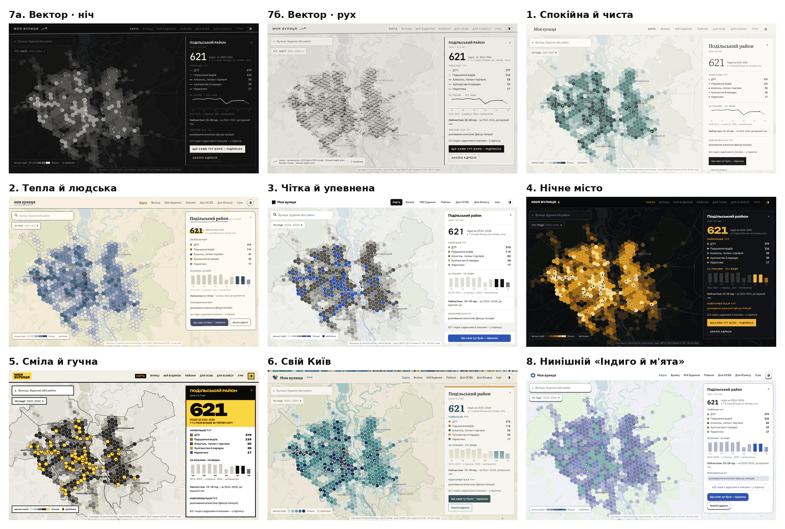
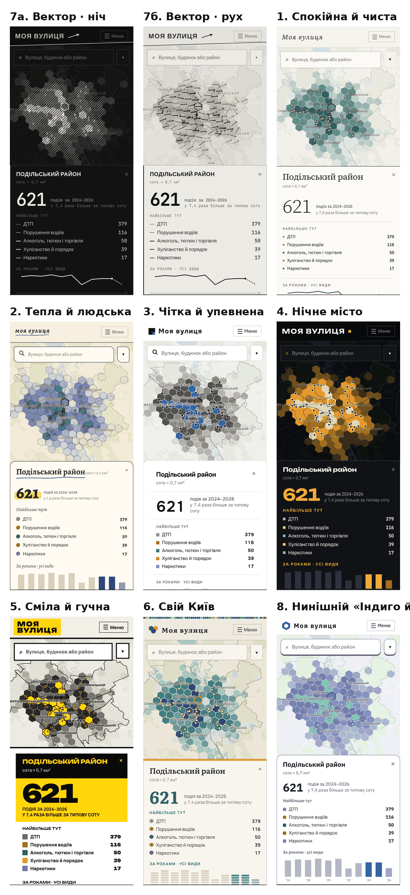

# ЗВІТ-193 — Сім інших виглядів (і нинішній для порівняння)

Хмара, 21.11.2026. Завдання — [`ZAVDANNYA-193.md`](../ZAVDANNYA-193.md). На живий сайт нічого не викладалось, Release лише читався.

## Коротко для Андрія

- Зроблено **9 виглядів**: 7 настроїв (з них «Вектор» — у двох варіантах) і нинішній «Індиго й м'ята». У кожного — 3 екрани
  (карта міста, сторінка будинку, картка району) на телефоні й на комп'ютері, плюс темна карта там, де стиль має темну тему.
- **Дані в усіх однакові й справжні** — випуск повного Києва від 21.11 (80 634 події з точкою за 2024–2026, 84 проблеми на карті,
  будинок на Вишгородській — номер закрито, Подільський район). Відрізняється лише вигляд.
- Моя порада подивитись першими: **«Вектор · ніч»**, **«Свій Київ»** і **«Спокійна й чиста»** — вони найменше схожі на «типовий
  зроблений штучним інтелектом сайт». «Нічне місто» і «Сміла й гучна» — сильні для роликів, але як основний вигляд сайту ризиковані.
- Це картинки для вибору, а не готовий сайт: сторінки зібрано окремо від справжнього збирача, з тими самими текстами й числами.

## Порівняння (картинки поруч)

Карта міста, комп'ютер:

Карта міста, телефон:

Сторінка будинку — [комп'ютер](makety-193/porivniannia-budynok-pk.png), [телефон](makety-193/porivniannia-budynok-tel.png).
Картка району — [комп'ютер](makety-193/porivniannia-rayon-pk.png), [телефон](makety-193/porivniannia-rayon-tel.png).
Окремі екрани кожного стилю — у теках `docs/makety-193/<стиль>/`: `karta-`, `budynok-`, `rayon-` × `tel` (375, удвічі чіткіше) і `pk` (1366);
`karta-pk-temna.png` — темна тема.

## Сім настроїв: настрій, для кого, ризик

### 7а. «Вектор · ніч» — `vektor-nich/` (найважливіший)
- **Настрій:** темно, без світла попереду — але все місто складається з напрямку: соти — це косі штрихи під одним кутом (чим більше
  подій, тим густіші й товщі), лінія від назви йде вгору й за край екрана, під кожним заголовком — коротка стрілка-вектор, кнопки
  закінчуються стрілкою; графік років — одна лінія, а вісь часу йде за край (дійти до кінця не можна).
- **Для кого:** люди, які шукають правду без прикрас; дорослі, що вирішують про житло; найкраще пасує до «серйозного» голосу бренду.
- **Ризик:** похмурість може відлякати частину покупців; групи подій розрізнити лише за підписом (усе в сірому); лише темна тема.
- Втілення: графіт `#121212`, попільний текст, єдиний «світлий» колір — кістяно-білий `#EEEBE4`; шрифти IBM Plex Sans Condensed
  (вузький, «рух уперед») + JetBrains Mono для чисел; проблема — шеврон «›», що вказує вперед.

### 7б. «Вектор · рух» — `vektor-rukh/`
- **Настрій:** той самий дух, але вдень, на бетонно-сірому: на кожній соті — риска, що показує, **куди змінилось** (2025 проти 2024:
  вгору — більше подій, униз — менше; товща — більше подій). Ціль не видно — видно напрям у кожному місці.
- **Для кого:** ті, кому цікаві зміни: журналісти, ОСББ, «що змінилось біля мене».
- **Ризик:** риску можуть прочитати як прогноз — тому в легенді прямо «як змінилось», лише минуле; на карті багато дрібних рисок
  (на телефоні густо); лише світла тема.
- Втілення: бетон `#E4E2DD`, чорний `#111`, ті самі шрифти, що в «ночі», — це одна родина в двох настроях.

### 1. «Спокійна й чиста» — `spokiyna/`
- **Настрій:** як дорогий журнал: багато повітря, тонкі лінії, великі тонкі числа з засічками, нічого не кричить.
- **Для кого:** покупці житла, юристи, рієлтори — хто хоче «читати й довіряти»; добре для платного звіту.
- **Ризик:** спокій може здатися нудним у стрічці соцмереж; на карті тихі кольори, менше «хочеться тапати».
- Втілення: папір `#F5F3EE`, чорнило, одна приглушена зелено-бірюзова гама для сот; Source Serif 4 + Source Sans 3; соти без обвідок;
  проблема — тонке кільце. Є світла й темна тема.

### 2. «Тепла й людська» — `tepla/`
- **Настрій:** записник уважного сусіда: кремовий папір у лінійку, чорнильний синій, числа «підкреслені маркером», картки трохи
  нахилені, соти на карті трохи нерівні, наче намальовані від руки, проблема — обведена ручкою.
- **Для кого:** мешканці, ОСББ, люди старшого віку; «свій» тон, не корпоративний.
- **Ризик:** «недосконалість» легко перегнути до несерйозності; для платного звіту може бути замало строгості.
- Втілення: Alegreya + Alegreya Sans (теплі, з характером); ручний підкреслений знак «моя вулиця». Світла й темна («під лампою»).

### 3. «Чітка й упевнена» — `chitka/`
- **Настрій:** добрий сучасний сервіс: жорстка сітка, білі панелі з тонкою межею, чорний + один кобальтовий; на комп'ютері сторінка
  будинку — у дві колонки, числа й покупка праворуч.
- **Для кого:** усі; найпростіше для першого знайомства й для бізнесу.
- **Ризик:** найближчий до «звичайного сервісу» — менше впізнаваності; кобальт поширений у банках і держсервісах.
- Втілення: шрифт Onest; соти — сірі, а верхні 12 % — кобальтові (як «вершини» в нинішньому); проблема — чорний квадрат. Світла й темна.

### 4. «Нічне місто» — `nich/`
- **Настрій:** місто з літака вночі: соти світяться бурштином вуличних ліхтарів на чорному, великий широкий шрифт, драйв.
- **Для кого:** молодь, ролики, нічні пости.
- **Ризик:** бурштин на темному можна прочитати як «гарячі точки», тобто як небезпеку — а колір у нас означає лише кількість;
  тільки темна тема.
- Втілення: Unbounded (заголовки й числа) + IBM Plex Sans Condensed; тло `#0B0C0F`, бурштин `#FFB547`.

### 5. «Сміла й гучна» — `smila/`
- **Настрій:** плакат: величезні числа, жовтий і чорний, товсті лінії, усе великими літерами.
- **Для кого:** стрічка соцмереж, реклама, обкладинки роликів — кидається в очі.
- **Ризик:** на сторінках сайту втомлює; жовто-чорне може асоціюватися з «увагою, небезпека»; довгі назви вулиць ледве влазять.
- Втілення: Unbounded 800–900 + Manrope; соти сірі, верхні — жовті з чорною обвідкою. Світла й темна (чорна з жовтим).

### 6. «Свій Київ» — `kyiv/`
- **Настрій:** місцеве без штампів: соти — це смальтова мозаїка київського модернізму (плитки зі швами, два відтінки в кожному
  класі), Дніпро — головна вісь карти, підписи «Лівий берег», вапняковий фон, вохра старої штукатурки.
- **Для кого:** кияни; добре для місцевої реклами й районних каналів.
- **Ризик:** вохра поруч зі смальтою може читатися як «особливе місце» — на карті вохрою лише виділена сота; при переході на інші міста
  стиль доведеться перебудовувати (він саме про Київ).
- Втілення: Literata + Manrope; смуга-мозаїка вгорі; графік років — стовпчики з плиток. Світла й темна («вечірній Дніпро»).

### 8. Нинішній «Індиго й м'ята» — `nynishniy/`
Для порівняння: ті самі змінні й шрифт, що в `docs/STYL.md` (IBM Plex Sans, індиго-соти, м'ятні вершини, кнопки-клавіші). Знято не зі
справжнього сайту, а відтворено тим самим способом, що й інші, щоб дані й розкладка були однакові.

## Чого уникали в усіх
Без градієнтів, скла, розмиття й тіней; без емодзі; жодного Inter; у кожного свій шрифт з вільною ліцензією (SIL OFL: Source Serif 4,
Source Sans 3, Alegreya, Onest, Unbounded, Manrope, Literata, IBM Plex Sans Condensed, JetBrains Mono). Фіолетово-бірюзова пара — лише в
нинішньому. Fixel і e-Ukraine не використано: з хмари не вдалось їх завантажити (сховище Fixel поза доступом сесії).

## Що не перевірено / межі
- Це знімки окремих сторінок, не справжній збирач сайту; на справжньому сайті вигляд вибраного стилю треба буде перенести
  в `site/sait/kolory.json`, `sait.css`, `karta.js` (окреме завдання).
- Картка району — проста (ZAVDANNYA-190 ще не здано): 7 груп у сталому порядку, динаміка 2016–2026, найчастіші види, скарги 1551.
  Район — за точкою, як на сайті. «Насильство й грабежі» в районі мале (19): у підрахунок не входять справи, позначені чутливими, і події без точки.
- Проблеми на карті — 84 з таблиці `problem` випуску (насильство — лише числом, як на сайті); дані нових проблем (MV-195) ще йдуть на ПК.
- Темні теми знято лише для карти на комп'ютері; вони грубіші за світлі (підписи районів у «Теплій» — з темним ореолом не перевірено очима людини).
- Контраст тексту для людей зі слабким зором окремо не міряно.
- Картинки збережено з обмеженою палітрою (256 кольорів), щоб не роздувати репозиторій: 14 МБ замість 44 МБ.

## Як відтворити
Код — `docs/makety-193/kod/` (шляхи в ньому — тимчасові теки хмари): `dani.py` рахує числа з `vuzkyi-events-2026-11-21.db` і
`budynky-2026-11-21.json` Release `vypusk-kyiv-2026-11-21` (з кодом `dani-edrsr/src`: `hrupy.py`, `labels.py`), `build.py` збирає
сторінки зі стилів `styli.py`, `znimky.cjs` знімає їх Playwright-ом (підкладка — OpenFreeMap, потрібна мережа), `arkush.py` — аркуші порівняння.
