# Ролики: п'ять напрямів стилю — кадри-макети (ZAVDANNYA-126)

Хмара, 17.11.2026. **Варіанти на вибір Андрію (MV-31)**. Основа:
- система дизайну [`../STYL.md`](../STYL.md) — «Індиго й м'ята», IBM Plex Sans, кнопки-клавіші, без червоного;
- карта сайту;
- дослідження [`../ROLYKY-DOSLIDZHENNIA-2026.md`](../ROLYKY-DOSLIDZHENNIA-2026.md).

Каталог роликів — [`../ROLYKY-KONTSEPTSII.md`](../ROLYKY-KONTSEPTSII.md): у кожної концепції вказано, до якого стилю вона
лягає.

**Що це за кадри.** Кадри 1080×1920 — не з рушія роликів, а з окремого малювальника. Його мета — показати мову стилю: колір,
шрифт, розмір тексту, як лежить карта.
- **Соти й стовпчики справжні:** 402 соти пробного випуску 08.11.2026 (`video/dani/soty-kyiv.geojson`, 71 698 подій з
  точкою, без чутливих). Камера — справжня 3D-перспектива.
- **Підкладки (вулиць, води, назв) немає.** У справжньому рушії ZAVDANNYA-127 вона буде, як на сайті.
- **Кольорові крапки «подій» у соті (кадр «Ніч» 2) розкладено умовно** — це показ руху «сота розпадається», а не справжні
  точки.
- **Факти на кадрах справжні:**
  - скарги 1551 — `dani-edrsr/docs/1551-DLIA-ZVITU.md`;
  - події — з еталона перевірки `dani-edrsr/perevirka/etalon-500.jsonl`; лише публічні місця, без номерів житлових
    будинків;
  - Кадетський Гай — пробний звіт.
- Сірі плашки внизу кадрів («0:03 · …») — **підказки режисеру**, у ролик вони не йдуть.

Перезняти: `node docs/rolyky-styli/dzherelo/zrobyty.js` (з кореня `moya-vulytsya`; потрібен Playwright).

---

## 1. «Ніч над містом» — кіношний проліт (темна тема сайту)

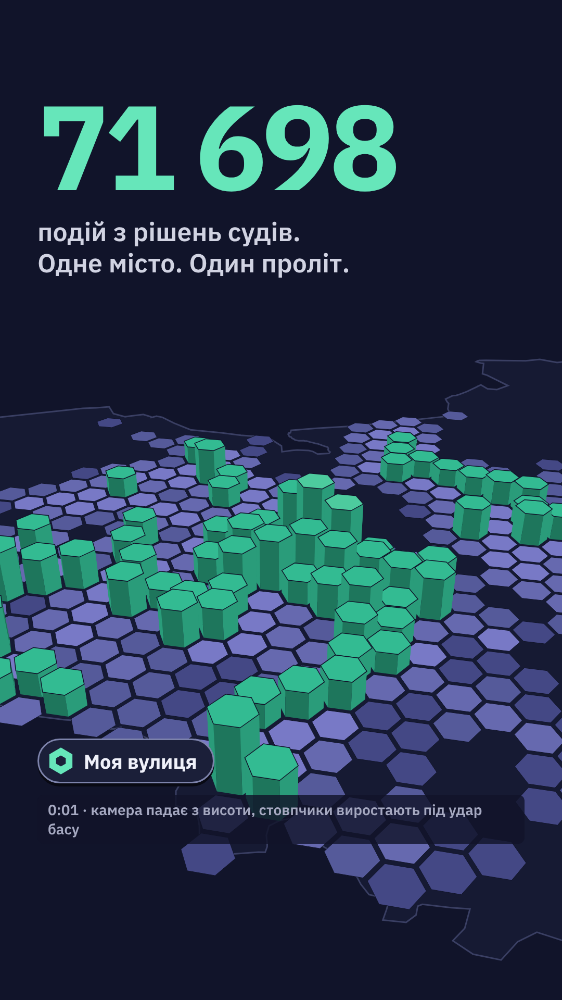 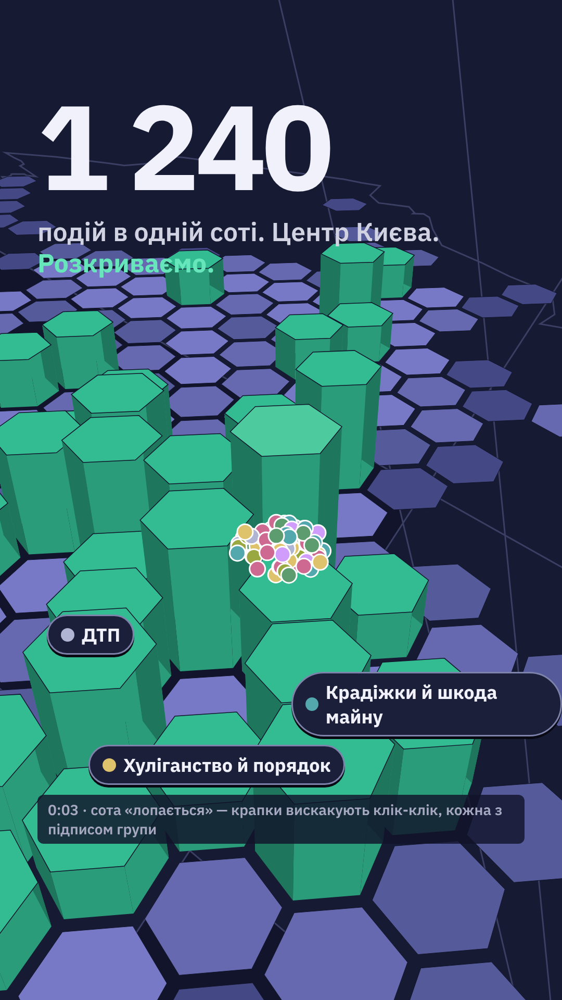 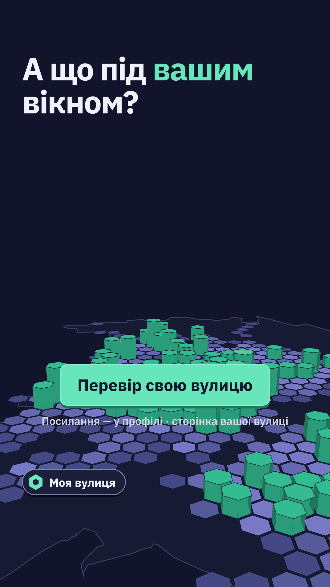

- **Для чого:** вау-ролики, «місто згори» (група 4), «заворожує», перша секунда будь-якого ролика.
- **Візуальна мова:**
  - тонована ніч `#11142A`, соти — індиго (`sc` темної теми), вершини — м'ятні 3D-стовпчики;
  - світло на гранях — як у темній темі сайту;
  - камера завжди рухається: падіння з висоти → обліт → проліт уздовж вулиці;
  - паралакс: соти й підписи йдуть з різною швидкістю.
- **Текст:** одне величезне число (230 px, Plex 700) і 1–2 рядки під ним. М'ятний — лише для одного слова-удару.
- **Звук:**
  - низький гул міста;
  - «вжух» на рух камери;
  - «клік-клік» на кожну точку, що вискакує;
  - удар баса, коли виростають стовпчики.
- **Темп:** повільний вхід 1 с → прискорення → 0,3 с тиші → відповідь.
- **Ризик:** «темно = страшно». Тому жодних сирен і червоного, тон спокійний, «Ніч» — це тема сайту, а не настрій.

## 2. «Редакційний» — як інфографіка в медіа (світла тема)

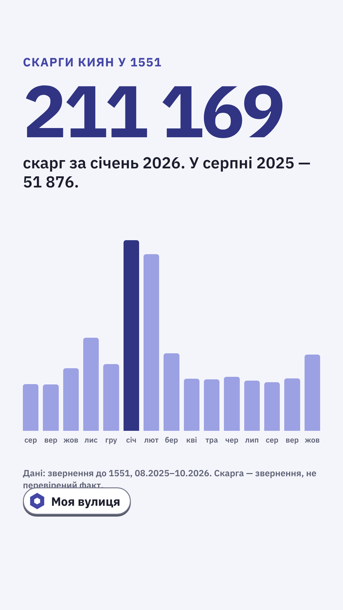 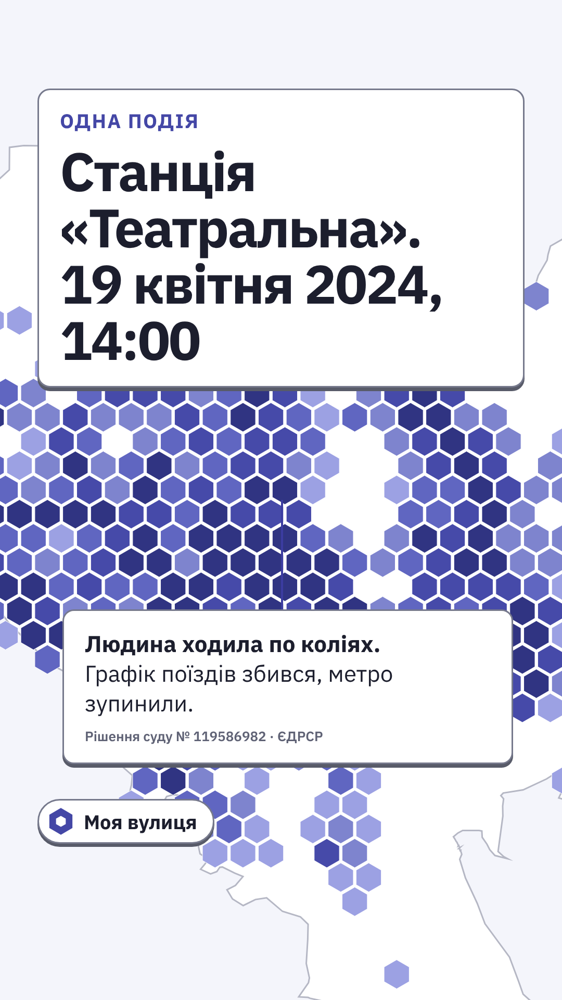 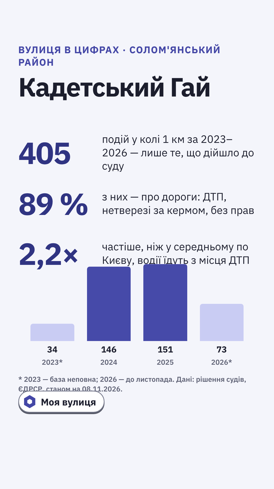

- **Для чого:** «Що болить вулиці» (група 1), «Що буває за…» (група 6), «Історії з даних» (група 7), «Для медіа».
- **Візуальна мова:** світле тло `#F4F5FB`, біле «паперове» поле. Прості стовпчики — індиго, підсвічений — найтемніший.
  Одна виноска з тонкою лінією до точки; джерело дрібно під графіком.
- **Текст:** надзаголовок великими літерами (рубрика), число 230 px, підпис-речення.
- **Звук:** голос за кадром (спокійний, «як ведучий новин»), тихий ритм, «тік» на кожен стовпчик.
- **Темп:** 60–90 с, 4–6 «кроків». Кожен крок — новий графік або наближення.
- **Ризик:** «нудно, як звіт». Тому кожен крок починається з питання, а графік рухається, а не стоїть.

## 3. «Гра-клавіші» — зовні гра (світла, яскрава)

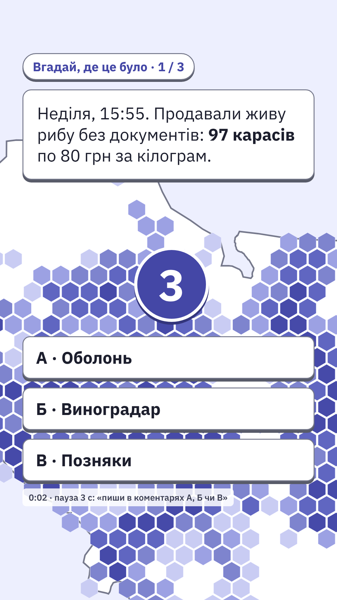 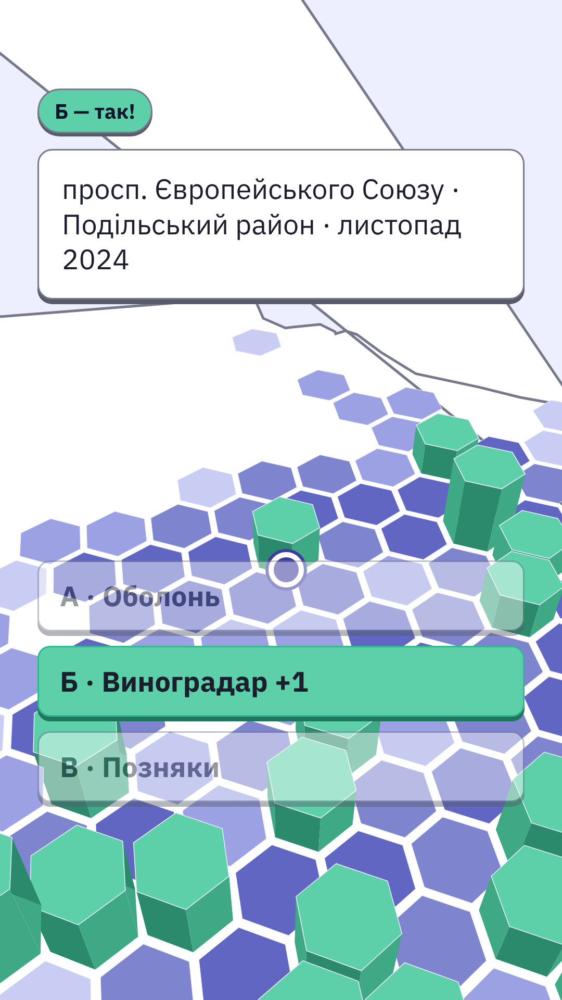 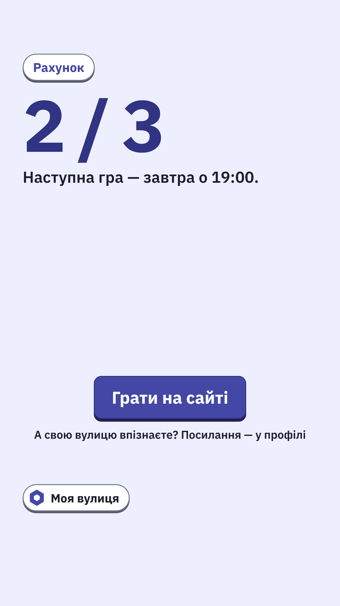

- **Для чого:** ігри (група 3), відповіді на коментарі, «знайди свою вулицю», серії «1 / 3».
- **Візуальна мова:** кнопки-клавіші сайту з бортиком знизу, «натискаються» під звук; таймер-сота; правильна відповідь —
  м'ятна клавіша; рахунок «2 / 3».
- **Текст:** картка-загадка (54 px), варіанти А / Б / В великими клавішами.
- **Звук:**
  - «клац» клавіші;
  - тікання таймера (3 с);
  - «дзинь» за правильну відповідь;
  - власна коротка мелодія гри — **звук бренду**.
- **Темп:** 15–25 с. Пауза 3 с перед відповіддю — щоб люди писали варіант у коментарях.
- **Ризик:** дитячість. Тому кольори лише з системи, без мультяшних персонажів і без емодзі.

## 4. «Хронометраж» — саспенс (темна, майже монохромна)

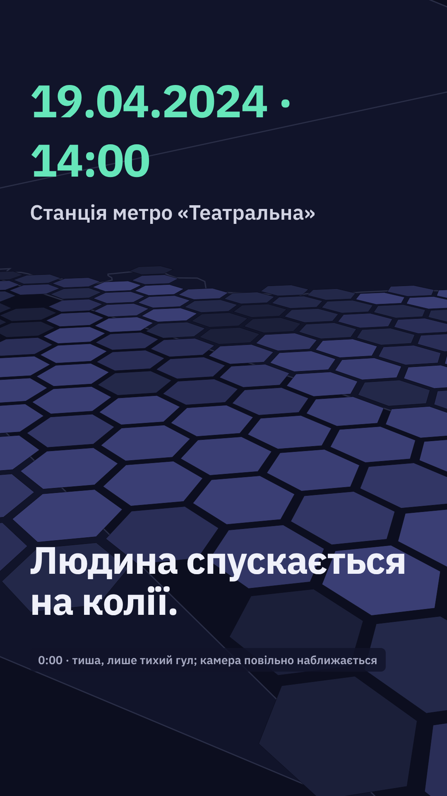 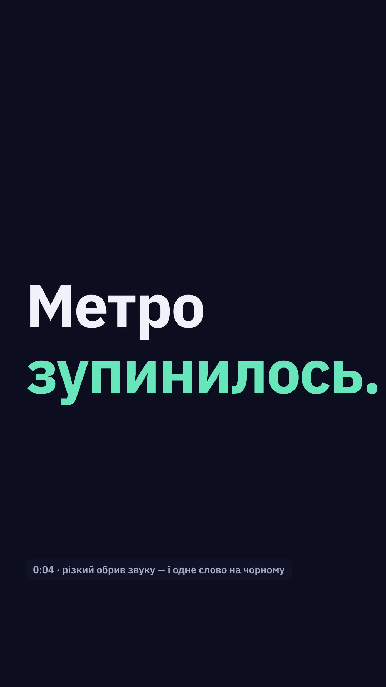 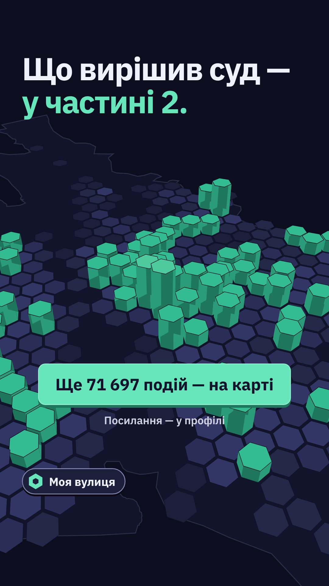

- **Для чого:** «одна подія», обрив-серія «частина 1 / 2», історії «під боком» (група 2).
- **Візуальна мова:**
  - майже чорно-індиго; єдиний колір — м'ятна точка й час;
  - велика мітка часу «19.04.2024 · 14:00» (110 px);
  - повільне наближення до однієї соти;
  - на один кадр — чорне тло з одним реченням.
- **Текст:** короткі речення по одному — як титри німого кіно. Жодних прикметників-страшилок.
- **Звук:**
  - тиша й тихий гул;
  - різкий обрив звуку перед головним реченням (прийом Гічкока: глядач чекає);
  - наприкінці «клік» — і текст «у частині 2».
- **Темп:** 7–20 с, обрив.
- **Ризик — найбільший серед п'яти.** Це схоже на true crime, тому:
  - лише легкі події: метро, крадіжки в магазинах, торгівля, хуліганство;
  - жодних тілесних і смертей як історії;
  - пояснення «що сталося» — дослівно з рішення, без домислів.

## 5. «Сота-кліп» — 7 секунд, удар у бит

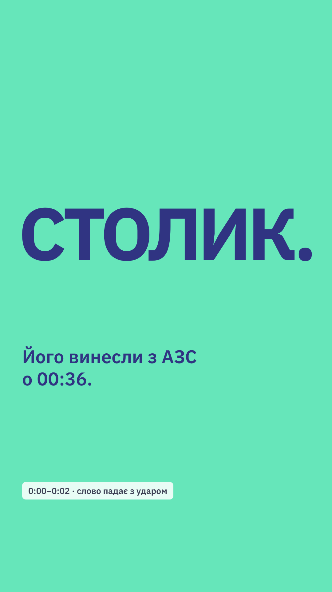 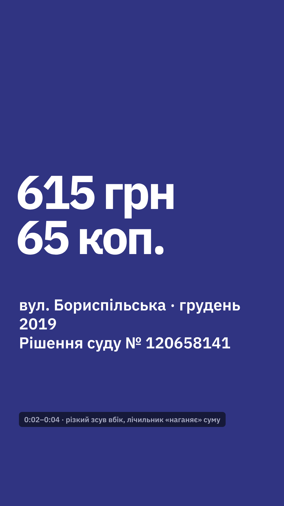 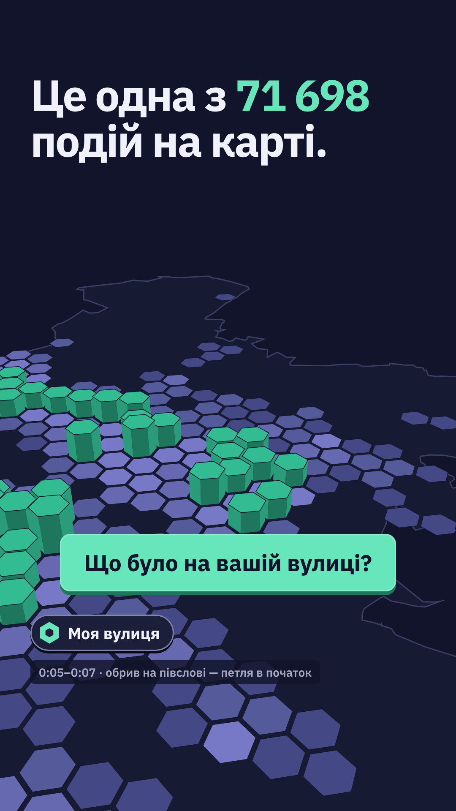

- **Для чого:** найкоротші ролики-обриви, перевірка гачків, петлі.
- **Візуальна мова:**
  - повноекранні кольорові плашки м'ята / індиго змінюються на кожен удар;
  - одне величезне слово (240 px);
  - різкі зсуви кадру вбік;
  - лічильник «наганяє» суму.
- **Текст:** 1–3 слова на кадр. Читається без звуку за 0,5 с.
- **Звук:** власний короткий біт (своя музика, без чужих прав); «бум» — слово; «тик-тик-тик» — лічильник; обрив на
  півслові, щоб петля в початок була непомітна.
- **Темп:** 6–10 с, 3–4 кадри.
- **Ризик:** «дешево, як реклама». Тому лише раз-два на тиждень, а не щодня.

---

## Порада

- **Основа — «Ніч над містом» + «Гра-клавіші».** Перший — для «вау» й впізнаваності; другий — для коментарів і повернень.
  Обидва вже є на сайті (темна тема, клавіші), тож ролик і сайт виглядають як одне ціле: людина з ролика впізнає карту.
- **«Редакційний»** — для «Що болить» і «Що буває за…»: там важлива довіра, а не вау.
- **«Хронометраж» і «Сота-кліп»** — як приправа, по 1–2 на тиждень.

Що вибирати — вирішує Андрій. Чернетки рушія — ZAVDANNYA-127, порівняння обох — критик ZAVDANNYA-128.
